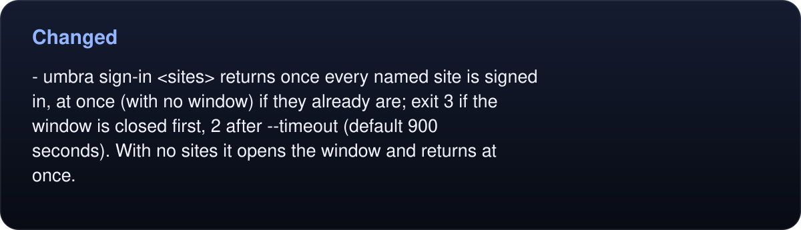
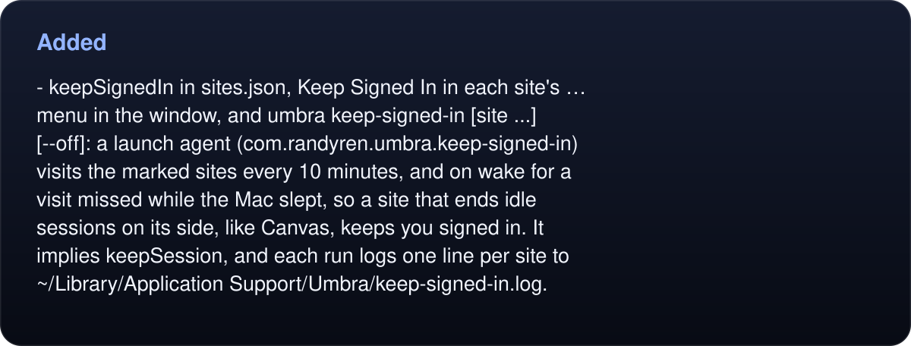
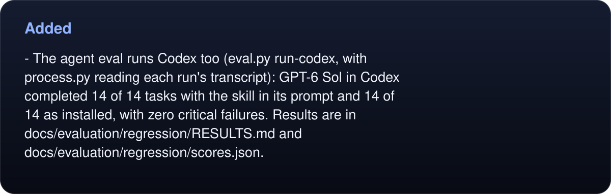
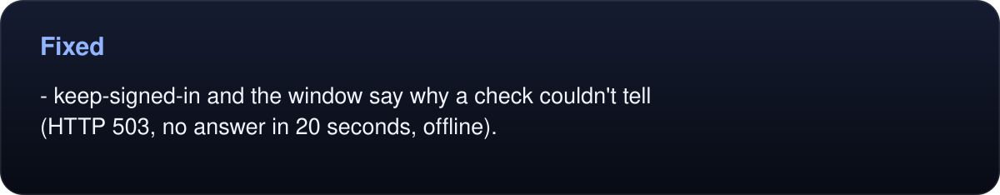

# Changelog

All notable changes to Umbra are recorded here. Versions follow [Semantic Versioning](https://semver.org).

## Unreleased

### Changed

- The sign-in window is a way to sign in, not a way to browse. It lists each site and whether it is signed in without loading any page. For a site it can check, it shows the login page only to sign in and closes it the moment the sign-in lands, before the signed-in site renders; a one-off URL or an added account's first sign-in stays open until Done.
- The daemon shows the sign-in window, so other commands keep working while a person signs in; `umbra sign-in` no longer stops the daemon. Opening Umbra.app shows the window even while the daemon runs (macOS hands the launch to it). The window comes with a Dock icon and a menu bar; Quit closes the window and leaves the daemon running.
<!-- umbra-figure: changelog-facts-4c9eb1aa75 -->
<picture>
  <source media="(max-width: 600px)" srcset="assets/docs/changelog-facts-4c9eb1aa75-1-mobile-7251e488f3.svg">
  
</picture>

Read the text, values and source links

- `umbra sign-in <sites>` returns once every named site is signed in, at once (with no window) if they already are; exit 3 if the window is closed first, 2 after `--timeout` (default 900 seconds). With no sites it opens the window and returns at once.

<!-- /umbra-figure -->
- `sign-in` is an MCP tool, and a signed-out error tells the model to call it.
- A site with both `cookie` and `probe` counts as signed in only when the probe passes too, so a session the site ended while its cookie stayed opens the login page instead of being reported as signed in. The old cookie is never deleted: a sign-in counts when the cookie gets a new value. A probe that answers 503, 429 or the like can't tell, so a named sign-in exits 4 and opens nothing.

### Added

- The sign-in window, redrawn for macOS 26: one Liquid Glass card of sites with each site's own logo, a status column (Signed in, Signed out, or Couldn't check with its reason), and Keep Signed In, Check Again and Sign Out… in each row's … menu. A login page opens under a toolbar with Done or a back button. On macOS 14 and 15 the same layout draws without glass.
<!-- umbra-figure: changelog-facts-b933b0146f -->
<picture>
  <source media="(max-width: 600px)" srcset="assets/docs/changelog-facts-b933b0146f-1-mobile-773c66d535.svg">
  
</picture>

Read the text, values and source links

- `keepSignedIn` in `sites.json`, Keep Signed In in each site's … menu in the window, and `umbra keep-signed-in [site ...] [--off]`: a launch agent (`com.randyren.umbra.keep-signed-in`) visits the marked sites every 10 minutes, and on wake for a visit missed while the Mac slept, so a site that ends idle sessions on its side, like Canvas, keeps you signed in. It implies `keepSession`, and each run logs one line per site to `~/Library/Application Support/Umbra/keep-signed-in.log`.

<!-- /umbra-figure -->
- `umbra sign-out <site>`, and a Sign Out button in the window: deletes the site's cookies from the profile's store.
- Add Account in the window, and `umbra sign-in <login URL> --save NAME`: a pasted login link becomes a site in `sites.json`. During its first sign-in Umbra learns the cookie it sets (a session-like one that appeared after the login page loaded), so from then on the site is checked like the others, and agents can use it.
<!-- umbra-figure: changelog-facts-bf11f49228 -->
<picture>
  <source media="(max-width: 600px)" srcset="assets/docs/changelog-facts-bf11f49228-1-mobile-83090a52e5.svg">
  
</picture>

Read the text, values and source links

- The agent eval runs Codex too (`eval.py run-codex`, with `process.py` reading each run's transcript): GPT-6 Sol in Codex completed 14 of 14 tasks with the skill in its prompt and 14 of 14 as installed, with zero critical failures. Results are in `docs/evaluation/regression/RESULTS.md` and `docs/evaluation/regression/scores.json`.

<!-- /umbra-figure -->
- `umbra mcp --print-config` prints the line for Codex.
- README diagrams in the artwork's style, each with a phone layout: the loop, why WebKit, the sign-in window, handoff, profiles, how it works, and two drawn from data by `assets/charts.py` (the eval scoreboard and the speed chart).

### Fixed

- The sign-in window showed sites as signed out when they were signed in: a site with no cookie or probe, such as Wealthsimple, had no status and its Sign In opened the site signed in (it is now asked by its login page, loaded out of sight: a site that moves it on into itself is signed in, and never opens), and a window left open or shown again kept its first results (it now checks every time it is shown).
- A sign-in that rested on a session-only cookie was gone after the daemon next exited, unless the site had `keepSession`: the window now sets `keepSession` for it, before `umbra sign-in` answers, and the daemon writes cookies to disk every five minutes.
- A named `umbra sign-in` used the daemon's sites file rather than the caller's for what it learned or kept.
<!-- umbra-figure: changelog-facts-9eb8f30145 -->
<picture>
  <source media="(max-width: 600px)" srcset="assets/docs/changelog-facts-9eb8f30145-1-mobile-4468bad162.svg">
  
</picture>

Read the text, values and source links

- `keep-signed-in` and the window say why a check couldn't tell (`HTTP 503`, no answer in 20 seconds, offline).

<!-- /umbra-figure -->
- A load whose web process stops answering (seen on GitHub's runners when several tabs start at once: the request never left and scripts got no answer) no longer hangs until the command's timeout. After two silent checks the watchdog ends that process and retries the load in a new one, up to twice, then reports exit 4.

## 0.2.0 - 2026-10-13

Umbra becomes a browser agents can drive step by step. The 0.1 one-shot commands keep their contract.

### Added

- A per-profile daemon (`umbra serve`) that keeps tabs alive between commands. It starts on first use, listens on a unix socket that only your user can open (one JSON object per line), and exits after 15 idle minutes (`UMBRA_IDLE`). `status` and `stop` manage it.
- Tabs that pages see as visible: each `WKWebView` lives in a transparent, click-through window off screen with occlusion detection off, so `visibilityState`, `requestAnimationFrame` and `IntersectionObserver` behave as they do on screen. No Dock icon, and the daemon never takes focus.
- Session commands: `open` (alias `goto`), `back`, `forward`, `reload`, `tabs`, `tab select|new|close`, `wait` (`--selector`, `--text`, `--url`, `--js`, `--gone`, `--idle`, `--ms`), `eval`, `block`, `viewport` (with `--mobile`), `downloads`. Pop-ups become tabs.
- `snapshot`: an accessibility-style outline with stable element refs (`e5`), with `--interactive` and `--scope`. It covers open shadow roots and same-origin iframes and marks cross-origin ones. It runs in an isolated JavaScript world the page can't see.
- Thirteen actions with trusted native input: `click`, `fill`, `type`, `press`, `select`, `check`, `uncheck`, `hover`, `scroll`, `drag`, `upload`, `dialog`, `focus`. They take a ref, `text=…` or a CSS selector, and wait until the target is actionable. Plus `get` for a quick read of one element.
- Capture and observe: `screenshot` (viewport, `--full`, or one element), `pdf`, `text`, `markdown` (`--main`), `html`, `links`, `console`, `network`, `info`.
- `handoff`: shows a tab to the person for 2FA, a CAPTCHA or consent, and hides it again when they're done or an `--until` condition holds.
- `umbra mcp`: a stdio MCP server whose 41 tools are the commands, driving the same tabs as the CLI. It returns screenshots as images, sends progress for long calls, and marks read-only and file-writing tools. `umbra mcp --print-config` prints setup for Claude Code, Claude Desktop and Cursor.
- `--json` and `--profile NAME` on every command; `umbra help <command>` and `umbra schema`, generated from one command registry.
- `skill/SKILL.md`, a Claude Code skill; `llms.txt`; docs for MCP and agents.
- `bench/`: the Northwind Ops test app, 15 graded agent tasks, a benchmark against Playwright, and an agent eval (`bench/eval/`) in which fresh agents passed all 14 unattended tasks.
- Tests for the daemon and session commands, and for MCP conformance, with an invisibility check after every daemon command.

### Changed

- `read`, `fetch` and `download` go through the profile's daemon when one is running, and share its session.
- `umbra sign-in` stops the profile's daemon before it opens its window.
- `make install` and `make uninstall` stop a running daemon first.
- JSON output keeps slashes unescaped and sorts keys.

## 0.1.0 - 2026-10-12

The first public release.

### Added

- `umbra read <url>`: loads a page off screen, runs JavaScript from stdin as the body of an async function, and prints the result. With an empty script it prints the page's HTML. `--cookie NAME` exits 3 when the session is missing. `--until JS` waits for an expression to become true across redirects and self-submitting forms, and `--wait` adds a fixed pause.
- `umbra fetch <url>`: an in-page `fetch()` from a same-origin page (`--from`, default `/robots.txt`) that carries the browser's cookies. Prints the body, and exits 5 on a non-2xx status.
- `umbra download <url> <file>`: a WebKit download that carries the session, written to a hidden `.umbra-part` file and renamed into place when complete.
- `umbra sign-in [site or URL ...]`: one window with a tab per site and a live green check once each one is signed in.
- `umbra cookies [domain]`: lists cookie names, domains and expiry dates, never values.
- `umbra --version`.
- Sites in `~/.config/umbra/sites.json` (or `$UMBRA_SITES`) with `cookie` or `probe` checks, and `keepSession` to keep session-only cookies between runs.
- `UMBRA_PROFILE=<name>` for separate cookie stores and locks.
- Runs on one profile take turns through a lock file.
- Sites see Safari's user agent, built from the installed Safari version.
- Exit codes: 0, 2 (timeout or script error), 3 (signed out), 4 (load failed), 5 (HTTP error), 64 (usage), 78 (bad sites file).
- `make build`, `make install`, `make uninstall`, `make test`, `make release`, `make icon` and `make help`, with `APPDIR` and `BINDIR` overrides.
- The eclipse artwork (app icon, banner, diagram and social preview), generated by `assets/build.py`.
