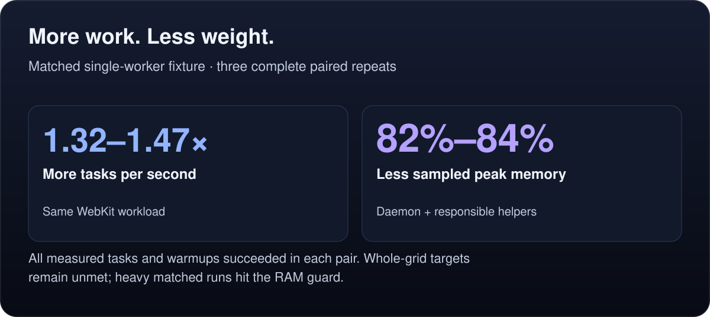
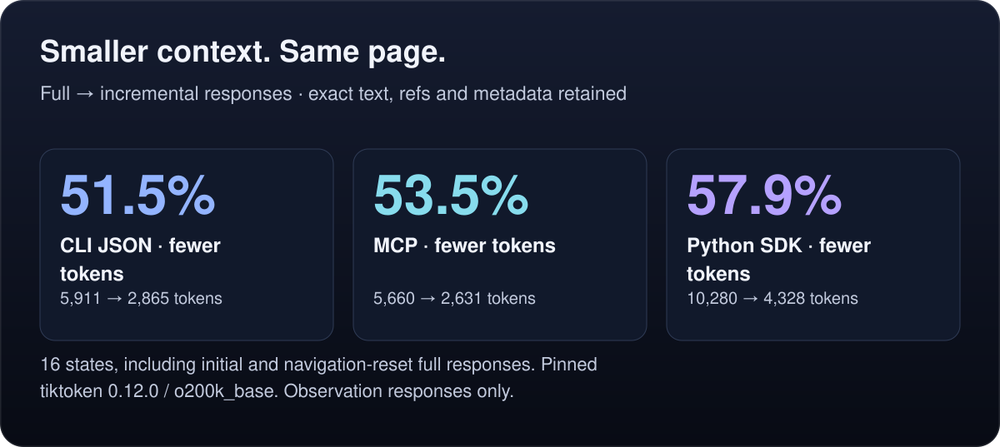
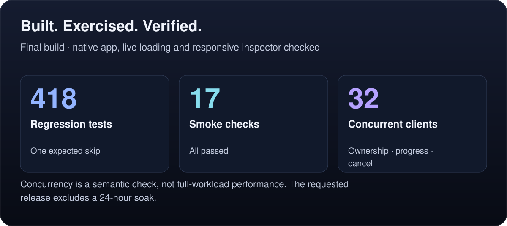

<p align="center">
  
</p>

<p align="center">
  <strong>Sign in once. Let your agents do the browsing.</strong><br>
  Umbra gives your agent a fast, persistent browser on your Mac. It uses native WebKit, keeps your accounts signed in, and works invisibly while your screen and focus stay yours.
</p>

<p align="center">
  <a href="#install">Install</a> ·
  <a href="#benchmarks">Benchmarks</a> ·
  <a href="docs/mcp.md">MCP setup</a> ·
  <a href="docs/README.md">Documentation</a>
</p>

## Benchmarks

<!-- runtime-panel: runtime-wins -->
<picture>
  <source media="(max-width: 600px)" srcset="assets/docs/runtime-wins-mobile-5968f2d4cf.svg">
  
</picture>
<!-- /runtime-panel -->

<!-- runtime-panel: runtime-observations -->
<picture>
  <source media="(max-width: 600px)" srcset="assets/docs/runtime-observations-mobile-8e685ac1ed.svg">
  
</picture>
<!-- /runtime-panel -->

<!-- runtime-panel: runtime-verification -->
<picture>
  <source media="(max-width: 600px)" srcset="assets/docs/runtime-verification-mobile-ae26ea8938.svg">
  
</picture>
<!-- /runtime-panel -->

The complete concurrency performance grid still missed its broad throughput, memory and latency targets. These figures identify the workloads and evidence they measure. [Runtime results, methods and every failed row](docs/evaluation/runtime/RESULTS.md).

### Earlier measurements

<a href="docs/evaluation/README.md">
  <picture>
    <source media="(max-width: 600px)" srcset="assets/showcase-mobile-v1.svg">
    
  </picture>
</a>

<a href="docs/evaluation/memory/README.md">
  <picture>
    <source media="(max-width: 600px)" srcset="assets/memory-mobile.svg">
    
  </picture>
</a>

These earlier measurements apply to their recorded builds: direct daemon latency excludes MCP framing, and Chromium navigated faster; reclaimed memory is measured after abandoned fixture tabs close. [Dates, methods, baselines and source data](docs/evaluation/README.md).

## Why Umbra

- **Native WebKit. No browser download.** The engine is already on your Mac. Umbra is a small Swift app that gives your agent direct browser commands.
- **Signed in and ready.** Log in through Umbra's own window. Agents keep using the session across commands, in a store separate from Safari.
- **Invisible until you need it.** Background tabs leave your desktop alone. Sign-in and handoff bring the page to you for the human steps.
- **Shell and MCP, together.** Your scripts and agents share live tabs, history and accounts. Use Claude Code, Codex, Cursor or your own tooling.
- **Parallel work with explicit ownership.** Named tabs, agent/task leases, bounded admission, deadlines and cancellation help cooperating agents share a profile. [Runtime guide](docs/runtime/README.md).
- **Smaller observations and reusable steps.** Read line deltas, extract typed DOM records, run checked batches and resume explicit workflow checkpoints. [Persistent clients](sdk/README.md) support Python, TypeScript and Swift.

## One continuous browsing session

<picture>
  <source media="(max-width: 600px)" srcset="assets/the-loop-mobile.svg">
  
</picture>

Tabs stay alive between calls. Read the page as a compact outline, click or fill an element, and keep going. [See a complete workflow](docs/walkthrough.md).

## Install

**macOS 14 or later**, with the Xcode Command Line Tools (`xcode-select --install`).

```sh
git clone https://github.com/randyren278/umbra.git
cd umbra
make install
```

Installs `~/Applications/Umbra.app` and links `~/.local/bin/umbra`. [Installation and agent skill setup](docs/install.md).

## Start browsing

```sh
umbra open example.com
umbra snapshot --interactive
umbra markdown --main
```

For Claude Code, Codex, Claude Desktop or Cursor:

```sh
umbra mcp --print-config
```

[Connect over MCP](docs/mcp.md) · [Teach your agent](docs/agents.md) · [Browse the commands](docs/commands.md)

## Go deeper

[Runtime guide](docs/runtime/README.md) · [Recipes](docs/recipes.md) · [Accounts and handoff](docs/sessions.md) · [Architecture](docs/how-it-works.md) · [Security and limitations](docs/security.md) · [Testing and development](docs/development.md) · [FAQ](docs/faq.md)

[MIT](LICENSE) © 2026 Randy Ren
