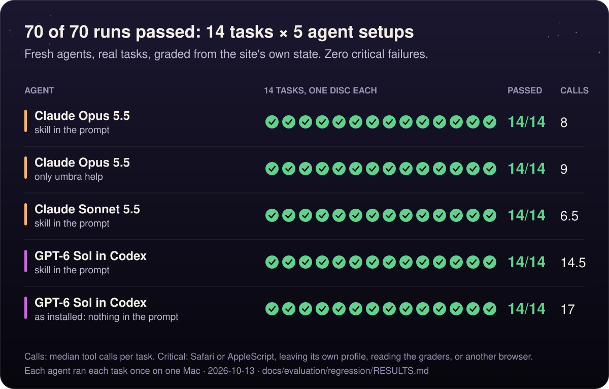
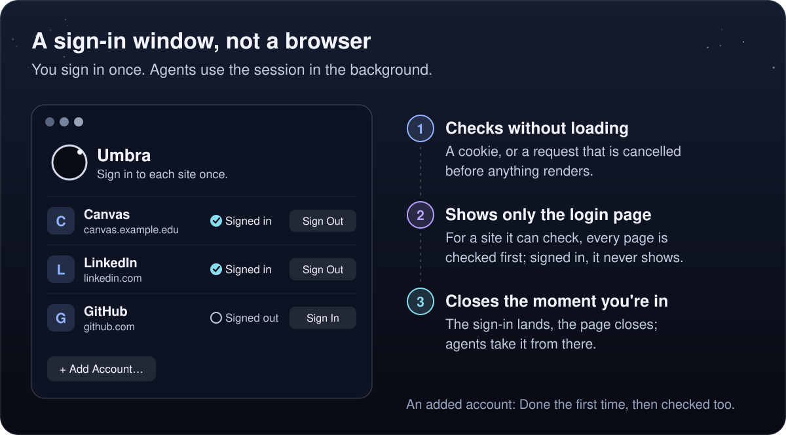
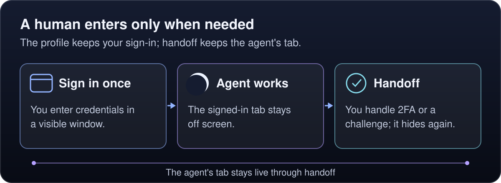
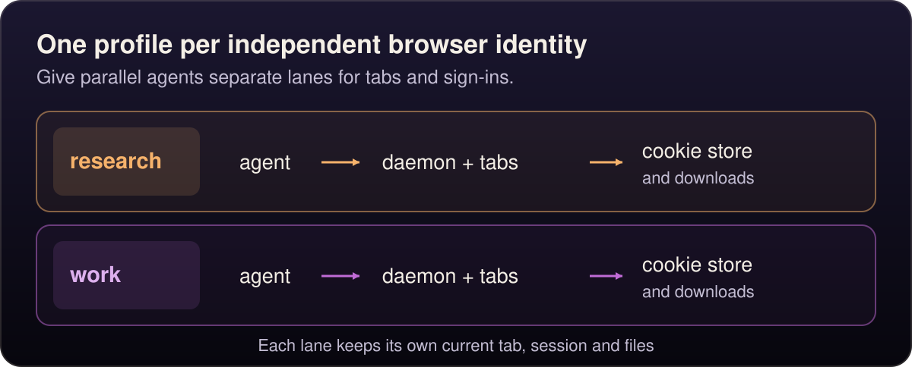

<p align="center">
  
</p>

<p align="center">
  <strong>Sign in once. Your agents take it from there.</strong><br>
  Umbra runs the WebKit built into macOS with no window. An agent opens a page, reads it as an outline with element refs, and clicks, types and fills with trusted native input, from a shell or over MCP. Tabs stay alive between commands, sign-ins live in Umbra's own cookie store, and while agents work, your screen, your focus and Safari are never touched.
</p>

<p align="center">
  <strong>517/625 full-reward outcomes</strong> on external MiniWoB++ tasks ·
  local-fixture medians: snapshot <strong>0.9 ms</strong>, click <strong>1.5 ms</strong> over the daemon socket ·
  a window only when you're needed
</p>

<p align="center">
  <a href="#agent-eval">Agent eval</a> ·
  <a href="#benchmarks">Benchmarks</a> ·
  <a href="#the-loop">The loop</a> ·
  <a href="#install">Install</a> ·
  <a href="#quick-start">Quick start</a> ·
  <a href="#commands">Commands</a> ·
  <a href="docs/mcp.md">MCP</a> ·
  <a href="#security-model">Security</a> ·
  <a href="#limitations">Limitations</a>
</p>

## Why choose Umbra

- **Fast page reads and actions.** On the same local fixture, socket snapshots took 0.9 ms versus Playwright Chromium's 3.6 ms; clicks took 1.5 ms versus 16 ms. [Measured comparison below](#benchmarks).
- **No browser download.** Umbra uses the WebKit already on your Mac. Sign in once in its own window; agents reuse that session without opening your everyday browser.
- **Your screen stays yours.** Background tabs leave your focus alone. Bring a tab on screen when a sign-in or human step needs you, then send it back to the agent.
- **One session, shell and MCP.** Scripts and agents share the same live tabs, history and sign-ins. Use your existing model and agent; Umbra supplies the browser.

## Agent eval

### External tasks: MiniWoB++ vs Playwright MCP

**125 upstream task types, five repetitions each, 1,250 total episodes.** Fresh Codex sessions used the same model (`gpt-6.1-sol`, high effort), paired seeds and the unchanged BrowserGym task setup and reward grader. Tasks and graders came from [MiniWoB++ and BrowserGym](bench/external/README.md), rather than this project's own test app.

| Measured outcome | Umbra MCP · native WebKit | Playwright MCP · Chromium |
|---|---:|---:|
| Full reward | **517/625 · 82.7%** | 489/625 · 78.2% |
| BrowserGym success (includes partial reward) | **524/625 · 83.8%** | 494/625 · 79.0% |
| Median episode time | **21.0 s** | 25.2 s |
| Episode p95 | 83.7 s | **71.6 s** |

Umbra's observed full-reward score was 4.48 percentage points higher. **The comparison is inconclusive:** the paired 95% task-bootstrap interval is −0.64 to +9.60 points. This is an adapted MCP protocol, not an official leaderboard run. Native key arrays counted as one interaction unit; expanding those keys in a conservative post-hoc sensitivity calculation gives **494/625 (79.0%) for Umbra versus 489/625 (78.2%) for Playwright**. Timing includes model inference, shared load and different tool/control paths; it does not establish an engine speedup.

Every frozen case stayed in the denominator, including one Playwright case with missing outcome evidence. Concurrent clipboard tasks share host state; a separate serialized diagnostic earned full reward on **10/10 cases for each tool**, without replacing the primary scores.

[Full results and per-task breakdown](bench/external/results/2026-10-13/RESULTS.md) · [Protocol and reproduction](bench/external/README.md) · [Verification receipt](bench/external/results/2026-10-13/VERIFICATION.md) · [Serialized clipboard diagnostic](bench/external/results/2026-10-13/clipboard-serial/RESULTS.md)

### Project regression: 70/70 completed

Five Claude Code and Codex setups each completed all 14 unattended Northwind Ops tasks. These project-authored tasks exercise signed-in workflows, exports, uploads, forms and browser edge cases; they are regression evidence, separate from the external evaluation above.

<details>
<summary>Agent setups, task coverage and regression methodology</summary>

<p align="center">
  <picture>
    <source media="(max-width: 600px)" srcset="assets/eval-mobile.svg">
    
  </picture>
</p>

Can a fresh agent get real work done with Umbra? The harness, [`bench/eval/eval.py`](bench/eval/eval.py), gives each of the proving ground's 14 unattended tasks to a fresh, isolated agent: a Claude Code subagent, or a `codex exec` run. Each one gets its own instance of the site, its own working directory and its own Umbra profile, and never sees the graders. The tasks include password and one-time-code sign-in, paginated and filtered tables, a refund behind `confirm()`, a CSV export, a hidden file input, a validated wizard, infinite scroll, a React-controlled input, a contenteditable, shadow DOM, an iframe, a pop-up and late-loading content. Each is graded from the site's server-side state, the answer and any output files.

| Agent | Guidance | Passed | Median tool calls | `umbra help` lookups, all runs | Runs that used `sleep` | Median time per task |
|---|---|:-:|:-:|:-:|:-:|:-:|
| Claude Opus 5.5 | the skill, in the prompt | 14/14 | 8 | 2 | 0 | 28 s |
| Claude Opus 5.5 | only `umbra help` | 14/14 | 9 | 21 | 2 | 29.5 s |
| Claude Sonnet 5.5 | the skill, in the prompt | 14/14 | 6.5 | 1 | 2 | 21.5 s |
| GPT-6 Sol in Codex | the skill, in the prompt | 14/14 | 14.5 | 3 | 0 | 41 s |
| GPT-6 Sol in Codex | as installed: nothing in the prompt | 14/14 | 17 | 17 | 0 | 43 s |

None of the 70 runs had a critical failure: no Safari or AppleScript, no leaving its own profile, no reading the repository's graders, and no other browser or screen tool. For Codex, [`bench/eval/process.py`](bench/eval/process.py) checks every command and tool call in each run's transcript.

What the runs showed:

- **Both model families do the whole job.** Claude and GPT-6 Sol each passed every task, with and without the skill pasted into the prompt: 14 tasks in 5 setups, 70 of 70 runs.
- **An installed skill gets used.** With nothing about the skill in the task prompt, only the standing `AGENTS.md` rule that names it, Codex read its installed `umbra` skill in all 14 runs, and none used `sleep` instead of `wait`. The skill's value is economy: with it in the prompt, agents look things up far less (3 `umbra help` lookups across 14 Codex runs, against 17 without).
- **The skill was fixed by the eval.** An early draft told agents to get the user's OK before refunds and similar actions, so one agent stopped and asked before a refund the user had explicitly requested. The rule now covers only consequential actions that are the agent's own idea, and the rerun passed.

Each agent ran each task once, the tasks were written by this project, and everything ran on one Mac. The 15th task, a CAPTCHA handoff, needs a person at the screen and wasn't run. Every agent ran with this Mac's own setup, where the skill is installed and the global instructions name it, so "only `umbra help`" and "nothing in the prompt" mean nothing about the skill in the task prompt. Codex ran with its usual setup except where isolation required otherwise: its Umbra MCP server pinned to the run's profile, its own browser tool off, and no session history kept. The Claude arms ran an earlier build (0eecdd3) than the Codex arms (30c0835). In between came 12 source changes, including download-aware click, navigation reports for form submits, the `wait --idle` timeout and new help pages, so call counts and times across the two families aren't like for like. The [full report](bench/eval/RESULTS.md) has every task and the process numbers.

</details>

## Benchmarks

<p align="center">
  <picture>
    <source media="(max-width: 600px)" srcset="assets/speed-mobile.svg">
    
  </picture>
</p>

Umbra against Playwright 1.62 on the same local pages of the proving site. Each cell is the median over 20 runs, in milliseconds. Measured on an M1 Pro MacBook Pro with macOS 27; results.md notes the machine's load during the run. The p95s, the method and every check are in [bench/results.md](bench/results.md).

| | Umbra CLI | Umbra socket | Playwright Chromium | Playwright WebKit |
|---|---:|---:|---:|---:|
| Accessibility snapshot | 14 | **0.9** | 3.6 | 4.4 |
| Click + DOM update | 15 | **1.5** | 16 | 66 |
| Fill a React-controlled field | 15 | **1.3** | 2.1 | 3.0 |
| Eval round trip | 12 | **0.2** | 0.3 | 0.4 |
| Viewport screenshot to a file | 64 | **50** | 85 | 57 |
| Warm navigate (local page) | 27 | 13 | **6.5** | 13 |
| 200-image page | 175 | 163 | **83** | 147 |
| 200-image page, images blocked | 42 | **29** | 76 | 60 |
| Cold start to first page | 408 | | **153** | 718 |
| One-shot `read`, no daemon | 385 | | | |

On these local fixtures, Umbra’s socket path had the lowest median for snapshots, clicks, field fills, eval round trips and screenshots. This is a project-authored command microbenchmark, separate from the external agent evaluation above. Each CLI command adds about 12 ms of process start-up, which is still small next to an agent's thinking time. Chromium starts faster: its figure leaves out Node's own start-up, while Umbra's includes spawning the daemon and WebKit. Chromium also loads a page full of uncached images faster unless you `block images`.

## The loop

<p align="center">
  <picture>
    <source media="(max-width: 600px)" srcset="assets/the-loop-mobile.svg">
    
  </picture>
</p>

Open a page, look at it, act on what you see, look again. This is a real session against Northwind Ops, the test app in [`bench/site`](bench/README.md), started with `python3 bench/site/server.py --port 8765`:

```console
$ umbra open 127.0.0.1:8765/login
Sign in · Northwind Ops · http://127.0.0.1:8765/login · HTTP 200

$ umbra snapshot --interactive
Sign in · Northwind Ops · http://127.0.0.1:8765/login
- heading "Sign in" [level=1]
- textbox "Username" [ref=e1] [required]
- textbox "Password" [ref=e2] [required] [type=password]
- checkbox "Remember me on this device" [ref=e3]
- button "Sign in" [ref=e4]

$ umbra fill e1 agent
filled textbox "Username" (e1) with "agent" via insertText

$ umbra fill e2 umbra-pass
filled textbox "Password" (e2) with •••••• via insertText

$ umbra click e4
clicked button "Sign in" (e4) → Dashboard · Northwind Ops · http://127.0.0.1:8765/app

$ umbra snapshot --interactive --scope main
Dashboard · Northwind Ops · http://127.0.0.1:8765/app
- heading "Dashboard" [level=1]
- heading "Recent orders" [level=2]
- link "Orders →" [ref=e1] → /app/orders
- link "#1040" [ref=e2] → /app/orders/1040
- link "#1039" [ref=e3] → /app/orders/1039
- link "#1038" [ref=e4] → /app/orders/1038
- link "#1037" [ref=e5] → /app/orders/1037
- link "#1036" [ref=e6] → /app/orders/1036

$ umbra click e1
clicked link "Orders →" (e1) → Orders · Northwind Ops · http://127.0.0.1:8765/app/orders

$ umbra select text=Status Pending
selected "Pending" in combobox "Status" (e1)

$ umbra get text=Showing
Showing 1–9 of 9 orders
```

Each command is a short process that talks to a per-profile daemon, so the tab, its history and its sign-in carry over from one command to the next. A target is a ref from the latest snapshot (`e4`), `text=` with visible text, or a CSS selector. Refs are numbered afresh after a navigation, so snapshot again before acting on a new page. Add `--json` to any command for structured output.

In the project's [agent eval](#agent-eval), fresh Claude Code and Codex agents completed all 14 unattended tasks on this app with Umbra, even with nothing about the skill in the task prompt, only `umbra help`.

## Why native WebKit, and why invisible

Umbra drives the same WebKit that Safari uses, through Apple's own `WKWebView`. Every tab lives in a transparent, click-through window placed far off screen, with WebKit's occlusion detection turned off. This configuration gives agents:

<p align="center">
  <picture>
    <source media="(max-width: 600px)" srcset="assets/why-webkit-mobile.svg">
    
  </picture>
</p>

`document.visibilityState` stays `"visible"`, `requestAnimationFrame` and `IntersectionObserver` keep running, and native clicks, key presses, scrolls and mouse drags arrive with `isTrusted == true`. `fill` uses the input method path so React-controlled fields keep their values. The daemon has no Dock icon and never becomes the active app, except while a sign-in or handoff window is open (handoff shows no Dock icon).

Here is that checked from inside a tab, on the same session as above:

```console
$ umbra eval 'addEventListener("click", e => window.lastClick = { isTrusted: e.isTrusted }, { once: true })'

$ umbra click h1
clicked heading "Orders" (e3)

$ umbra eval 'return window.lastClick'
{"isTrusted":true}

$ umbra eval 'let frames = 0; const end = performance.now() + 1000; while (performance.now() < end) { await new Promise(requestAnimationFrame); frames++ } return { visibilityState: document.visibilityState, frames }'
{"frames":30,"visibilityState":"visible"}
```

Sites see Safari's user agent, built from the version of Safari installed on the Mac, and your sign-ins persist in a store that belongs to Umbra alone.

## Install

You need macOS 14 Sonoma or later and the Xcode Command Line Tools (`xcode-select --install`).

```sh
git clone https://github.com/randyren278/umbra.git
cd umbra
make install
```

`make install` builds `Umbra.app`, copies it to `~/Applications` and links `~/.local/bin/umbra` to the binary inside it. If a daemon from an older install is running, it's stopped first. Nothing else on the system changes. Put `~/.local/bin` on your `PATH` if it isn't already, and check with `umbra --version`.

To install elsewhere, set the directories: `make install APPDIR=~/Apps BINDIR=~/bin`. `make uninstall` (with the same overrides) stops the daemon and removes the app and the link. Your sign-ins stay in `~/Library/WebKit/com.randyren.umbra/`; delete that folder to sign out everywhere. `scripts/doctor.sh` checks the macOS version, the compiler, the link, the binary and your sites file.

Prebuilt zips are built on Apple Silicon and signed ad hoc, not notarized, so macOS blocks a downloaded copy until you clear its quarantine flag with `xattr -dr com.apple.quarantine Umbra.app`. On an Intel Mac, build from source.

## Quick start

### From a shell

```sh
umbra open example.com              # loads and waits; prints title, URL and HTTP status
umbra snapshot --interactive        # the page as an outline with refs
umbra click "text=Learn more"       # trusted click; follows the navigation
umbra markdown --main               # read the main content as markdown
umbra stop                          # optional: the daemon also exits after 15 idle minutes
```

The first command starts the daemon, and every command after that reuses it. `umbra help <command>` lists a command's parameters, and `umbra schema` prints every command as JSON.

### Over MCP

`umbra mcp` is a stdio MCP server whose tools are Umbra's commands, run against the same daemon and tabs as the CLI. Print the setup for your install:

```sh
umbra mcp --print-config
```

It prints ready-to-run lines for Claude Code and Codex and JSON blocks for Claude Desktop and Cursor, using the full path of your `umbra`. For a `make install`:

```sh
claude mcp add --scope user umbra -- ~/Applications/Umbra.app/Contents/MacOS/umbra mcp   # Claude Code
codex mcp add umbra -- ~/Applications/Umbra.app/Contents/MacOS/umbra mcp                 # Codex
```

Leave out `--scope user` to add it to the current project only. [docs/mcp.md](docs/mcp.md) covers the other clients, profiles, image results and progress for long calls.

### Teach your agent

[`skill/SKILL.md`](skill/SKILL.md) is an agent skill that teaches the loop, the targets, waiting, sign-in and handoff, and the rules. Claude Code and Codex both load it from their skills folder; a link keeps it current as you pull:

```sh
mkdir -p ~/.claude/skills ~/.codex/skills
ln -s "$PWD/skill" ~/.claude/skills/umbra    # Claude Code
ln -s "$PWD/skill" ~/.codex/skills/umbra     # Codex
```

In the [agent eval](#agent-eval), with nothing about the skill in the task prompt (only the standing `AGENTS.md` rule that names it), Codex read the installed skill in all 14 runs.

For other agents, [docs/agents.md](docs/agents.md) has a short block to paste into `AGENTS.md` or a system prompt.

## Commands

Commands that work on a page take `--tab NAME` (default: the current tab). Every command takes `--timeout SECONDS`, `--json` and `--profile NAME`. Options can go before or after the command name: `umbra --tab work snapshot` works too. `umbra help <command>` has the details.

### Session

| Command | What it does |
|---|---|
| `open <url>` | Load a URL (a host name or file path works too) and wait for it. `--new` opens a new tab; `--until JS` waits for a condition across redirects. Alias `goto`. |
| `back`, `forward`, `reload` | Move through the tab's history, or reload. |
| `tabs`, `tab select <name>`, `tab new`, `tab close` | List tabs, or switch, open and close them. Pop-ups become tabs. |
| `wait` | Wait for `--selector`, `--text`, `--url`, `--js`, `--gone`, `--idle` (network quiet for 500 ms), or `--ms`. |
| `eval <script>` | Run JavaScript in the page as the body of an async function and print what it returns. |
| `block <types>` | Stop loading images, fonts, media, stylesheets, scripts or trackers. `--none` clears. |
| `viewport [w h]` | Set the viewport. `--mobile` sends iPhone Safari's user agent; `--scale` sets the pixel ratio. |
| `handoff "<message>"` | Show the tab to the person for a step only they can do, then hide it again. |
| `status`, `stop` | The daemon's profile, uptime and tabs; stop it. |

### See

| Command | What it does |
|---|---|
| `snapshot` | One line per element with role, name, state, value and ref. `--interactive` keeps only elements with refs plus headings; `--scope` narrows it to part of the page. |
| `text` | The visible text, as the browser lays it out. The cheapest way to read. |
| `markdown` | The page as markdown with tables and absolute links. `--main` drops navigation and page chrome. |
| `html`, `links` | The live DOM; every link as text and URL, with `--filter`. |
| `get <target>` | One element's text or value, or an attribute with `--attr`. |
| `info` | URL, title, HTTP status, viewport, scroll, ready state, visibility, and counts of links, forms, images and iframes. |

### Act

All of these use trusted native input and wait until the target is visible, enabled and not covered.

| Command | What it does |
|---|---|
| `click <target>` | Click (`--button`, `--count`, `--modifiers`). Waits for any navigation it starts and reports the new page. |
| `fill <target> <value>` | Replace a field's contents, typed as a keyboard would. Works on React-controlled inputs and contenteditables. |
| `type <text>` | Type without clearing first, into `--target` or the focused element. |
| `press <keys…>` | Keys and chords in order: `Enter`, `Tab`, `Meta+a`, `Shift+Tab`… |
| `select <target> <values…>` | Choose options in a `<select>` by value or label. |
| `check`, `uncheck <target>` | Set a checkbox, radio or switch, then verify it. |
| `hover`, `focus <target>` | Move the mouse over an element; move keyboard focus to it. |
| `scroll` | Native wheel scrolling: `--dy`, `--dx`, `--to top` or `--to bottom`, or `--target` into view. |
| `drag <from> <to>` | Drag one element onto another. |
| `upload <target> <files…>` | Answer a file chooser, including one behind a styled button. |
| `dialog accept`, `dialog dismiss` | Dialogs never block: each alert, confirm or prompt is accepted by default, and the reply of the action that raised it reports it. `dialog dismiss` changes how the next one is answered (`--text` answers a prompt); `dialog` alone lists the ones seen. |

### Capture

| Command | What it does |
|---|---|
| `screenshot [path]` | The viewport, the whole page with `--full`, or one element with `--target`. PNG or JPEG; base64 when no path is given. |
| `pdf <path>` | The whole page as one tall PDF page, with selectable text and working links. |

### Observe

| Command | What it does |
|---|---|
| `console` | What the page logged, uncaught errors included. `--level`, `--clear`. |
| `network` | Documents, fetch and XHR calls, and every loaded resource, with status, timing and size. `--failed`, `--filter`, `--clear`. |
| `downloads` | Files the page downloaded, saved under `~/Downloads/Umbra/`. |
| `cookies [domain]` | Cookie names, domains and expiry dates. Never values. |

### One-shot

These keep their original contract for scheduled scripts: one process, a result on stdout and an exit code. When a daemon is running they go through it; otherwise they run on their own.

| Command | What it does |
|---|---|
| `read <url> < script.js` | Load a page in a scratch tab, run the script (or print the HTML when it's empty) and close the tab. `--cookie NAME` exits 3 when signed out; `--until`, `--wait`. |
| `fetch <url>` | GET a URL with the browser's session, from a page on the same site (`--from`, default `/robots.txt`). |
| `download <url> <file>` | Download with the session, replacing `<file>` once complete. |

[docs/recipes.md](docs/recipes.md) has worked examples for both styles.

## Sign-in and handoff

<p align="center">
  <picture>
    <source media="(max-width: 600px)" srcset="assets/sign-in-mobile.svg">
    
  </picture>
</p>

Umbra never types your passwords. You sign in once, in a window:

```sh
umbra sign-in                                    # every site in sites.json (or open Umbra.app)
umbra sign-in Canvas                             # one site; returns once you're signed in
umbra sign-in https://canvas.example.edu/login   # any site, as a one-off page
umbra sign-in https://github.com/login --save GitHub   # add it to your sites
```

The window lists your sites and whether each is signed in, without loading any of them. For a site Umbra can check (a cookie or probe in `sites.json`), it shows only the login page: a site you're signed in to is never loaded, and the page closes the moment the sign-in lands. A one-off URL, or an added account's first sign-in, has nothing to check yet, so its page stays open until you click Done. Umbra is a way to sign in, not a browser for you: a site you're signed in to can't become another place to scroll Instagram. While the window is open, Umbra has a Dock icon; Quit closes the window, and agents keep working throughout. A signed-in row has a Sign Out button, and so does the command line (`umbra sign-out Canvas`), for a sign-in the site has dropped. **Add Account** takes a link to any site's login page: you sign in once and click Done, Umbra learns which cookie marks you as signed in, and from then on the account is checked like the others and agents can use it.

List your regular sites in [`sites.json`](docs/sites.md) with a cookie or probe that proves you're signed in. Mark `keepSession` on the ones whose sign-in rests on session cookies, such as university single sign-on, so the sign-in survives between runs.

<p align="center">
  <picture>
    <source media="(max-width: 600px)" srcset="assets/human-handoff-mobile.svg">
    
  </picture>
</p>

Mid-task, an agent may hit something only you can do: a two-factor prompt, a CAPTCHA or a consent screen. `handoff` shows you that tab in a window with a message, and returns when you close it or when a condition holds:

```sh
umbra handoff "Approve the Duo push" --until "location.pathname.startsWith('/app')"
```

The window hides again afterward, and the tab carries on where you left it. If the condition already holds, no window appears at all.

## Profiles

A profile is a separate browser identity: its own cookie store, daemon, socket and download folder. The default profile is your main one. Choose another with `--profile NAME` or `UMBRA_PROFILE=NAME`:

<p align="center">
  <picture>
    <source media="(max-width: 600px)" srcset="assets/profile-lanes-mobile.svg">
    
  </picture>
</p>

```sh
umbra --profile research open https://news.example.com/
UMBRA_PROFILE=research umbra snapshot --interactive
```

Give agents and experiments their own profiles, signed in only to the sites they need, so they can't disturb the store your scheduled jobs use. The same goes for agents working in parallel. The current tab and the cookies belong to the profile, so two agents on one profile change things under each other. Give each its own profile, or at least its own `--tab`. Cookies on `127.0.0.1` are shared across ports, so local test servers don't keep agents apart either. Each profile's files live in `~/Library/WebKit/com.randyren.umbra/WebsiteDataStore/`, `~/Library/Application Support/Umbra/` and `~/Downloads/Umbra/<profile>/`; [docs/how-it-works.md](docs/how-it-works.md#profiles) shows how to find and delete one.

## Exit codes

Results go to stdout and messages to stderr. Over MCP, a failure comes back as a tool error with the message and, for codes 1 to 4, a hint about what to do next.

| Exit | Meaning | What to do |
|---|---|---|
| `0` | Done | |
| `1` | Umbra itself failed | Read stderr; the next command starts the daemon again |
| `2` | Timed out, or a script threw | Wait for a specific condition, raise `--timeout`, or fix the script |
| `3` | Signed out (`read --cookie`) | Run `umbra sign-in <site>` |
| `4` | The page or download failed to load | Check the URL and that the site is up |
| `5` | HTTP error status (`fetch`, `download`) | Check the URL and your access |
| `64` | Usage error | Fix the command; `umbra help <command>` |
| `78` | `sites.json` can't be parsed | Fix the file; the message names the problem |

## How it works

<p align="center">
  <picture>
    <source media="(max-width: 600px)" srcset="assets/how-it-works-mobile.svg">
    
  </picture>
</p>

The first command for a profile starts a daemon, `umbra serve`, which owns WebKit, the tabs and the cookie store. The CLI and `umbra mcp` send it one JSON object per line over a unix socket that only your user can open, so a shell and an MCP client drive the same live tabs. The daemon exits after 15 idle minutes (`UMBRA_IDLE` sets the limit in seconds).

Snapshot, refs and actions run in an isolated JavaScript world. They share the page's DOM but not its globals, so the page can't see or tamper with them. Only `eval` and `read` scripts run in the page's own world. Commands are declared once in a registry, which generates the CLI parser, `umbra help`, `umbra schema` and the MCP tool list, so the surfaces can't drift apart.

[docs/how-it-works.md](docs/how-it-works.md) covers the daemon, the socket protocol, tabs, input, the store and the lock in detail.

## Security model

- **Cookies stay in the store.** Like any browser, Umbra sends a cookie only to the site it belongs to. No command or tool prints, returns or exports a cookie value; `cookies` lists names and expiry dates only.
- **The agent acts as you.** On any site a profile is signed into, an agent can read, click and submit as you would. The [skill](skill/SKILL.md) tells agents to do what the request asks and to ask first before any consequential action that's their own idea. Give agents a profile signed in only where you'd trust them.
- **People stay in charge of identity.** Signing in, two-factor prompts and CAPTCHAs happen in `sign-in` and `handoff` windows, by you.
- **Only your user reaches the daemon.** Its socket is created with owner-only permissions in `~/Library/Application Support/Umbra/`.
- **Pages can't see Umbra's machinery.** Snapshot and action code runs in an isolated world.
- **No telemetry.** Umbra's own requests are the URLs you or your agent give it; what those pages load is up to them, as in any browser.
- **The `keepSession` trade-off.** It re-saves a site's session-only cookies with a 30-day expiry so sign-ins survive between runs. They outlive the browser session the site had in mind, so turn it on only where it's needed and only on a Mac you trust.
- **Your account protects the store.** As with Safari, anyone who can read your home folder can reuse your sessions.

## Limitations

- macOS 14 or later only. Prebuilt zips are Apple Silicon; build from source on Intel.
- Closed shadow roots and cross-origin iframes can't be reached. `snapshot` marks cross-origin iframes so an agent knows something is there; open shadow roots and same-origin iframes work.
- `fill` and `type` insert text the way an input method does, so a page that listens for a `keydown` per character won't see one. Use `press` for those keys.
- HTML5 drag and drop is dispatched as page events, which are untrusted, because a native drag session would act on the real desktop. Mouse-driven drags (sliders, sortable lists, canvases) are native.
- No passkeys or Touch ID in the sign-in window. Use a password with a push approval or a code.
- One daemon per profile. Runs of the one-shot commands without a daemon take turns on the profile's lock.
- It's not a scraper or an anti-bot tool. It's for your own accounts at a human pace. It doesn't hide automation, rotate identities or solve CAPTCHAs, and site terms still apply.

## FAQ

**How is this different from Playwright MCP?**
Playwright MCP drives Playwright's own browser builds (Chromium by default) and also reads pages as accessibility snapshots with refs. It's cross-platform and a good choice for testing web apps. Umbra is macOS only and uses the WebKit already in the system, with Safari's user agent. Its tabs are invisible but report themselves visible, its input is native and trusted, and it keeps a persistent signed-in store with a sign-in window and handoff for the human steps. The same tabs are reachable from a shell and from MCP at once.

**How is this different from Browser Use?**
Browser Use is a Python framework that puts an LLM in charge of a Chromium browser through its own agent loop. Umbra is only the browser. There's no model inside it; your agent, whether that's Claude Code, Cursor or a script, decides what to do and calls Umbra's commands or tools.

**Why not script Safari with AppleScript?**
`do JavaScript` needs Safari running, "Allow JavaScript from Apple Events" turned on, and a tab in your browser. That tab takes focus and catches your clicks, its events are synthetic, and the script breaks when Safari shows a dialog or someone closes the window. Umbra runs the same engine with none of that. It began as the replacement for exactly that setup.

**Can I still use it without an agent?**
Yes. Scheduled scripts use the one-shot `read`, `fetch` and `download` commands, and the session commands work just as well from a shell script. [docs/recipes.md](docs/recipes.md) has examples in Python, Node and shell.

## Testing

```sh
make test       # builds if needed, then runs every suite against the build, never the installed app
```

`tests/run.sh` runs the smoke test and three suites, all against local servers on `127.0.0.1` with throwaway profiles:

- `test_umbra.py`: 77 tests of the one-shot commands and every exit code.
- `test_daemon.py`: 102 tests of the daemon's lifecycle, the session commands, and one-shots served through a daemon.
- `mcp_conformance.py`: 32 tests of the MCP server's protocol, tools and errors.

An invisibility guard runs after every daemon command in the suite. It fails the test if any Umbra window is visible on screen or the daemon has become the frontmost app.

[`bench/`](bench/README.md) adds the proving-ground app behind the [agent eval](#agent-eval) and the [benchmarks](#benchmarks).

## Development

```sh
make build     # build/Umbra.app (BUILD=dir builds elsewhere), signed ad hoc as com.randyren.umbra
make icon      # regenerate the logo, icon, banner and how-it-works diagram (assets/build.py)
make release   # dist/Umbra-<version>.zip and its .sha256
make help      # list targets and overrides
python3 assets/charts.py   # redraw the eval, speed and sign-in pictures from bench/ data
```

The loop, WebKit, handoff and profile diagrams are hand-drawn SVGs in the same style; edit them directly.

[AGENTS.md](AGENTS.md) explains the architecture and the safety rules for working on Umbra, including never touching the default profile. [CHANGELOG.md](CHANGELOG.md) has release notes.

## License

[MIT](LICENSE) © 2026 Randy Ren
