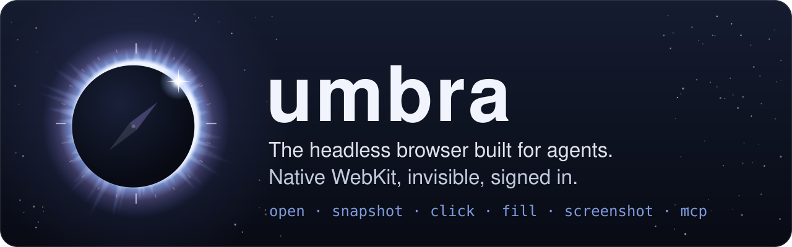
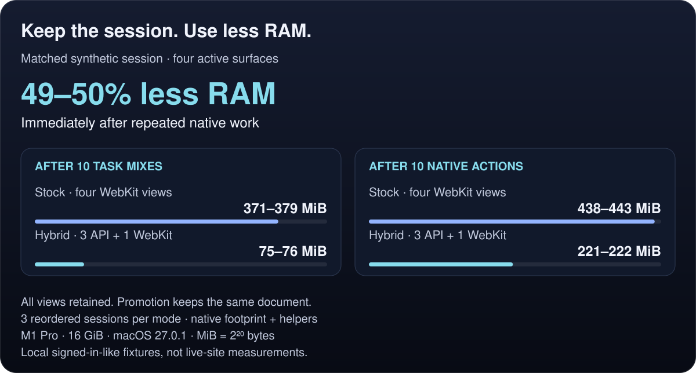
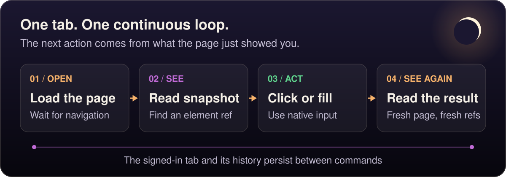

<p align="center">
  
</p>

<p align="center">
  <strong>Sign in once. Let your agents do the browsing.</strong><br>
  Umbra gives your agent a fast, persistent browser on your Mac. It uses native WebKit, keeps your accounts signed in, and works invisibly while your screen and focus stay yours.
</p>

<p align="center">
  <a href="#install">Install</a> ·
  <a href="#benchmarks">Benchmarks</a> ·
  <a href="docs/mcp.md">MCP setup</a> ·
  <a href="docs/README.md">Documentation</a>
</p>

## Benchmarks

<!-- runtime-panel: competitive-benchmarks -->
<picture>
  <source media="(max-width: 600px)" srcset="assets/docs/competitive-benchmarks-mobile-3184cba02d.svg">
  
</picture>
<!-- /runtime-panel -->

[Speed benchmarks](docs/evaluation/latency/README.md) · [Token benchmark, method and raw results](docs/evaluation/observation-tokens/README.md)

<!-- runtime-panel: low-memory-comparison -->
<picture>
  <source media="(max-width: 600px)" srcset="assets/docs/low-memory-comparison-mobile-6de8fd3083.svg">
  
</picture>
<!-- /runtime-panel -->

The hybrid keeps three supported API views and one live WebKit fallback. Measurements use the same signed-in-like local tasks on an M1 Pro, with new isolated profiles and all views retained. Physical footprint includes daemon and WebKit helpers; it is not summed RSS or globally deduplicated RAM. [Results, methodology and reproduction](docs/evaluation/low-memory/README.md).


## Why Umbra

<!-- runtime-panel: why-umbra -->
<picture>
  <source media="(max-width: 600px)" srcset="assets/docs/why-umbra-mobile-b3e946ebe0.svg">
  
</picture>
<!-- /runtime-panel -->

[Shared runtime](docs/runtime/README.md) · [Persistent clients](sdk/README.md) · [Accounts and handoff](docs/sessions.md)

## One continuous browsing session

<picture>
  <source media="(max-width: 600px)" srcset="assets/the-loop-mobile.svg">
  
</picture>

Tabs stay alive between calls. Read the page as a compact outline, click or fill an element, and keep going. [See a complete workflow](docs/walkthrough.md).

## Install

**macOS 14 or later**, with the Xcode Command Line Tools (`xcode-select --install`).

```sh
git clone https://github.com/randyren278/umbra.git
cd umbra
make install
```

Installs `~/Applications/Umbra.app` and links `~/.local/bin/umbra`. [Installation and agent skill setup](docs/install.md).

## Start browsing

```sh
umbra open example.com
umbra snapshot --interactive
umbra markdown --main
```

For Claude Code, Codex, Claude Desktop or Cursor:

```sh
umbra mcp --print-config
```

[Connect over MCP](docs/mcp.md) · [Teach your agent](docs/agents.md) · [Browse the commands](docs/commands.md)

## Opt-in low-memory sessions

Use [declared API sessions](docs/api.md) for supported same-origin JSON routes without creating a browser. For browser tasks that can run without visibility-dependent rendering, opt a new tab into nonvisual mode:

```sh
umbra open example.com --new --tab reading --nonvisual
umbra dom read --tab reading
umbra dom find --tab reading --query urgent
umbra render --tab reading
```

The tab retains its WebKit view and JavaScript state. Native input and capture promote it automatically; `render` promotes explicitly without reloading. Promotion is sticky, and the offscreen window remains invisible. Animation frames may pause before promotion. Ordinary browser commands retain their existing defaults. [Modes, API contracts and limitations](docs/api.md).

<!-- runtime-panel: low-memory-reads -->
<picture>
  <source media="(max-width: 600px)" srcset="assets/docs/low-memory-reads-mobile-eda1b6e08f.svg">
  
</picture>
<!-- /runtime-panel -->

`api read` uses declared GET/HEAD routes. `dom read/find/links` reads bounded main-document structure without style, geometry or input; CSS-hidden text may be included. Native input, geometry and pixels need the full browser. These explicit contracts expand no-render task coverage; they do not demonstrate a further RAM reduction over efficient C3 reads. [Read scope and fallback](docs/semantic.md) · [Benchmark limits](docs/evaluation/low-memory/README.md).

## Go deeper

[Explicit no-render reads](docs/semantic.md) · [Runtime guide](docs/runtime/README.md) · [Recipes](docs/recipes.md) · [Accounts and handoff](docs/sessions.md) · [Architecture](docs/how-it-works.md) · [Security and limitations](docs/security.md) · [Testing and development](docs/development.md) · [FAQ](docs/faq.md)

[MIT](LICENSE) © 2026 Randy Ren
