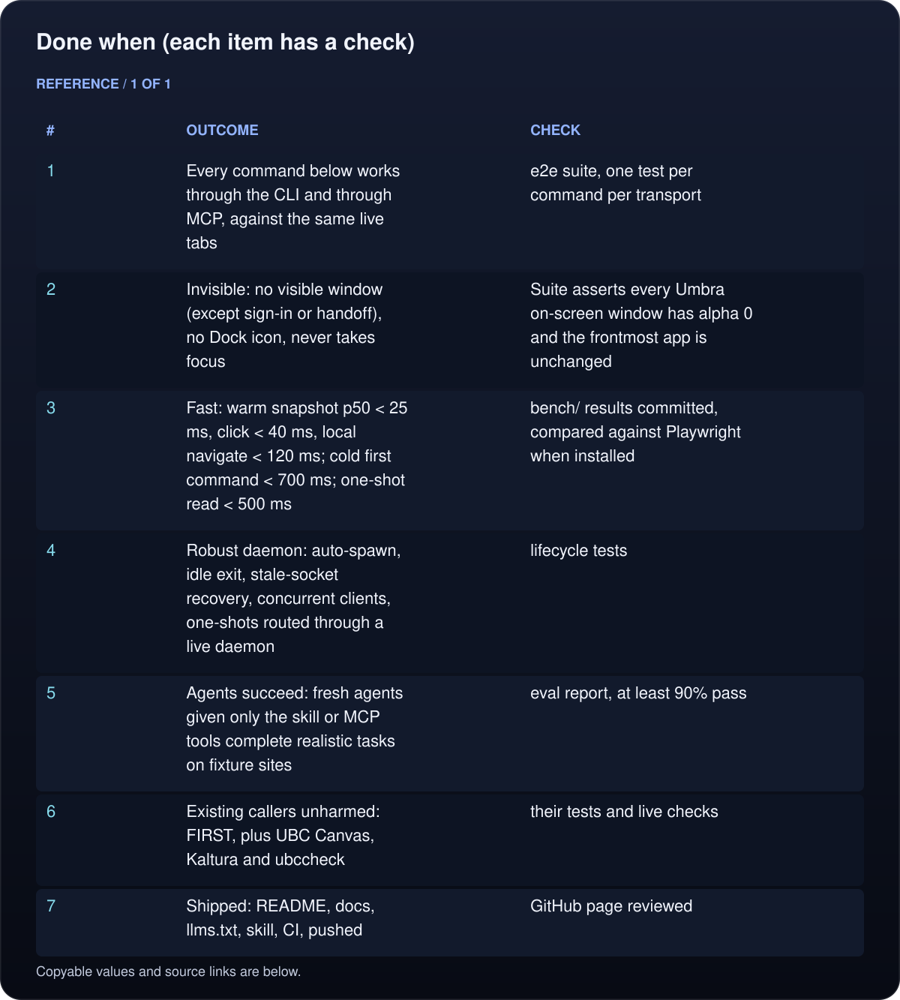
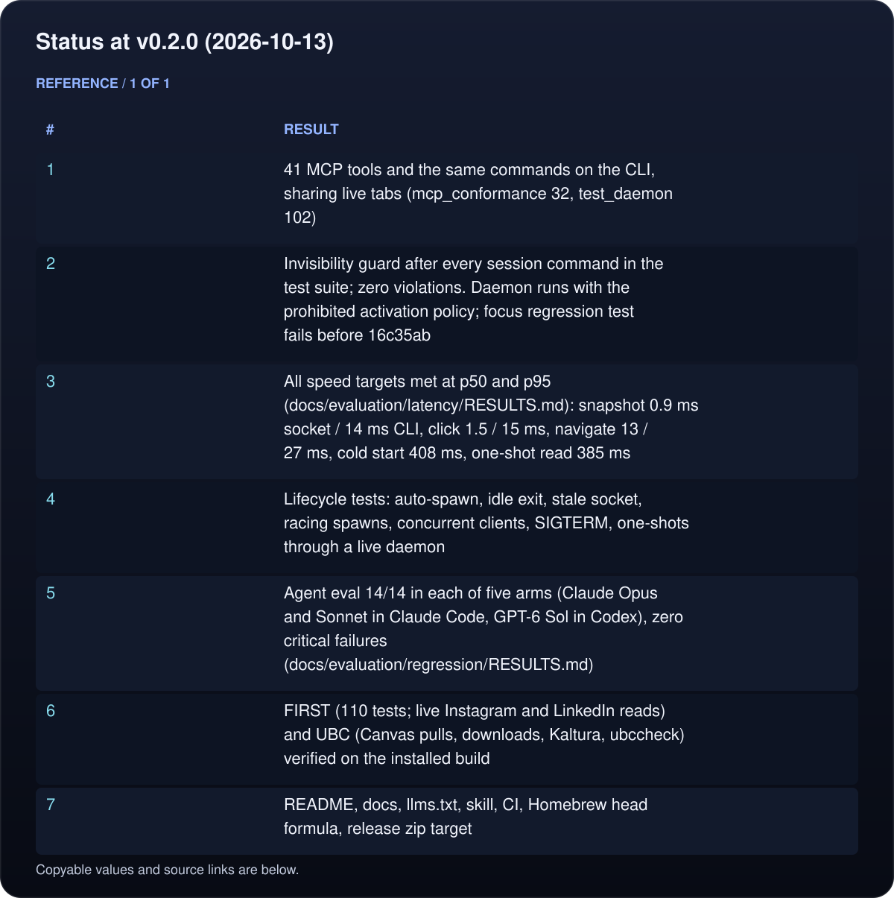
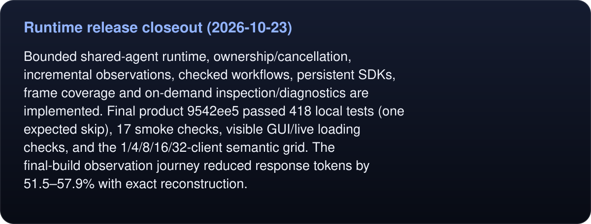
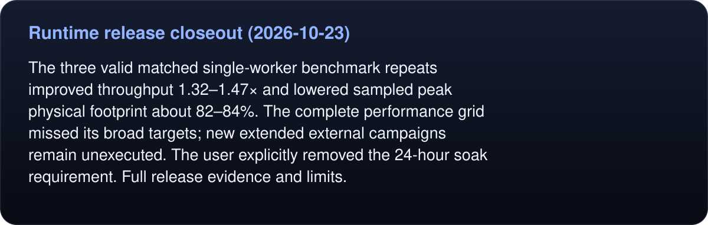
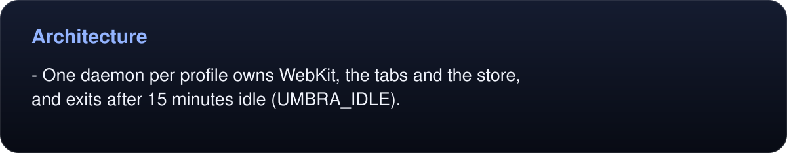
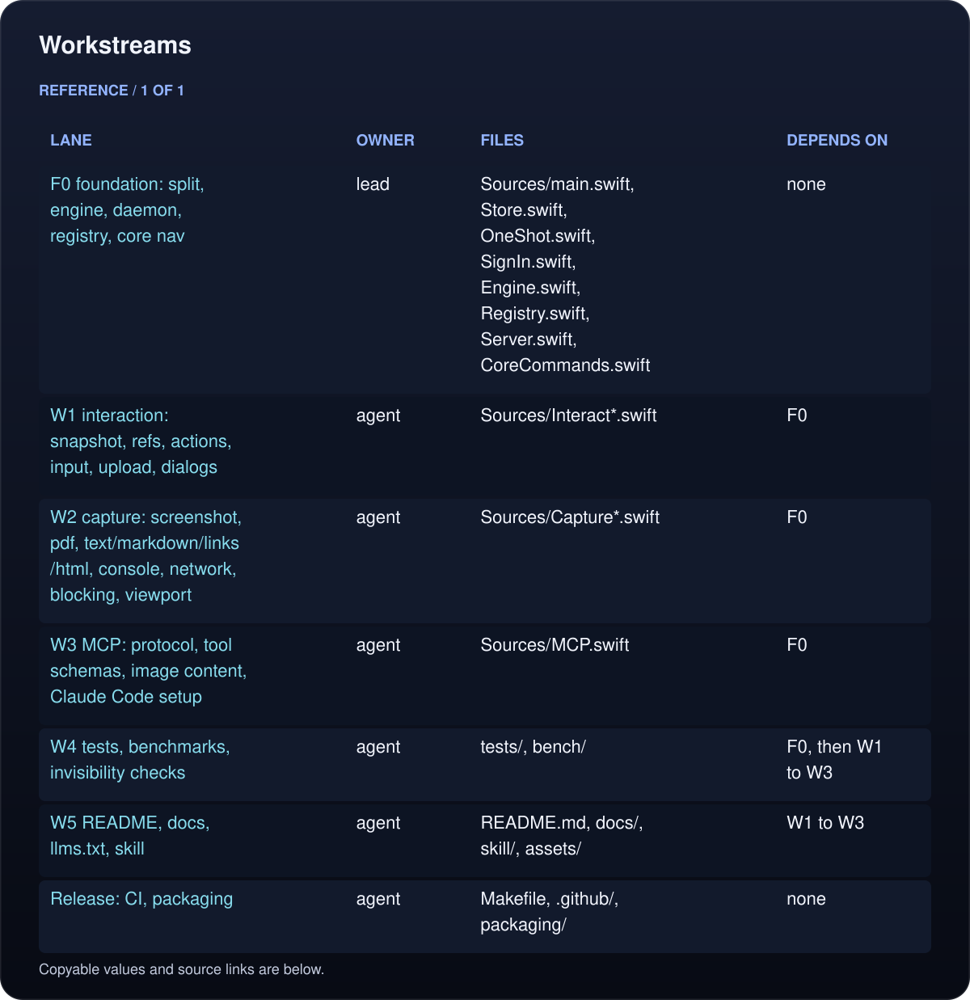
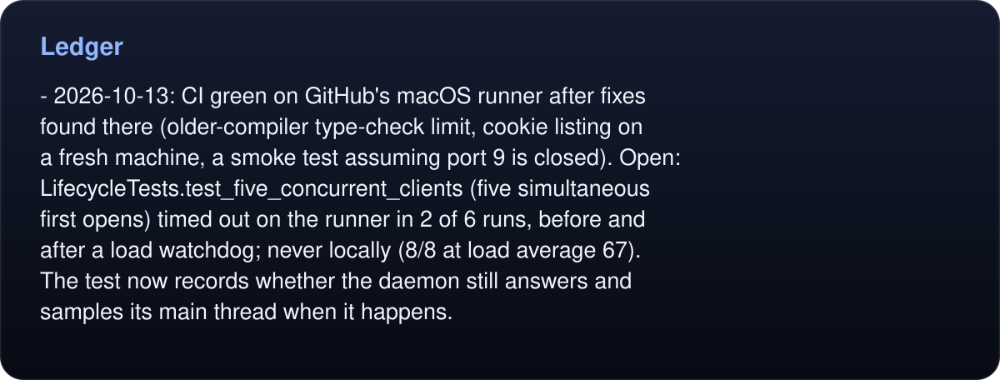
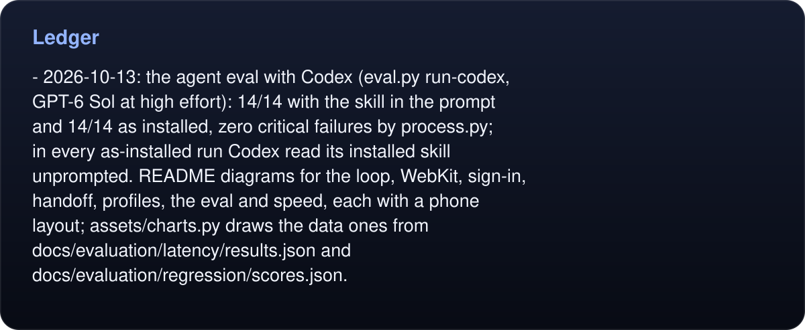
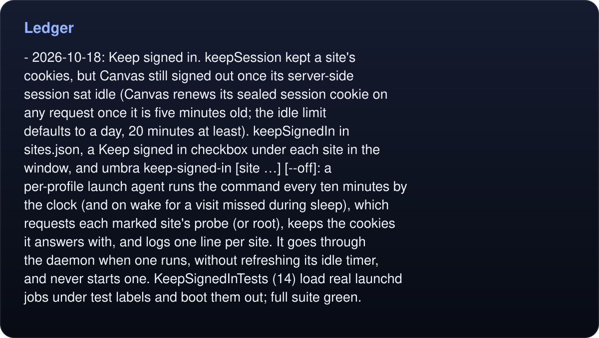
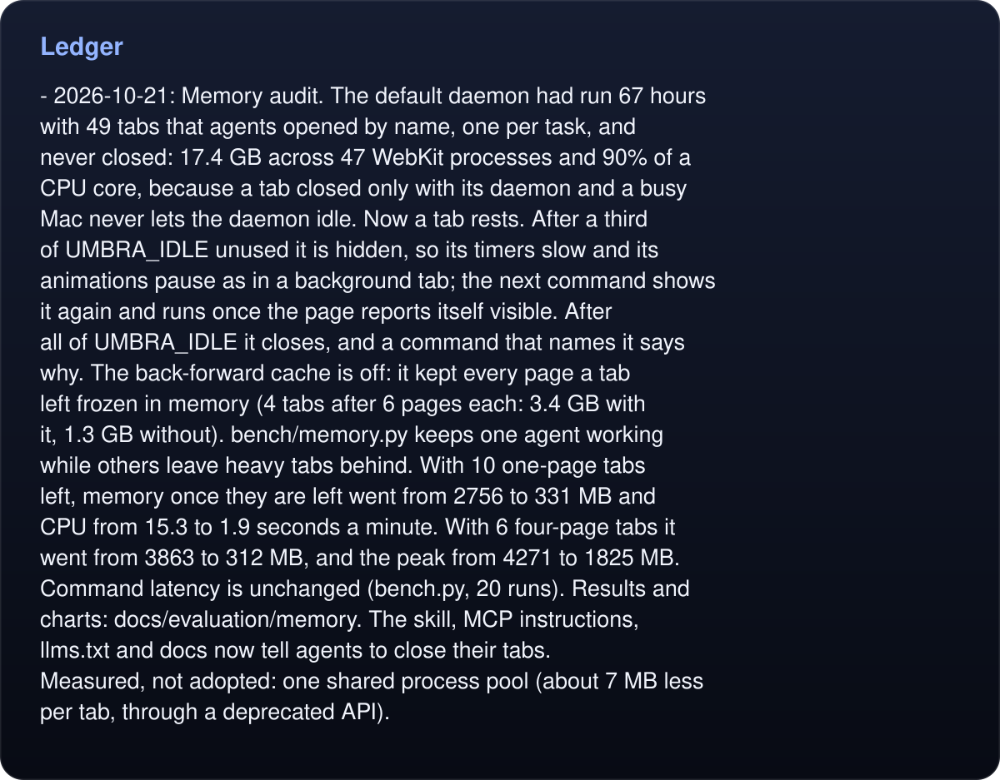

# Umbra roadmap: the headless browser built for agents

Goal: the best headless browser an AI agent can drive on a Mac. Native system WebKit,
invisible, signed in, fast, and usable through a shell (`umbra …`) or MCP with the same
live state.

## Done when (each item has a check)

<!-- umbra-figure: roadmap-table-df8682e1a0 -->
<picture>
  <source media="(max-width: 600px)" srcset="assets/docs/roadmap-table-df8682e1a0-1-mobile-65cbf6ce70.svg">
  
</picture>

<details>
<summary>Read the text, values and source links</summary>

- **#:** 1
- **Outcome:** Every command below works through the CLI and through MCP, against the same live tabs
- **Check:** e2e suite, one test per command per transport

- **#:** 2
- **Outcome:** Invisible: no visible window (except sign-in or handoff), no Dock icon, never takes focus
- **Check:** Suite asserts every Umbra on-screen window has alpha 0 and the frontmost app is unchanged

- **#:** 3
- **Outcome:** Fast: warm snapshot p50 < 25 ms, click < 40 ms, local navigate < 120 ms; cold first command < 700 ms; one-shot read < 500 ms
- **Check:** `bench/` results committed, compared against Playwright when installed

- **#:** 4
- **Outcome:** Robust daemon: auto-spawn, idle exit, stale-socket recovery, concurrent clients, one-shots routed through a live daemon
- **Check:** lifecycle tests

- **#:** 5
- **Outcome:** Agents succeed: fresh agents given only the skill or MCP tools complete realistic tasks on fixture sites
- **Check:** eval report, at least 90% pass

- **#:** 6
- **Outcome:** Existing callers unharmed: FIRST, plus UBC Canvas, Kaltura and ubccheck
- **Check:** their tests and live checks

- **#:** 7
- **Outcome:** Shipped: README, docs, llms.txt, skill, CI, pushed
- **Check:** GitHub page reviewed

</details>
<!-- /umbra-figure -->

## Status at v0.2.0 (2026-10-13)

<!-- umbra-figure: roadmap-table-8bf3b81cb9 -->
<picture>
  <source media="(max-width: 600px)" srcset="assets/docs/roadmap-table-8bf3b81cb9-1-mobile-7328a473de.svg">
  
</picture>

<details>
<summary>Read the text, values and source links</summary>

- **#:** 1
- **Result:** 41 MCP tools and the same commands on the CLI, sharing live tabs (mcp_conformance 32, test_daemon 102)

- **#:** 2
- **Result:** Invisibility guard after every session command in the test suite; zero violations. Daemon runs with the prohibited activation policy; focus regression test fails before 16c35ab

- **#:** 3
- **Result:** All speed targets met at p50 and p95 (docs/evaluation/latency/RESULTS.md): snapshot 0.9 ms socket / 14 ms CLI, click 1.5 / 15 ms, navigate 13 / 27 ms, cold start 408 ms, one-shot read 385 ms

- **#:** 4
- **Result:** Lifecycle tests: auto-spawn, idle exit, stale socket, racing spawns, concurrent clients, SIGTERM, one-shots through a live daemon

- **#:** 5
- **Result:** Agent eval 14/14 in each of five arms (Claude Opus and Sonnet in Claude Code, GPT-6 Sol in Codex), zero critical failures (docs/evaluation/regression/RESULTS.md)

- **#:** 6
- **Result:** FIRST (110 tests; live Instagram and LinkedIn reads) and UBC (Canvas pulls, downloads, Kaltura, ubccheck) verified on the installed build

- **#:** 7
- **Result:** README, docs, llms.txt, skill, CI, Homebrew head formula, release zip target

</details>
<!-- /umbra-figure -->

## Runtime release closeout (2026-10-23)

<!-- umbra-figure: roadmap-facts-2c85ccaec1 -->
<picture>
  <source media="(max-width: 600px)" srcset="assets/docs/roadmap-facts-2c85ccaec1-1-mobile-2b2583372f.svg">
  
</picture>

<details>
<summary>Read the text, values and source links</summary>

Bounded shared-agent runtime, ownership/cancellation, incremental observations, checked workflows, persistent SDKs, frame coverage and on-demand inspection/diagnostics are implemented. Final product `9542ee5` passed 418 local tests (one expected skip), 17 smoke checks, visible GUI/live loading checks, and the 1/4/8/16/32-client semantic grid. The final-build observation journey reduced response tokens by 51.5–57.9% with exact reconstruction.

</details>
<!-- /umbra-figure -->

<!-- umbra-figure: roadmap-facts-98a2f4114b -->
<picture>
  <source media="(max-width: 600px)" srcset="assets/docs/roadmap-facts-98a2f4114b-1-mobile-95963b3964.svg">
  
</picture>

<details>
<summary>Read the text, values and source links</summary>

The three valid matched single-worker benchmark repeats improved throughput 1.32–1.47× and lowered sampled peak physical footprint about 82–84%. The complete performance grid missed its broad targets; new extended external campaigns remain unexecuted. The user explicitly removed the 24-hour soak requirement. [Full release evidence and limits](docs/evaluation/runtime/RESULTS.md).

</details>
<!-- /umbra-figure -->

## Commands (target surface)

- Session: `open` (alias `goto`), `back`, `forward`, `reload`, `tabs`, `tab new|select|close`, `status`, `stop`
- See: `snapshot` (accessibility-style tree with `e<N>` refs; `--interactive`, `--scope`), `text`, `markdown`, `html`, `links`, `screenshot` (viewport, `--full`, element; file or base64), `pdf`
- Act: `click`, `fill`, `type`, `press`, `select`, `check`, `uncheck`, `hover`, `scroll`, `upload`, `dialog`
- Wait: `wait --selector|--text|--url|--js|--idle|--gone`
- Script: `eval` (page world, async)
- Observe: `console`, `network`
- Session data: `fetch`, `download`, `cookies` (names only), `sign-in`, `handoff` (show the tab to the human for 2FA or CAPTCHA, then hide it)
- Shape: `viewport`, `--mobile`, `block images,fonts,media,trackers`
- One-shot (no daemon, kept for scripts): `read`, `fetch`, `download`
- `mcp` (stdio MCP server), `serve` (daemon), `schema` (machine-readable command list)

## Architecture

```
umbra CLI ─┐                       ┌─ Tab "main"  (WKWebView in a transparent,
           ├─ unix socket (JSON) ──┤   off-screen, click-through window)
umbra mcp ─┘   per profile         ├─ Tab …
                                   └─ Store (cookies, keepSession) + profile lock
```

<!-- umbra-figure: roadmap-facts-2d6ecc5d8b -->
<picture>
  <source media="(max-width: 600px)" srcset="assets/docs/roadmap-facts-2d6ecc5d8b-1-mobile-069a1f0ddc.svg">
  
</picture>

<details>
<summary>Read the text, values and source links</summary>

- One daemon per profile owns WebKit, the tabs and the store, and exits after 15 minutes idle (`UMBRA_IDLE`).

</details>
<!-- /umbra-figure -->
- Commands are declared once in a registry (name, params, help, handler). The CLI parser, MCP `tools/list` and `umbra schema` all come from it.
- Page-world scripts run only for `eval` and `read`. Snapshot, refs and actions run in an isolated content world, so pages can't see or tamper with them.
- Input is native and trusted (`isTrusted == true`): NSEvent clicks and keys, plus `insertText` for typing.
- The prototype (2026-10-12) showed a transparent off-screen window with occlusion detection off gives `visibilityState == "visible"` and about 30 animation frames per second. A bare view gives `hidden` and a stalled frame rate. Both deliver trusted input and render screenshots.

## Workstreams

<!-- umbra-figure: roadmap-table-a24530cfac -->
<picture>
  <source media="(max-width: 600px)" srcset="assets/docs/roadmap-table-a24530cfac-1-mobile-7e1719bcc2.svg">
  
</picture>

<details>
<summary>Read the text, values and source links</summary>

- **Lane:** F0 foundation: split, engine, daemon, registry, core nav
- **Owner:** lead
- **Files:** `Sources/main.swift`, `Store.swift`, `OneShot.swift`, `SignIn.swift`, `Engine.swift`, `Registry.swift`, `Server.swift`, `CoreCommands.swift`
- **Depends on:** none

- **Lane:** W1 interaction: snapshot, refs, actions, input, upload, dialogs
- **Owner:** agent
- **Files:** `Sources/Interact*.swift`
- **Depends on:** F0

- **Lane:** W2 capture: screenshot, pdf, text/markdown/links/html, console, network, blocking, viewport
- **Owner:** agent
- **Files:** `Sources/Capture*.swift`
- **Depends on:** F0

- **Lane:** W3 MCP: protocol, tool schemas, image content, Claude Code setup
- **Owner:** agent
- **Files:** `Sources/MCP.swift`
- **Depends on:** F0

- **Lane:** W4 tests, benchmarks, invisibility checks
- **Owner:** agent
- **Files:** `tests/`, `bench/`
- **Depends on:** F0, then W1 to W3

- **Lane:** W5 README, docs, llms.txt, skill
- **Owner:** agent
- **Files:** `README.md`, `docs/`, `skill/`, `assets/`
- **Depends on:** W1 to W3

- **Lane:** Release: CI, packaging
- **Owner:** agent
- **Files:** `Makefile`, `.github/`, `packaging/`
- **Depends on:** none

</details>
<!-- /umbra-figure -->

## Ledger

- 2026-10-12: v0.1 (read, fetch, download, sign-in, cookies, profiles, keepSession, `--until`) in production for FIRST and UBC. A download cookie bug was fixed by switching to a top-level navigation that becomes a download.
- 2026-10-13: v0.2.0. Daemon, tabs, snapshot refs, 13 trusted-input actions, capture and observe, MCP server, handoff. Built by parallel lanes (interact, capture, MCP, tests, proving ground, brand, packaging) on the foundation, integrated and verified by the lead. Bugs found by tests and agents and fixed on the way: focus taken at launch, quadratic reply read, SIGPIPE, stop race, scratch tabs and downloads after timeouts, handoff windows left up, attachments shown inline, --profile read too late, form submits not reported, wait --idle ignoring its timeout.
<!-- umbra-figure: roadmap-facts-7b3667370c -->
<picture>
  <source media="(max-width: 600px)" srcset="assets/docs/roadmap-facts-7b3667370c-1-mobile-00ae6313c7.svg">
  
</picture>

<details>
<summary>Read the text, values and source links</summary>

- 2026-10-13: CI green on GitHub's macOS runner after fixes found there (older-compiler type-check limit, cookie listing on a fresh machine, a smoke test assuming port 9 is closed). Open: LifecycleTests.test_five_concurrent_clients (five simultaneous first opens) timed out on the runner in 2 of 6 runs, before and after a load watchdog; never locally (8/8 at load average 67). The test now records whether the daemon still answers and samples its main thread when it happens.

</details>
<!-- /umbra-figure -->
- 2026-10-13: the runner-only timeout, explained. An A/B probe on the runner (8 jobs, test server backlog 5 vs 128) reproduced it in both arms (10 of 48 isolated runs with a backlog of 5, 9 of 48 with 128), so the listen backlog wasn't the cause. The new diagnostics showed it each time: the stuck tab's request never reached the server, and a script in that tab got no answer, so its web process was wedged. The load watchdog asked that process for `document.readyState` and stopped when no answer came. Now two silent checks end the process and retry the load in a new one (`test_a_load_whose_web_process_stops_answering_moves_to_a_new_one` hangs for 60 s before the fix, passes in about 20 s after).
- 2026-10-13: the sign-in window became a way to sign in, never a way to browse (opening Umbra showed signed-in Instagram and LinkedIn, which are distracting). The daemon shows it, with a Dock icon while it is open; signed-in sites are checked without loading, and a login page closes the moment its sign-in lands.
- 2026-10-13: after the fix the five-concurrent test passed 96 of 96 isolated runs on the runner (19 of 96 failed before). The account's GitHub Actions minutes then ran out (macOS jobs count ten times on a private repo, and the two probes used most of them), so both workflows are disabled (`gh workflow enable CI` turns CI back on). Until then, tests run locally: `make test`, about five minutes, never touching the default profile.
- 2026-10-13: Add Account. A pasted login link becomes a site in sites.json; during its first sign-in Umbra learns the cookie it set, so the site is then checked like the others and agents can use it. `umbra sign-in <url> --save NAME` does the same from a shell.
<!-- umbra-figure: roadmap-facts-a37af53672 -->
<picture>
  <source media="(max-width: 600px)" srcset="assets/docs/roadmap-facts-a37af53672-1-mobile-780ab737cc.svg">
  
</picture>

<details>
<summary>Read the text, values and source links</summary>

- 2026-10-13: the agent eval with Codex (`eval.py run-codex`, GPT-6 Sol at high effort): 14/14 with the skill in the prompt and 14/14 as installed, zero critical failures by `process.py`; in every as-installed run Codex read its installed skill unprompted. README diagrams for the loop, WebKit, sign-in, handoff, profiles, the eval and speed, each with a phone layout; `assets/charts.py` draws the data ones from docs/evaluation/latency/results.json and docs/evaluation/regression/scores.json.

</details>
<!-- /umbra-figure -->
<!-- umbra-figure: roadmap-facts-6e5fa5b769 -->
<picture>
  <source media="(max-width: 600px)" srcset="assets/docs/roadmap-facts-6e5fa5b769-1-mobile-383b1804c2.svg">
  
</picture>

<details>
<summary>Read the text, values and source links</summary>

- 2026-10-18: Keep signed in. `keepSession` kept a site's cookies, but Canvas still signed out once its server-side session sat idle (Canvas renews its sealed session cookie on any request once it is five minutes old; the idle limit defaults to a day, 20 minutes at least). `keepSignedIn` in sites.json, a Keep signed in checkbox under each site in the window, and `umbra keep-signed-in [site …] [--off]`: a per-profile launch agent runs the command every ten minutes by the clock (and on wake for a visit missed during sleep), which requests each marked site's probe (or root), keeps the cookies it answers with, and logs one line per site. It goes through the daemon when one runs, without refreshing its idle timer, and never starts one. KeepSignedInTests (14) load real launchd jobs under test labels and boot them out; full suite green.

</details>
<!-- /umbra-figure -->
- 2026-10-18: Sign-in window audit and redesign. Audit against the real profile: two of five sites (no cookie or probe) always looked signed out; a window left open or shown again kept its first results; a session-only sign-in without keepSession vanished when the daemon exited (Strava's); Couldn't check gave no reason. Fixed: Not checked, with the cookie learned at Done; every showing re-checks; session-only sign-in cookies get keepSession before `sign-in` answers; the daemon persists cookies every five minutes; reasons in the window and the keep-signed-in log; a named sign-in uses the caller's sites file. Redesigned for macOS 26 from two competing prototypes (grouped vs floating glass), then three rounds with an independent design reviewer to PASS: one glass card on a soft glow, sites' own logos (fetched without cookies, never from the login page), a status column, capsule actions, a … menu (Keep Signed In, Check Again, Sign Out…), and the login page under a glass toolbar. Five new GUI tests; full suite green.
- 2026-10-18: Sites with no cookie or probe are asked by their login page. Wealthsimple (a single-page app: every path answers 200, so a probe can't tell, and its kept session cookie outlives the session) showed no status, and its Sign In opened the site signed in. Now a hidden view loads the login page and watches it: moved off it onto a non-sign-in page of the site with no password for a second means signed in; a password, a sign-in path or another host for 2.5 s means signed out. Sign In asks first, so a signed-in site never opens; the visible page closes itself once the site lets the person in; keep-signed-in reports real states instead of "visited". The regression test hangs on the pre-fix build and passes now; full suite green; on the real profile all five sites read Signed in.
<!-- umbra-figure: roadmap-facts-35b3b8f1e1 -->
<picture>
  <source media="(max-width: 600px)" srcset="assets/docs/roadmap-facts-35b3b8f1e1-1-mobile-360ca24875.svg">
  
</picture>

<details>
<summary>Read the text, values and source links</summary>

- 2026-10-21: Memory audit. The default daemon had run 67 hours with 49 tabs that agents opened by name, one per task, and never closed: 17.4 GB across 47 WebKit processes and 90% of a CPU core, because a tab closed only with its daemon and a busy Mac never lets the daemon idle. Now a tab rests. After a third of `UMBRA_IDLE` unused it is hidden, so its timers slow and its animations pause as in a background tab; the next command shows it again and runs once the page reports itself visible. After all of `UMBRA_IDLE` it closes, and a command that names it says why. The back-forward cache is off: it kept every page a tab left frozen in memory (4 tabs after 6 pages each: 3.4 GB with it, 1.3 GB without). `bench/memory.py` keeps one agent working while others leave heavy tabs behind. With 10 one-page tabs left, memory once they are left went from 2756 to 331 MB and CPU from 15.3 to 1.9 seconds a minute. With 6 four-page tabs it went from 3863 to 312 MB, and the peak from 4271 to 1825 MB. Command latency is unchanged (bench.py, 20 runs). Results and charts: docs/evaluation/memory. The skill, MCP instructions, llms.txt and docs now tell agents to close their tabs. Measured, not adopted: one shared process pool (about 7 MB less per tab, through a deprecated API).

</details>
<!-- /umbra-figure -->
- 2026-10-21: WRDS always read signed out. Signed in, its login page stays at /login/ and offers a Logout form instead of moving on into the site, and the check for sites with no cookie or probe counted only moving on. A page that asks for no password and shows a way to sign out (a Log out button or link, or a link or form to a logout path) now counts as signed in, on the login page or off it; a visible password still means signed out. Checked on the real site both ways. The regression test (three login pages that keep someone signed in where they are) fails on the previous build; full suite green.
