# Commands

Commands that work on a page take `--tab NAME` (default: the current tab). Daemon commands take `--timeout SECONDS`, `--agent`, `--task`, `--request` and an absolute Unix-second `--deadline`; `--json` and `--profile NAME` select output and identity. Options can go before or after the command name: `umbra --tab work snapshot` works too. `umbra help <command>` has the details, and `umbra schema` is the generated parameter reference. [Runtime guide](runtime/README.md) covers ownership, bounded concurrency, observations and recovery.

### Session

<!-- umbra-figure: docs-commands-table-e872c48d03 -->
<picture>
  <source media="(max-width: 600px)" srcset="../assets/docs/docs-commands-table-e872c48d03-1-mobile-d6b588ef5b.svg">
  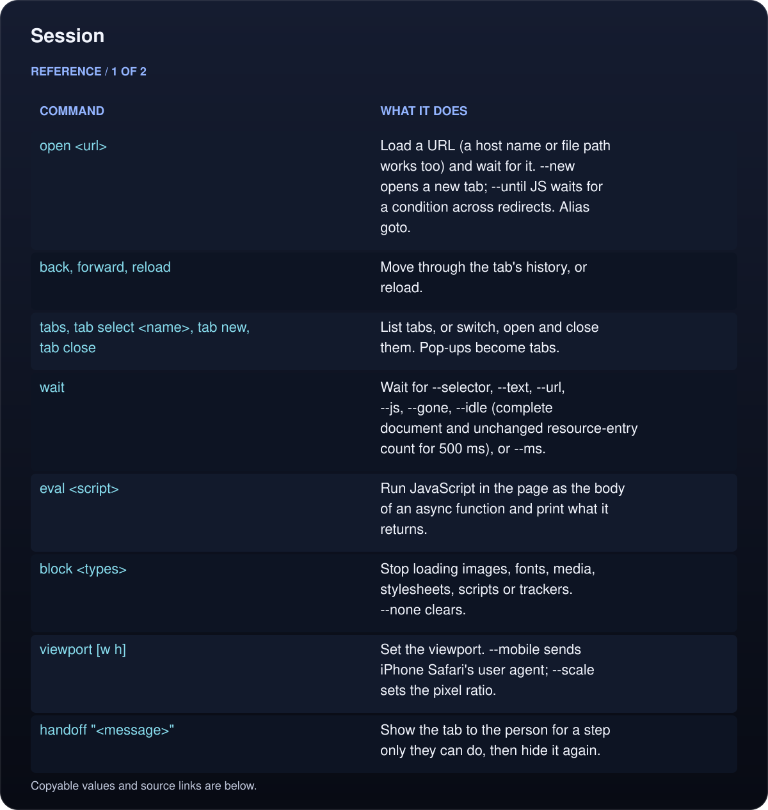
</picture>

<picture>
  <source media="(max-width: 600px)" srcset="../assets/docs/docs-commands-table-e872c48d03-2-mobile-a2f2ba3e0c.svg">
  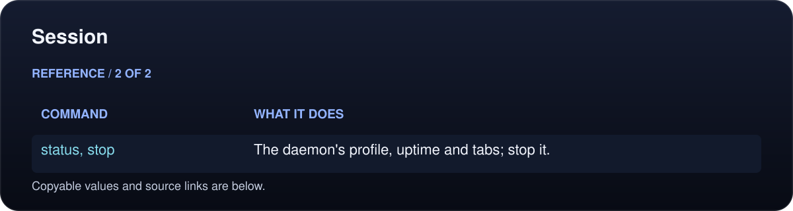
</picture>

Read the text, values and source links

- **Command:** `open <url>`
- **What it does:** Load a URL (a host name or file path works too) and wait for it. `--new` opens a new tab; `--until JS` waits for a condition across redirects. Alias `goto`.

- **Command:** `back`, `forward`, `reload`
- **What it does:** Move through the tab's history, or reload.

- **Command:** `tabs`, `tab select <name>`, `tab new`, `tab close`
- **What it does:** List tabs, or switch, open and close them. Pop-ups become tabs.

- **Command:** `wait`
- **What it does:** Wait for `--selector`, `--text`, `--url`, `--js`, `--gone`, `--idle` (complete document and unchanged resource-entry count for 500 ms), or `--ms`.

- **Command:** `eval <script>`
- **What it does:** Run JavaScript in the page as the body of an async function and print what it returns.

- **Command:** `block <types>`
- **What it does:** Stop loading images, fonts, media, stylesheets, scripts or trackers. `--none` clears.

- **Command:** `viewport [w h]`
- **What it does:** Set the viewport. `--mobile` sends iPhone Safari's user agent; `--scale` sets the pixel ratio.

- **Command:** `handoff "<message>"`
- **What it does:** Show the tab to the person for a step only they can do, then hide it again.

- **Command:** `status`, `stop`
- **What it does:** The daemon's profile, uptime and tabs; stop it.

<!-- /umbra-figure -->

### See

<!-- umbra-figure: docs-commands-table-99bfc94cd0 -->
<picture>
  <source media="(max-width: 600px)" srcset="../assets/docs/docs-commands-table-99bfc94cd0-1-mobile-608e206c52.svg">
  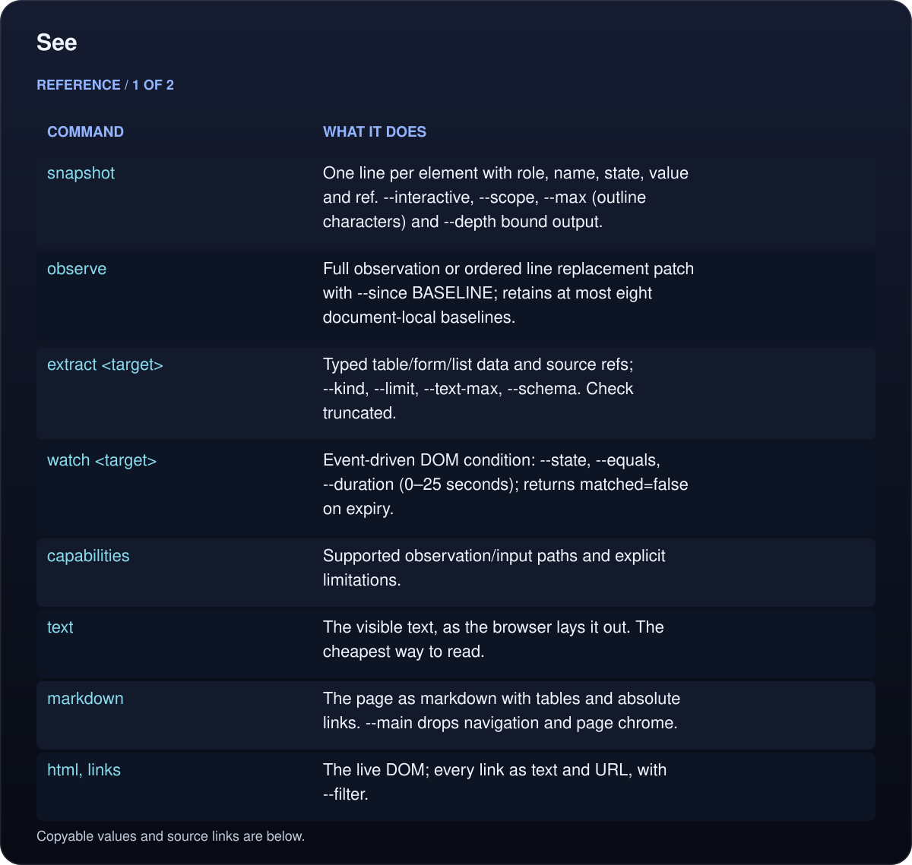
</picture>

<picture>
  <source media="(max-width: 600px)" srcset="../assets/docs/docs-commands-table-99bfc94cd0-2-mobile-25505166a7.svg">
  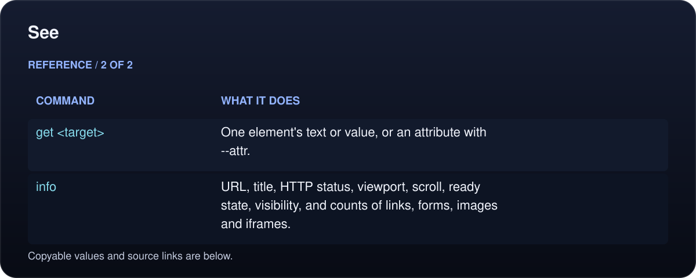
</picture>

Read the text, values and source links

- **Command:** `snapshot`
- **What it does:** One line per element with role, name, state, value and ref. `--interactive`, `--scope`, `--max` (outline characters) and `--depth` bound output.

- **Command:** `observe`
- **What it does:** Full observation or ordered line replacement patch with `--since BASELINE`; retains at most eight document-local baselines.

- **Command:** `extract <target>`
- **What it does:** Typed table/form/list data and source refs; `--kind`, `--limit`, `--text-max`, `--schema`. Check `truncated`.

- **Command:** `watch <target>`
- **What it does:** Event-driven DOM condition: `--state`, `--equals`, `--duration` (0–25 seconds); returns `matched=false` on expiry.

- **Command:** `capabilities`
- **What it does:** Supported observation/input paths and explicit limitations.

- **Command:** `text`
- **What it does:** The visible text, as the browser lays it out. The cheapest way to read.

- **Command:** `markdown`
- **What it does:** The page as markdown with tables and absolute links. `--main` drops navigation and page chrome.

- **Command:** `html`, `links`
- **What it does:** The live DOM; every link as text and URL, with `--filter`.

- **Command:** `get <target>`
- **What it does:** One element's text or value, or an attribute with `--attr`.

- **Command:** `info`
- **What it does:** URL, title, HTTP status, viewport, scroll, ready state, visibility, and counts of links, forms, images and iframes.

<!-- /umbra-figure -->

### Act

Native pointer and keyboard paths produce trusted input. Actions wait for actionability where supported; direct value setters, select events and HTML5 drag/drop have explicit untrusted fallbacks. Inspect the returned receipt and application state.

<!-- umbra-figure: docs-commands-table-d6f5520937 -->
<picture>
  <source media="(max-width: 600px)" srcset="../assets/docs/docs-commands-table-d6f5520937-1-mobile-5c38b62a77.svg">
  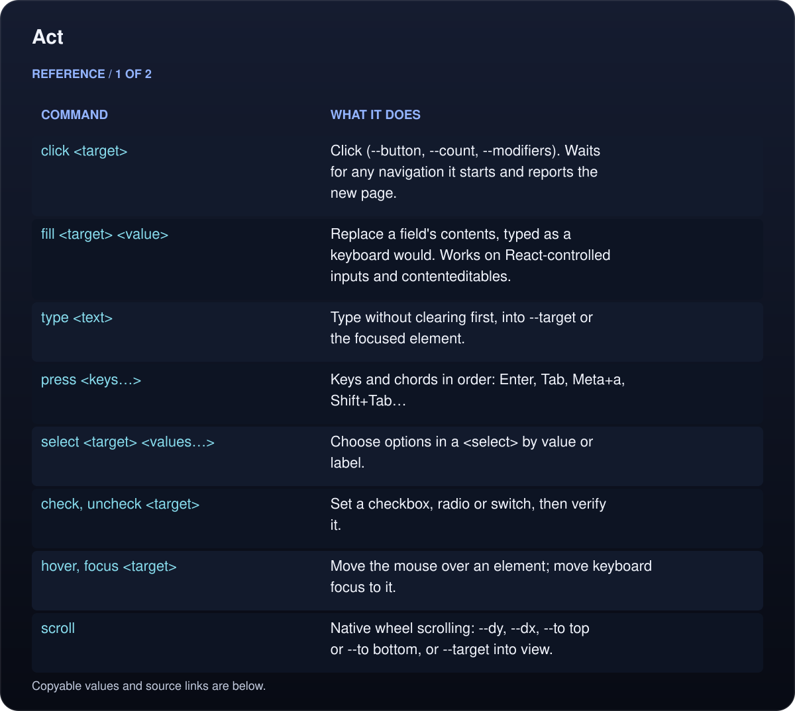
</picture>

<picture>
  <source media="(max-width: 600px)" srcset="../assets/docs/docs-commands-table-d6f5520937-2-mobile-829aecdda0.svg">
  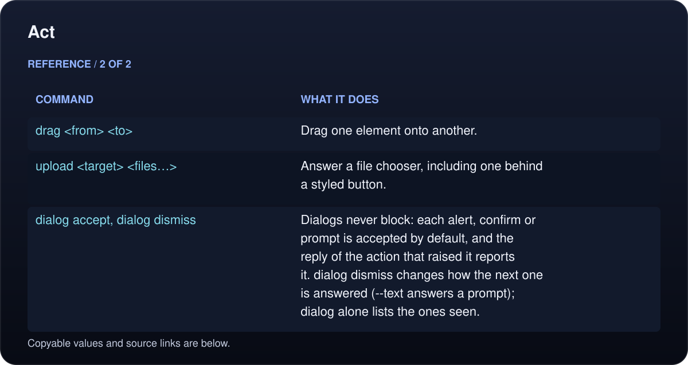
</picture>

Read the text, values and source links

- **Command:** `click <target>`
- **What it does:** Click (`--button`, `--count`, `--modifiers`). Waits for any navigation it starts and reports the new page.

- **Command:** `fill <target> <value>`
- **What it does:** Replace a field's contents, typed as a keyboard would. Works on React-controlled inputs and contenteditables.

- **Command:** `type <text>`
- **What it does:** Type without clearing first, into `--target` or the focused element.

- **Command:** `press <keys…>`
- **What it does:** Keys and chords in order: `Enter`, `Tab`, `Meta+a`, `Shift+Tab`…

- **Command:** `select <target> <values…>`
- **What it does:** Choose options in a `<select>` by value or label.

- **Command:** `check`, `uncheck <target>`
- **What it does:** Set a checkbox, radio or switch, then verify it.

- **Command:** `hover`, `focus <target>`
- **What it does:** Move the mouse over an element; move keyboard focus to it.

- **Command:** `scroll`
- **What it does:** Native wheel scrolling: `--dy`, `--dx`, `--to top` or `--to bottom`, or `--target` into view.

- **Command:** `drag <from> <to>`
- **What it does:** Drag one element onto another.

- **Command:** `upload <target> <files…>`
- **What it does:** Answer a file chooser, including one behind a styled button.

- **Command:** `dialog accept`, `dialog dismiss`
- **What it does:** Dialogs never block: each alert, confirm or prompt is accepted by default, and the reply of the action that raised it reports it. `dialog dismiss` changes how the next one is answered (`--text` answers a prompt); `dialog` alone lists the ones seen.

<!-- /umbra-figure -->

### Capture

<!-- umbra-figure: docs-commands-table-14177c4af4 -->
<picture>
  <source media="(max-width: 600px)" srcset="../assets/docs/docs-commands-table-14177c4af4-1-mobile-87232bfe34.svg">
  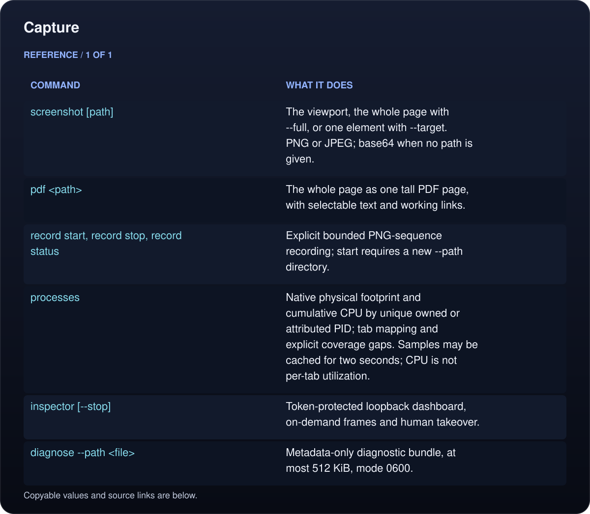
</picture>

Read the text, values and source links

- **Command:** `screenshot [path]`
- **What it does:** The viewport, the whole page with `--full`, or one element with `--target`. PNG or JPEG; base64 when no path is given.

- **Command:** `pdf <path>`
- **What it does:** The whole page as one tall PDF page, with selectable text and working links.

- **Command:** `record start`, `record stop`, `record status`
- **What it does:** Explicit bounded PNG-sequence recording; start requires a new `--path` directory.

- **Command:** `processes`
- **What it does:** Native physical footprint and cumulative CPU by unique owned or attributed PID; tab mapping and explicit coverage gaps. Samples may be cached for two seconds; CPU is not per-tab utilization.

- **Command:** `inspector [--stop]`
- **What it does:** Token-protected loopback dashboard, on-demand frames and human takeover.

- **Command:** `diagnose --path <file>`
- **What it does:** Metadata-only diagnostic bundle, at most 512 KiB, mode 0600.

<!-- /umbra-figure -->

### Observe

<!-- umbra-figure: docs-commands-table-ec5b2a67ec -->
<picture>
  <source media="(max-width: 600px)" srcset="../assets/docs/docs-commands-table-ec5b2a67ec-1-mobile-f910f78ab9.svg">
  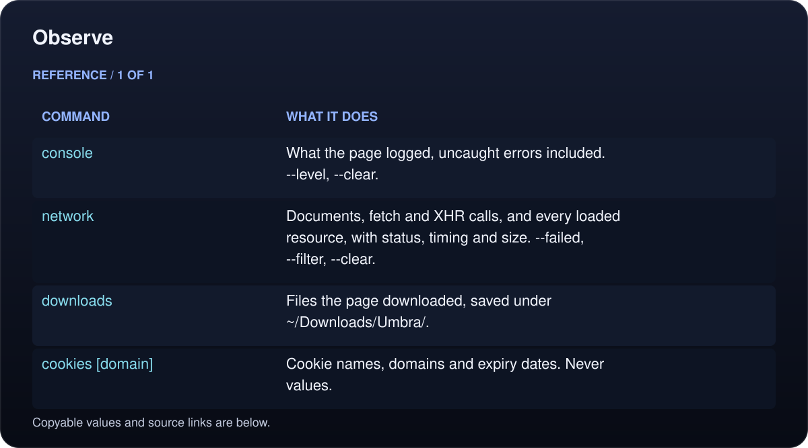
</picture>

Read the text, values and source links

- **Command:** `console`
- **What it does:** What the page logged, uncaught errors included. `--level`, `--clear`.

- **Command:** `network`
- **What it does:** Documents, fetch and XHR calls, and every loaded resource, with status, timing and size. `--failed`, `--filter`, `--clear`.

- **Command:** `downloads`
- **What it does:** Files the page downloaded, saved under `~/Downloads/Umbra/`.

- **Command:** `cookies [domain]`
- **What it does:** Cookie names, domains and expiry dates. Never values.

<!-- /umbra-figure -->

### Runtime and workflows

<!-- umbra-figure: docs-commands-table-69653e37c5 -->
<picture>
  <source media="(max-width: 600px)" srcset="../assets/docs/docs-commands-table-69653e37c5-1-mobile-da74c4ed1d.svg">
  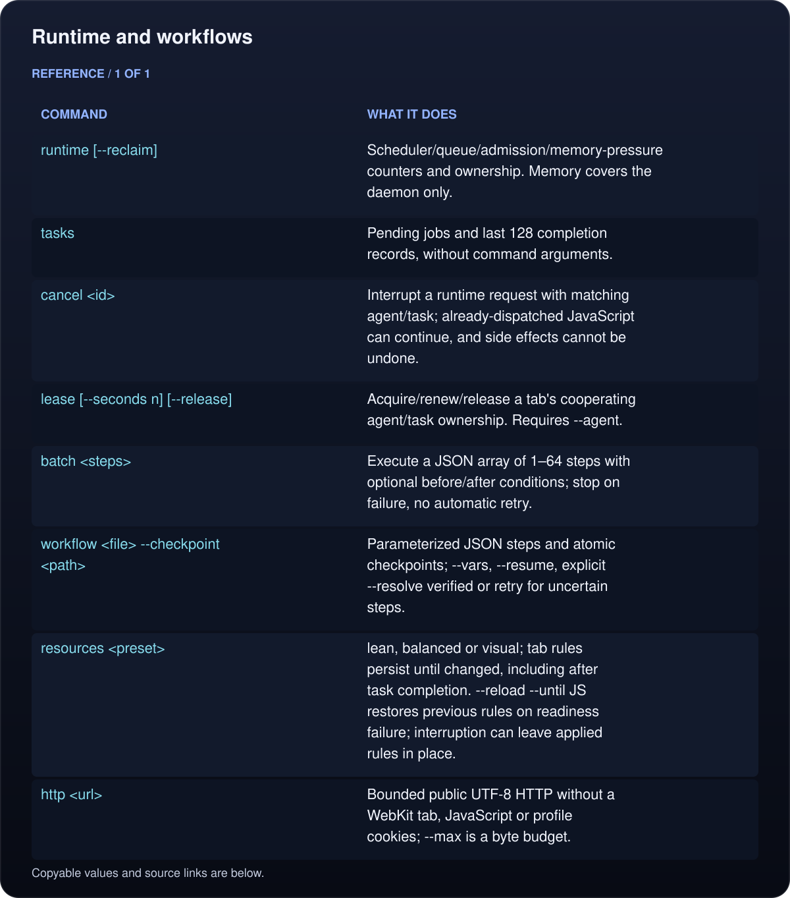
</picture>

Read the text, values and source links

- **Command:** `runtime [--reclaim]`
- **What it does:** Scheduler/queue/admission/memory-pressure counters and ownership. Memory covers the daemon only.

- **Command:** `tasks`
- **What it does:** Pending jobs and last 128 completion records, without command arguments.

- **Command:** `cancel <id>`
- **What it does:** Interrupt a runtime request with matching agent/task; already-dispatched JavaScript can continue, and side effects cannot be undone.

- **Command:** `lease [--seconds n] [--release]`
- **What it does:** Acquire/renew/release a tab's cooperating agent/task ownership. Requires `--agent`.

- **Command:** `batch <steps>`
- **What it does:** Execute a JSON array of 1–64 steps with optional before/after conditions; stop on failure, no automatic retry.

- **Command:** `workflow <file> --checkpoint <path>`
- **What it does:** Parameterized JSON steps and atomic checkpoints; `--vars`, `--resume`, explicit `--resolve verified` or `retry` for uncertain steps.

- **Command:** `resources <preset>`
- **What it does:** `lean`, `balanced` or `visual`; tab rules persist until changed, including after task completion. `--reload --until JS` restores previous rules on readiness failure; interruption can leave applied rules in place.

- **Command:** `http <url>`
- **What it does:** Bounded public UTF-8 HTTP without a WebKit tab, JavaScript or profile cookies; `--max` is a byte budget.

<!-- /umbra-figure -->

`batch` and `workflow` carry agent/task/deadline at the coordinator level; put each target `tab` in the step's `args`. See [recovery and safety limits](runtime/README.md#batch-known-steps-and-checkpoint-a-workflow).

### Frames and coordinates

<!-- umbra-figure: docs-commands-table-9ae059d752 -->
<picture>
  <source media="(max-width: 600px)" srcset="../assets/docs/docs-commands-table-9ae059d752-1-mobile-772ffde3d0.svg">
  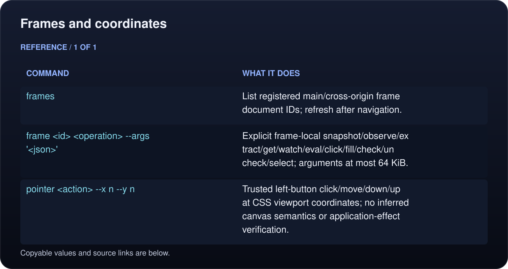
</picture>

Read the text, values and source links

- **Command:** `frames`
- **What it does:** List registered main/cross-origin frame document IDs; refresh after navigation.

- **Command:** `frame <id> <operation> --args '<json>'`
- **What it does:** Explicit frame-local snapshot/observe/extract/get/watch/eval/click/fill/check/uncheck/select; arguments at most 64 KiB.

- **Command:** `pointer <action> --x n --y n`
- **What it does:** Trusted left-button click/move/down/up at CSS viewport coordinates; no inferred canvas semantics or application-effect verification.

<!-- /umbra-figure -->

Native frame input refuses unavailable, hidden, covered, transformed, zoomed or offscreen geometry. Closed shadow roots remain unsupported. [Frame examples](runtime/README.md#reach-frames-and-canvas-carefully).

### One-shot

These keep their original contract for scheduled scripts: one process, a result on stdout and an exit code. When a daemon is running they go through it; otherwise they run on their own.

<!-- umbra-figure: docs-commands-table-e81061a828 -->
<picture>
  <source media="(max-width: 600px)" srcset="../assets/docs/docs-commands-table-e81061a828-1-mobile-ee1724e461.svg">
  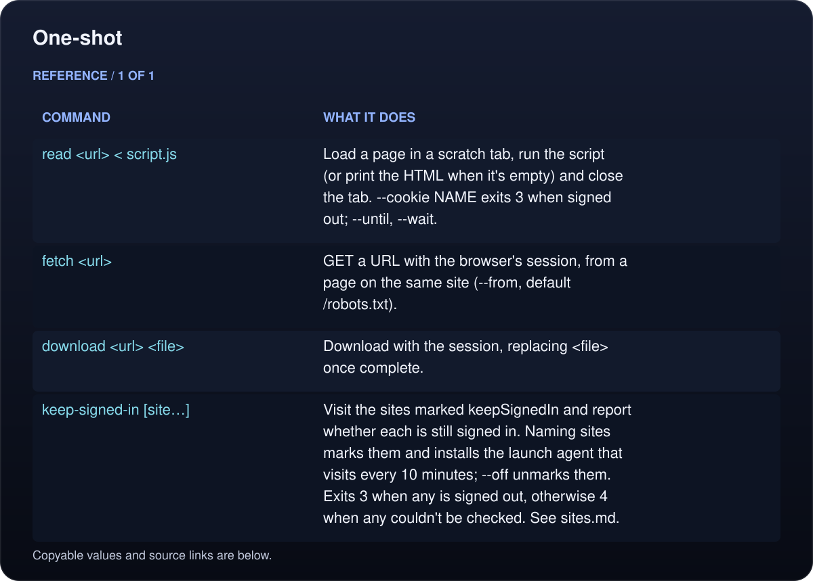
</picture>

Read the text, values and source links

- **Command:** `read <url> < script.js`
- **What it does:** Load a page in a scratch tab, run the script (or print the HTML when it's empty) and close the tab. `--cookie NAME` exits 3 when signed out; `--until`, `--wait`.

- **Command:** `fetch <url>`
- **What it does:** GET a URL with the browser's session, from a page on the same site (`--from`, default `/robots.txt`).

- **Command:** `download <url> <file>`
- **What it does:** Download with the session, replacing `<file>` once complete.

- **Command:** `keep-signed-in [site…]`
- **What it does:** Visit the sites marked `keepSignedIn` and report whether each is still signed in. Naming sites marks them and installs the launch agent that visits every 10 minutes; `--off` unmarks them. Exits 3 when any is signed out, otherwise 4 when any couldn't be checked. See [sites.md](sites.md#keepsignedin).

<!-- /umbra-figure -->

[docs/recipes.md](recipes.md) has worked examples for both styles.

## Exit codes

Results go to stdout and messages to stderr. Over MCP, a failure comes back as a tool error with the message and, for codes 1 to 4, a hint about what to do next.

<!-- umbra-figure: docs-commands-table-6a9ed7d3ef -->
<picture>
  <source media="(max-width: 600px)" srcset="../assets/docs/docs-commands-table-6a9ed7d3ef-1-mobile-7b0014e3ec.svg">
  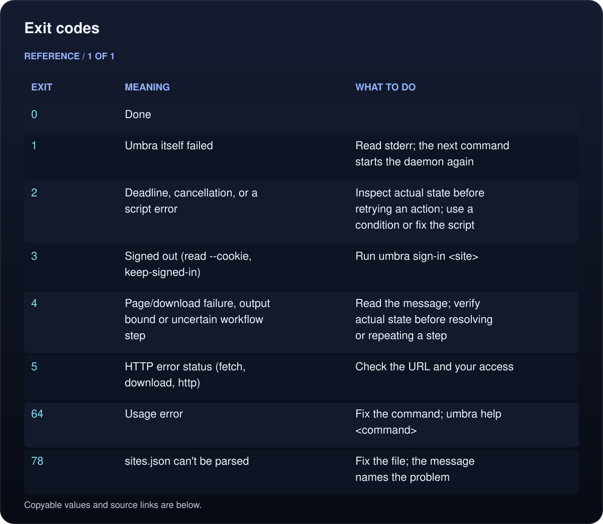
</picture>

Read the text, values and source links

- **Exit:** `0`
- **Meaning:** Done
- **What to do:**

- **Exit:** `1`
- **Meaning:** Umbra itself failed
- **What to do:** Read stderr; the next command starts the daemon again

- **Exit:** `2`
- **Meaning:** Deadline, cancellation, or a script error
- **What to do:** Inspect actual state before retrying an action; use a condition or fix the script

- **Exit:** `3`
- **Meaning:** Signed out (`read --cookie`, `keep-signed-in`)
- **What to do:** Run `umbra sign-in <site>`

- **Exit:** `4`
- **Meaning:** Page/download failure, output bound or uncertain workflow step
- **What to do:** Read the message; verify actual state before resolving or repeating a step

- **Exit:** `5`
- **Meaning:** HTTP error status (`fetch`, `download`, `http`)
- **What to do:** Check the URL and your access

- **Exit:** `64`
- **Meaning:** Usage error
- **What to do:** Fix the command; `umbra help <command>`

- **Exit:** `78`
- **Meaning:** `sites.json` can't be parsed
- **What to do:** Fix the file; the message names the problem

<!-- /umbra-figure -->

<!-- umbra-figure: docs-commands-facts-104bf82a01 -->
<picture>
  <source media="(max-width: 600px)" srcset="../assets/docs/docs-commands-facts-104bf82a01-1-mobile-2121401655.svg">
  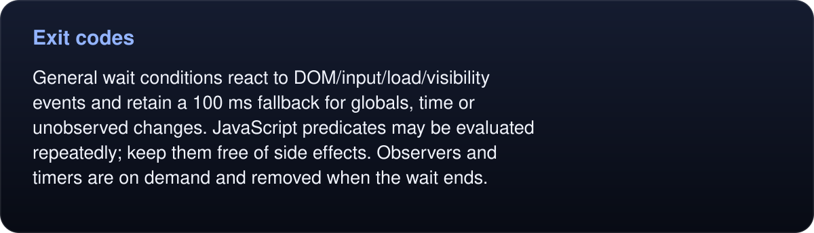
</picture>

Read the text, values and source links

General `wait` conditions react to DOM/input/load/visibility events and retain a 100 ms fallback for globals, time or unobserved changes. JavaScript predicates may be evaluated repeatedly; keep them free of side effects. Observers and timers are on demand and removed when the wait ends.

<!-- /umbra-figure -->
