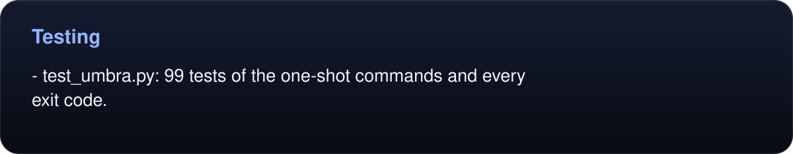
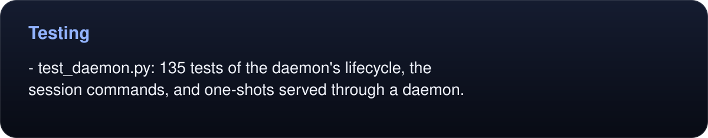
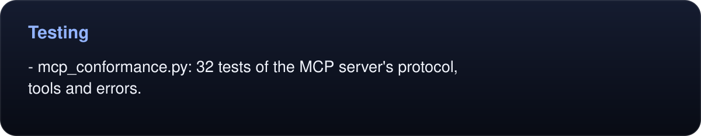

# Testing

```sh
make test       # builds if needed, then runs every suite against the build, never the installed app
```

`tests/run.sh` runs smoke checks and the full regression suite against local servers on `127.0.0.1` with throwaway profiles. Core suites include:

<!-- umbra-figure: docs-development-facts-d51d21b83f -->
<picture>
  <source media="(max-width: 600px)" srcset="../assets/docs/docs-development-facts-d51d21b83f-1-mobile-aaa45fc2bb.svg">
  
</picture>

<details>
<summary>Read the text, values and source links</summary>

- `test_umbra.py`: 99 tests of the one-shot commands and every exit code.

</details>
<!-- /umbra-figure -->
<!-- umbra-figure: docs-development-facts-6c1bb41886 -->
<picture>
  <source media="(max-width: 600px)" srcset="../assets/docs/docs-development-facts-6c1bb41886-1-mobile-61f4a0d106.svg">
  
</picture>

<details>
<summary>Read the text, values and source links</summary>

- `test_daemon.py`: 135 tests of the daemon's lifecycle, the session commands, and one-shots served through a daemon.

</details>
<!-- /umbra-figure -->
<!-- umbra-figure: docs-development-facts-4875a04c38 -->
<picture>
  <source media="(max-width: 600px)" srcset="../assets/docs/docs-development-facts-4875a04c38-1-mobile-0739db9e98.svg">
  
</picture>

<details>
<summary>Read the text, values and source links</summary>

- `mcp_conformance.py`: 32 tests of the MCP server's protocol, tools and errors.

</details>
<!-- /umbra-figure -->

An invisibility guard runs after every daemon command in the suite. It fails the test if any Umbra window is visible on screen or the daemon has become the frontmost app.

The suite never takes your focus, so you can keep working while it runs. It sets `UMBRA_UNSEEN=1` for every Umbra it starts. The sign-in and handoff windows then open transparent and click-through, Umbra never comes forward or shows a Dock icon, and the tests still read and press those windows. `UMBRA_TEST_GUI=1 make test` shows them for real instead, as CI does. In that mode the windows take focus, and the tests also check the Dock icon and that each window is opaque on screen.

[`bench/`](../bench/README.md) adds the proving-ground app behind the [agent eval](evaluation/README.md) and the [benchmarks](evaluation/latency/README.md).


## Development

```sh
make build     # build/Umbra.app (BUILD=dir builds elsewhere), signed ad hoc as com.randyren.umbra
make icon      # regenerate the logo, icon, banner and how-it-works diagram (assets/build.py)
make release   # dist/Umbra-<version>.zip and its .sha256
make help      # list targets and overrides
python3 assets/charts.py   # redraw the eval, speed, memory and sign-in pictures from docs/evaluation data
python3 assets/doc_figures.py   # redraw all documentation figures and benchmark panels
python3 assets/validate.py      # verify artwork, source data and text equivalents
python3 assets/verify_doc_figures.py  # check text bounds in real WebKit, using a disposable profile
```

The loop, WebKit, handoff and profile diagrams are hand-drawn SVGs in the same style; edit them directly.

[AGENTS.md](../AGENTS.md) explains the architecture and the safety rules for working on Umbra, including never touching the default profile. [CHANGELOG.md](../CHANGELOG.md) has release notes.

## Editing documentation figures

Presentation tables and quantitative callouts are generated from `assets/doc_figures.json`. Edit their text/data there, then run `python3 assets/doc_figures.py`. The README benchmark panels read the retained measurement JSON directly. Each figure has a narrow-screen layout, SVG accessibility labels, and an expandable Markdown equivalent with copyable values and clickable source links. Commands and configuration blocks remain ordinary code.

Use `python3 assets/doc_figures.py --import` when introducing new Markdown tables or quantitative callouts. Content-hashed SVG names refresh image caches; regeneration removes only stale files from the generator-owned `assets/docs/` directory. The validator rejects stale artwork, missing text equivalents, and unconverted presentation tables.

<!-- umbra-figure: docs-development-facts-c51de2a654 -->
<picture>
  <source media="(max-width: 600px)" srcset="../assets/docs/docs-development-facts-c51de2a654-1-mobile-fbf3080b0e.svg">
  
</picture>

<details>
<summary>Read the text, values and source links</summary>

The latest recorded final-build run covered **418 tests across 22 suites**, with **one expected skip and 17 smoke checks**. See the [complete release receipt](evaluation/runtime/verification/full-v7/README.md).

</details>
<!-- /umbra-figure -->
