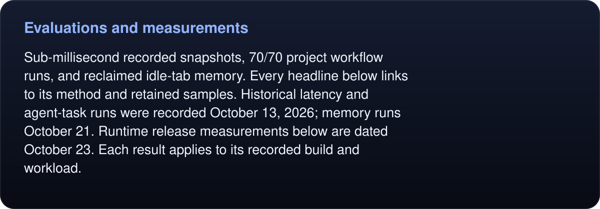
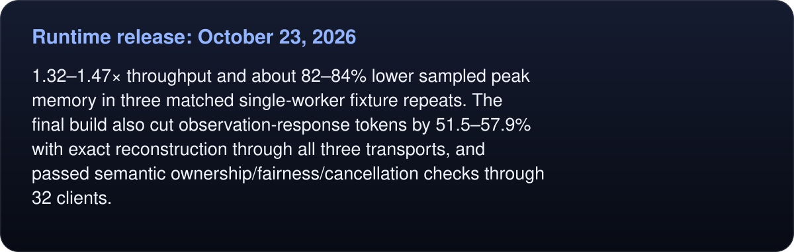
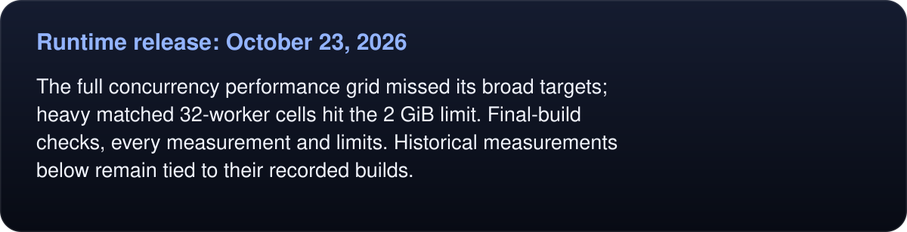
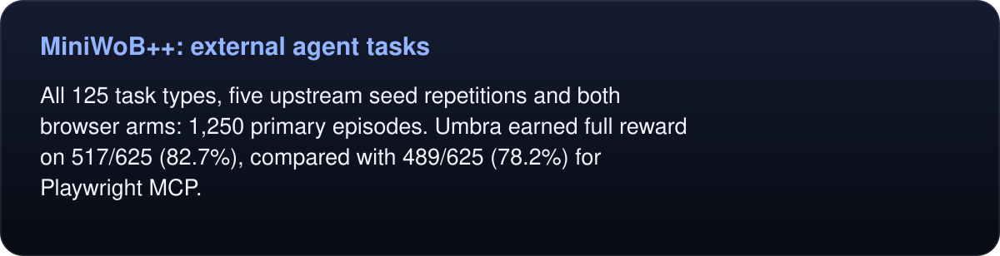
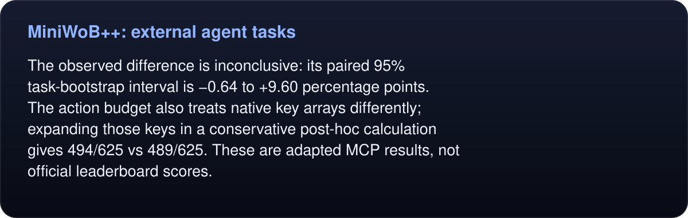
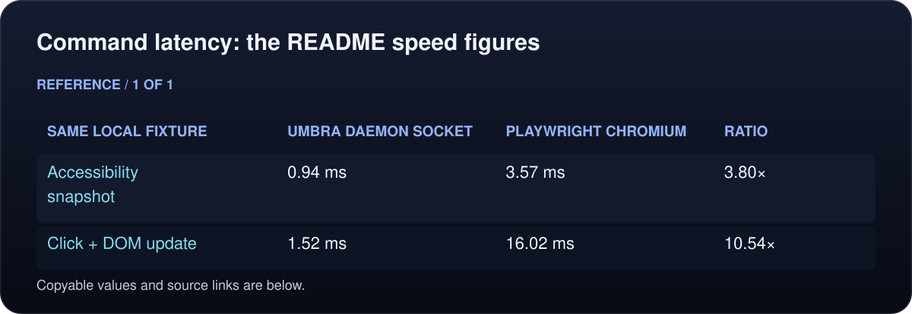
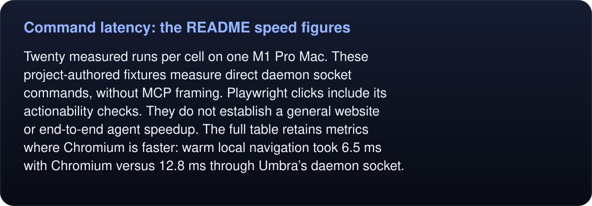
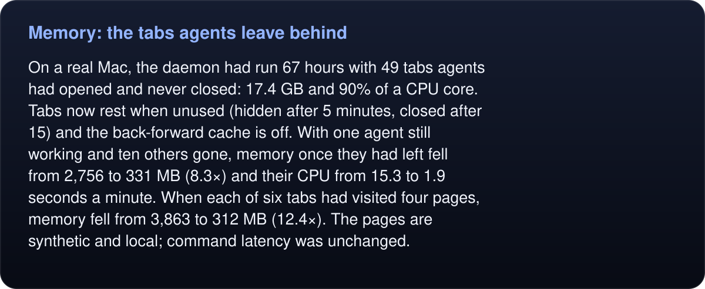
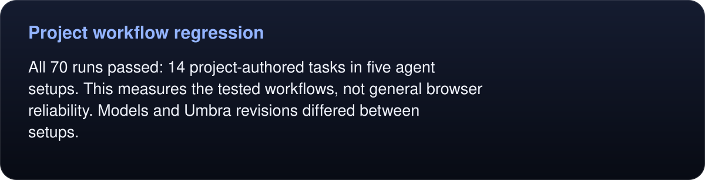

# Evaluations and measurements

<!-- umbra-figure: docs-evaluation-readme-facts-bd83ce338a -->
<picture>
  <source media="(max-width: 600px)" srcset="../../assets/docs/docs-evaluation-readme-facts-bd83ce338a-1-mobile-7837cdbf2d.svg">
  
</picture>

Read the text, values and source links

**Sub-millisecond recorded snapshots, 70/70 project workflow runs, and reclaimed idle-tab memory.** Every headline below links to its method and retained samples. Historical latency and agent-task runs were recorded October 13, 2026; memory runs October 21. Runtime release measurements below are dated October 23. Each result applies to its recorded build and workload.

<!-- /umbra-figure -->

## Runtime release: October 23, 2026

<!-- umbra-figure: docs-evaluation-readme-facts-e903cd9229 -->
<picture>
  <source media="(max-width: 600px)" srcset="../../assets/docs/docs-evaluation-readme-facts-e903cd9229-1-mobile-0f90f4d678.svg">
  
</picture>

Read the text, values and source links

**1.32–1.47× throughput and about 82–84% lower sampled peak memory** in three matched single-worker fixture repeats. The final build also cut observation-response tokens by **51.5–57.9%** with exact reconstruction through all three transports, and passed semantic ownership/fairness/cancellation checks through **32 clients**.

<!-- /umbra-figure -->

<!-- umbra-figure: docs-evaluation-readme-facts-de526ada8a -->
<picture>
  <source media="(max-width: 600px)" srcset="../../assets/docs/docs-evaluation-readme-facts-de526ada8a-1-mobile-dd1eb5b7a1.svg">
  
</picture>

Read the text, values and source links

The full concurrency performance grid missed its broad targets; heavy matched 32-worker cells hit the 2 GiB limit. [Final-build checks, every measurement and limits](runtime/RESULTS.md). Historical measurements below remain tied to their recorded builds.

<!-- /umbra-figure -->

## MiniWoB++: external agent tasks

<!-- umbra-figure: docs-evaluation-readme-facts-64ef5618d0 -->
<picture>
  <source media="(max-width: 600px)" srcset="../../assets/docs/docs-evaluation-readme-facts-64ef5618d0-1-mobile-5ea4c3bbae.svg">
  
</picture>

Read the text, values and source links

All 125 task types, five upstream seed repetitions and both browser arms: **1,250 primary episodes**. Umbra earned full reward on **517/625 (82.7%)**, compared with **489/625 (78.2%)** for Playwright MCP.

<!-- /umbra-figure -->

<!-- umbra-figure: docs-evaluation-readme-facts-830896f5ea -->
<picture>
  <source media="(max-width: 600px)" srcset="../../assets/docs/docs-evaluation-readme-facts-830896f5ea-1-mobile-18ea9cb4b7.svg">
  
</picture>

Read the text, values and source links

The observed difference is inconclusive: its paired 95% task-bootstrap interval is **−0.64 to +9.60 percentage points**. The action budget also treats native key arrays differently; expanding those keys in a conservative post-hoc calculation gives **494/625 vs 489/625**. These are adapted MCP results, not official leaderboard scores.

<!-- /umbra-figure -->

- [Full results, failures, sensitivity and per-task table](miniwob/2026-10-13/RESULTS.md)
- [Protocol, benchmark selection and reproduction](protocol.md)
- [Verification and retained raw evidence](miniwob/2026-10-13/VERIFICATION.md)
- [Every episode](miniwob/2026-10-13/results.json), [summary](miniwob/2026-10-13/summary.json), [frozen manifest](miniwob/2026-10-13/manifest.json), [raw evidence hashes](miniwob/2026-10-13/evidence-hashes.json)
<!-- umbra-figure: docs-evaluation-readme-facts-e77228fd68 -->
<picture>
  <source media="(max-width: 600px)" srcset="../../assets/docs/docs-evaluation-readme-facts-e77228fd68-1-mobile-83c702fbfc.svg">
  
</picture>

Read the text, values and source links

- [Supplementary serialized clipboard diagnostic](miniwob/2026-10-13/clipboard-serial/RESULTS.md): 10/10 full reward for each arm; primary results remain unchanged.

<!-- /umbra-figure -->

## Command latency: the README speed figures

[Full comparison and methodology](latency/README.md) · [measurement receipt](latency/RESULTS.md) · [all samples](latency/results.json)

The showcase ratios use the recorded medians, before rounding:

<!-- umbra-figure: docs-evaluation-readme-table-d0d8b63626 -->
<picture>
  <source media="(max-width: 600px)" srcset="../../assets/docs/docs-evaluation-readme-table-d0d8b63626-1-mobile-c8fc4fcd29.svg">
  
</picture>

Read the text, values and source links

- **Same local fixture:** Accessibility snapshot
- **Umbra daemon socket:** 0.94 ms
- **Playwright Chromium:** 3.57 ms
- **Ratio:** 3.80×

- **Same local fixture:** Click + DOM update
- **Umbra daemon socket:** 1.52 ms
- **Playwright Chromium:** 16.02 ms
- **Ratio:** 10.54×

<!-- /umbra-figure -->

<!-- umbra-figure: docs-evaluation-readme-facts-aad7a3ecaa -->
<picture>
  <source media="(max-width: 600px)" srcset="../../assets/docs/docs-evaluation-readme-facts-aad7a3ecaa-1-mobile-0b8fe4b6a6.svg">
  
</picture>

Read the text, values and source links

Twenty measured runs per cell on one M1 Pro Mac. These project-authored fixtures measure direct daemon socket commands, without MCP framing. Playwright clicks include its actionability checks. They do not establish a general website or end-to-end agent speedup. The full table retains metrics where Chromium is faster: warm local navigation took 6.5 ms with Chromium versus 12.8 ms through Umbra’s daemon socket.

<!-- /umbra-figure -->

## Memory: the tabs agents leave behind

[Findings, method and limits](memory/README.md) · [every sample](memory/results.json)

<!-- umbra-figure: docs-evaluation-readme-facts-fdd1f381a8 -->
<picture>
  <source media="(max-width: 600px)" srcset="../../assets/docs/docs-evaluation-readme-facts-fdd1f381a8-1-mobile-0a6e372103.svg">
  
</picture>

Read the text, values and source links

On a real Mac, the daemon had run 67 hours with 49 tabs agents had opened and never closed: 17.4 GB and 90% of a CPU core. Tabs now rest when unused (hidden after 5 minutes, closed after 15) and the back-forward cache is off. With one agent still working and ten others gone, memory once they had left fell from **2,756 to 331 MB** (8.3×) and their CPU from **15.3 to 1.9 seconds a minute**. When each of six tabs had visited four pages, memory fell from **3,863 to 312 MB** (12.4×). The pages are synthetic and local; command latency was unchanged.

<!-- /umbra-figure -->

## Project workflow regression

[Agent setups and coverage](regression/README.md) · [full report](regression/RESULTS.md) · [scores](regression/scores.json) · [fixture and graders](proving-ground.md)

<!-- umbra-figure: docs-evaluation-readme-facts-e583a7903f -->
<picture>
  <source media="(max-width: 600px)" srcset="../../assets/docs/docs-evaluation-readme-facts-e583a7903f-1-mobile-24726ab647.svg">
  
</picture>

Read the text, values and source links

All 70 runs passed: 14 project-authored tasks in five agent setups. This measures the tested workflows, not general browser reliability. Models and Umbra revisions differed between setups.

<!-- /umbra-figure -->

## Testing and development

[Local test suites, build commands and SVG generation](../development.md) · [security and limitations](../security.md)
