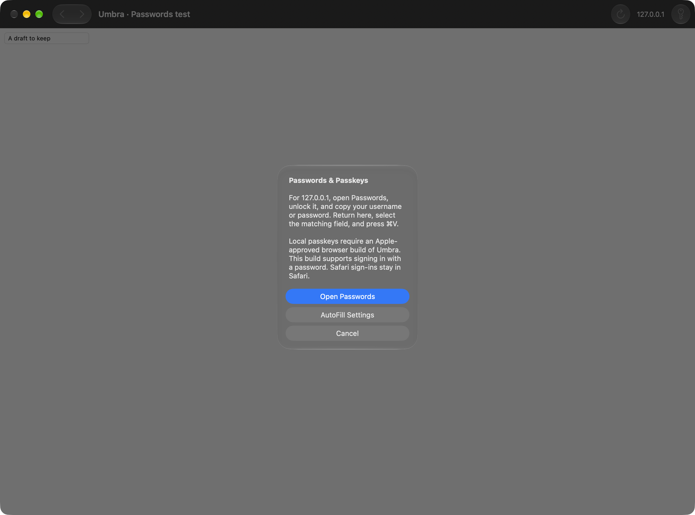

# Passwords and passkey integration

The requested outcome is Safari-like sign-in in Umbra: use the same signed-in sessions, or use Apple Passwords/passkeys without typing credentials. **That complete outcome is blocked by platform access requirements.** The local implementation provides a Passwords handoff and conditional native passkey authorization, not automatic password filling or Safari session synchronization.

## Architecture decision

Two alternatives were considered within one implementation review:

| Alternative | Boundary and result |
| --- | --- |
| Share Safari sessions | Umbra owns a separate `WKWebsiteDataStore` per profile. WKWebView does not expose Safari's store. `ASWebAuthenticationSession` can reuse browser sign-in during a cooperating OAuth flow, but its callback does not export arbitrary website sessions into Umbra. No cookie import or Safari automation was added. |
| Use system credentials | WKWebView handles a site's WebAuthn ceremony. Access to local passkeys for arbitrary relying parties needs Apple's restricted browser entitlement and user permission. Password sharing through `ASAuthorizationPasswordProvider` requires an app identity and website associations, not arbitrary domains. The local implementation uses the public browser authorization manager only when the executable is entitled and otherwise offers the Passwords app for manual copy/paste. |

`BrowserView` already owns each visible sign-in, popup and handoff page. Its key button and View menu action show `BrowserCredentials` in that window. The helper reads the executable's signing entitlements using Security.framework; an unentitled build never calls the browser credential manager. An entitled build distinguishes not determined, authorized and denied access. Only an explicit **Allow Passkeys** click requests access. Website JavaScript and WebKit retain ownership of the actual WebAuthn request and result. No credential list, password, cookie value or clipboard contents pass through this helper or a CLI/MCP result.

The Passwords action launches `com.apple.Passwords` with `NSWorkspace`; on macOS 14 the helper points to System Settings instead. The person unlocks Passwords and copies/pastes into the page. This does not provide Safari's automatic suggestions or save-password prompts. The existing handoff cleanup dismisses any attached helper sheet and restores the same page.

## Platform evidence

- Apple's [browser passkey documentation](https://developer.apple.com/documentation/authenticationservices/passkey-use-in-web-browsers) assigns WKWebView the WebAuthn ceremony and the browser credential manager the user's access permission.
- Apple's [browser entitlement requirements](https://developer.apple.com/documentation/bundleresources/entitlements/com.apple.developer.web-browser.public-key-credential) require an organization account holder's request and Apple approval. Requirements also include HTTP/HTTPS registration and a browser entry surface. Adding a boolean entitlement to an ad hoc build is insufficient.
- Apple's [saved password access model](https://support.apple.com/guide/security/app-access-to-saved-passwords-sec8762eb992/web) requires app and website approval, plus the user's consent.
- A disposable ad hoc native app on this Mac called `ASAuthorizationPasswordProvider` without reading credentials. It returned AuthenticationServices error 1004: the calling process has no application identifier. This proves the current signing gap; it does not establish what an approved browser build would show.

## Remaining requirements

Full native passkey verification needs an Apple-approved organization account capability, a matching provisioning profile, and a correctly signed Umbra build. HTTP/HTTPS URL handling and the browser entry surface must meet Apple's requirements before requesting the capability; this change does not claim Umbra is eligible or approved. Keep the existing bundle identifier so Umbra's profile stores remain attached to the same app identity. Do not apply the restricted entitlement to the ordinary ad hoc build.

An approved build must then be tested for permission approval/denial, passkey creation and assertion against a local WebAuthn relying party, cancellation, navigation, popup handling, and a real user-approved sign-in. These paths remain **BLOCKED**, not passed. Safari-style password AutoFill additionally needs a supported credential-provider/browser integration; the passkey entitlement alone is not proof of password AutoFill.

## Verification

Pre-commit verification on macOS 27.0.1 used the ad hoc development build, based on `1a6ef96788ea9aa2fd5eac97eefb346ba1edd1d7` with the local changes in this working tree. Binary SHA-256: `7e0c7db8fef7fd0e5d5801af4ae0a33515aac9d88ec77d0018e7f8e2c170f39e`. The [machine receipt](receipt.json) also records source digests and the delivery state at the time of that verification.

| Check | Result |
| --- | --- |
| `make build`; `codesign --verify --strict build/Umbra.app` | PASS ([build log](build.log)) |
| `tests/run.sh` | PASS: 428 tests across 22 suites, two skips; smoke checks passed ([full log](full-suite.log)) |
| Visible native journey, `UMBRA_TEST_GUI=1` | PASS: five tests ([log](native.log)). Key button, native Passwords launch, cancel, form preservation, helper-sheet cleanup, scrolling/shortcuts, handoff and sign-in popups. The test did not unlock Passwords or select a credential. |
| Hidden helper, `python3 tests/test_daemon.py -v CredentialsTests` | PASS ([log](hidden.log)): transparent sheet, no foreground activation, form preservation and cleanup. The new regression caught an opaque NSAlert before the visibility fix. |
| Script-checked session fixture | PASS: three focused repetitions ([log](auth-handshake.log)); all original assertions retained |
| Native passkey approval/denial and login | BLOCKED: approved signing entitlement and profile unavailable |
| Automatic password filling; Safari session mirroring | NOT IMPLEMENTED |

Independent source review found an accidentally removed existing viewport assertion; it was restored before this verification. The first full run also exposed a timer race in an existing sign-in fixture: a 1.5-second cookie timer could elapse before a throttled auth probe. The fixture now waits for an actual unauthenticated probe with the fresh session, with a bounded wait, before granting verification. Production authentication behavior is unchanged. The reviewer confirmed both corrections and reported no remaining actionable findings.

The visible native command was `UMBRA_TEST_GUI=1 UMBRA_CREDENTIALS_EVIDENCE=/tmp/umbra-credentials-evidence python3 tests/test_daemon.py -v CredentialsTests HumanBrowserTests SignInWindowTests.test_sign_in_popup_keeps_its_opener_and_can_close_itself SessionCommandTests.test_handoff_preserves_the_agents_viewport_and_form SessionCommandTests.test_handoff_popups_are_visible_and_hide_with_the_parent`.

All web fixtures were on 127.0.0.1 with throwaway profiles. Test cleanup completed, and no development-build daemon remained. The default profile and installed application were excluded. The receipt captures the pre-commit verification state. Commit and push state are recorded by Git; this change does not install or replace the running app.

