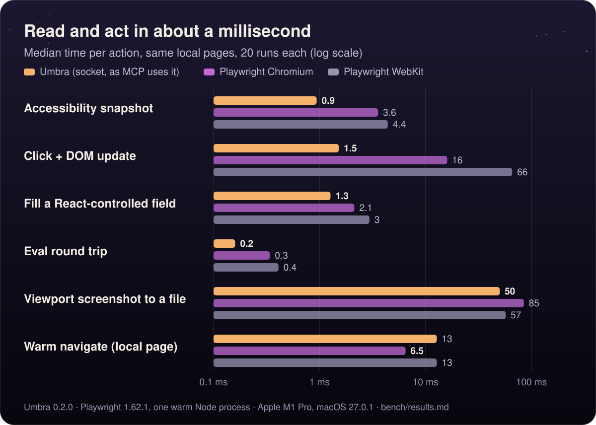
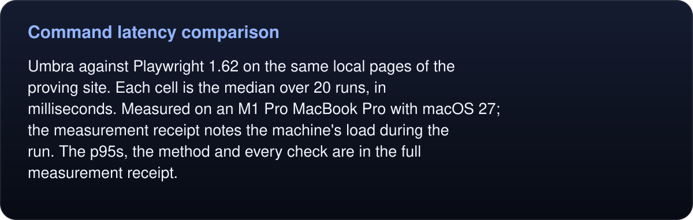
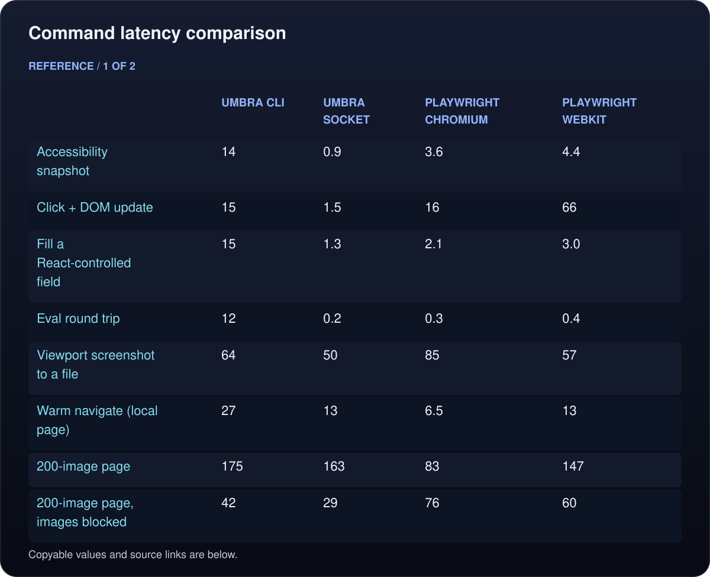
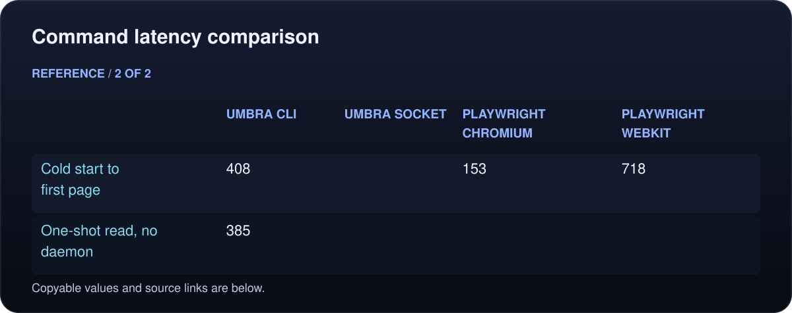
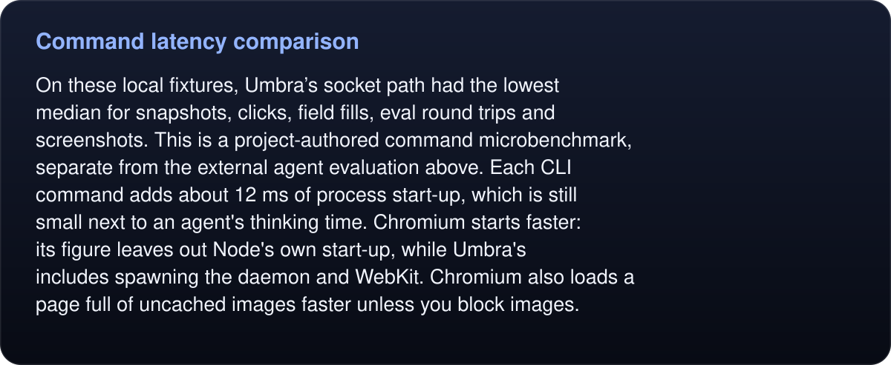

# Command latency comparison

  <picture>
    <source media="(max-width: 600px)" srcset="../../../assets/speed-mobile.svg">
    
  </picture>

<!-- umbra-figure: docs-evaluation-latency-readme-facts-7df7d96a9a -->
<picture>
  <source media="(max-width: 600px)" srcset="../../../assets/docs/docs-evaluation-latency-readme-facts-7df7d96a9a-1-mobile-131c8526ec.svg">
  
</picture>

Read the text, values and source links

Umbra against Playwright 1.62 on the same local pages of the proving site. Each cell is the median over 20 runs, in milliseconds. Measured on an M1 Pro MacBook Pro with macOS 27; the measurement receipt notes the machine's load during the run. The p95s, the method and every check are in [the full measurement receipt](RESULTS.md).

<!-- /umbra-figure -->

<!-- umbra-figure: docs-evaluation-latency-readme-table-d715888b9f -->
<picture>
  <source media="(max-width: 600px)" srcset="../../../assets/docs/docs-evaluation-latency-readme-table-d715888b9f-1-mobile-14f83e4e9d.svg">
  
</picture>

<picture>
  <source media="(max-width: 600px)" srcset="../../../assets/docs/docs-evaluation-latency-readme-table-d715888b9f-2-mobile-e99ebaa120.svg">
  
</picture>

Read the text, values and source links

- **:** Accessibility snapshot
- **Umbra CLI:** 14
- **Umbra socket:** **0.9**
- **Playwright Chromium:** 3.6
- **Playwright WebKit:** 4.4

- **:** Click + DOM update
- **Umbra CLI:** 15
- **Umbra socket:** **1.5**
- **Playwright Chromium:** 16
- **Playwright WebKit:** 66

- **:** Fill a React-controlled field
- **Umbra CLI:** 15
- **Umbra socket:** **1.3**
- **Playwright Chromium:** 2.1
- **Playwright WebKit:** 3.0

- **:** Eval round trip
- **Umbra CLI:** 12
- **Umbra socket:** **0.2**
- **Playwright Chromium:** 0.3
- **Playwright WebKit:** 0.4

- **:** Viewport screenshot to a file
- **Umbra CLI:** 64
- **Umbra socket:** **50**
- **Playwright Chromium:** 85
- **Playwright WebKit:** 57

- **:** Warm navigate (local page)
- **Umbra CLI:** 27
- **Umbra socket:** 13
- **Playwright Chromium:** **6.5**
- **Playwright WebKit:** 13

- **:** 200-image page
- **Umbra CLI:** 175
- **Umbra socket:** 163
- **Playwright Chromium:** **83**
- **Playwright WebKit:** 147

- **:** 200-image page, images blocked
- **Umbra CLI:** 42
- **Umbra socket:** **29**
- **Playwright Chromium:** 76
- **Playwright WebKit:** 60

- **:** Cold start to first page
- **Umbra CLI:** 408
- **Umbra socket:**
- **Playwright Chromium:** **153**
- **Playwright WebKit:** 718

- **:** One-shot `read`, no daemon
- **Umbra CLI:** 385
- **Umbra socket:**
- **Playwright Chromium:**
- **Playwright WebKit:**

<!-- /umbra-figure -->

<!-- umbra-figure: docs-evaluation-latency-readme-facts-7c6fb84bbe -->
<picture>
  <source media="(max-width: 600px)" srcset="../../../assets/docs/docs-evaluation-latency-readme-facts-7c6fb84bbe-1-mobile-25b54349e6.svg">
  
</picture>

Read the text, values and source links

On these local fixtures, Umbra’s socket path had the lowest median for snapshots, clicks, field fills, eval round trips and screenshots. This is a project-authored command microbenchmark, separate from the external agent evaluation above. Each CLI command adds about 12 ms of process start-up, which is still small next to an agent's thinking time. Chromium starts faster: its figure leaves out Node's own start-up, while Umbra's includes spawning the daemon and WebKit. Chromium also loads a page full of uncached images faster unless you `block images`.

<!-- /umbra-figure -->
