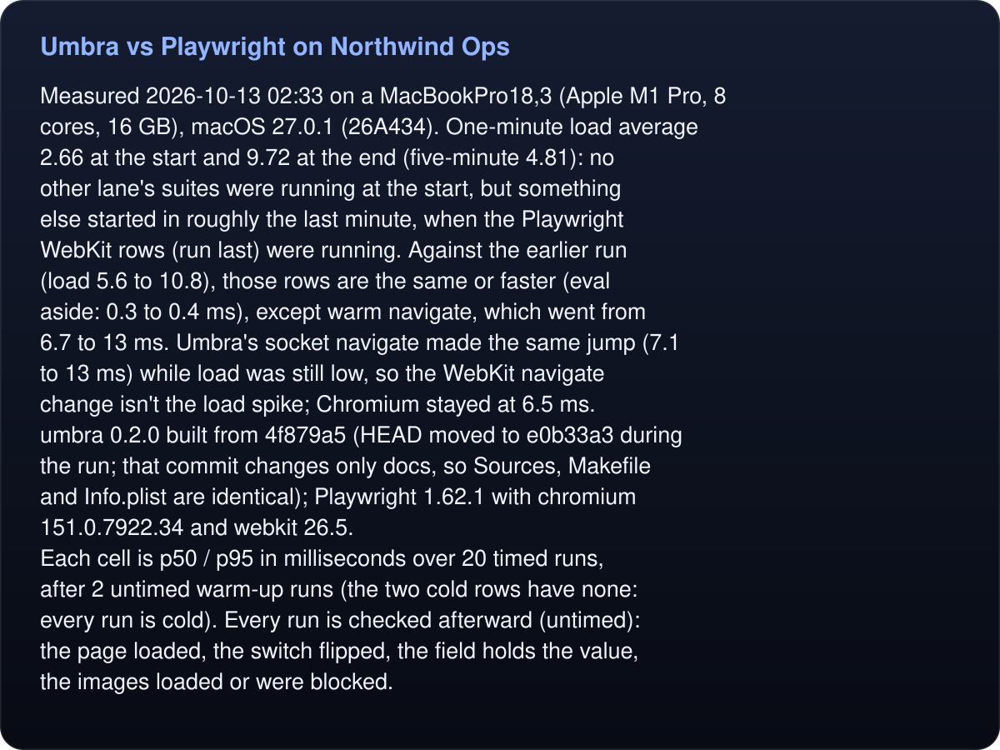
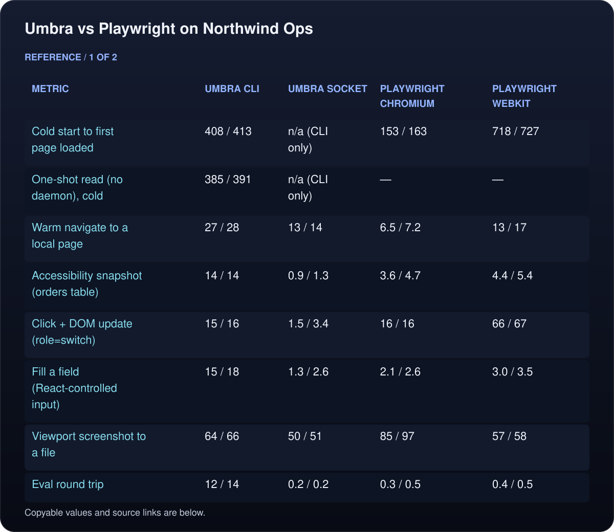
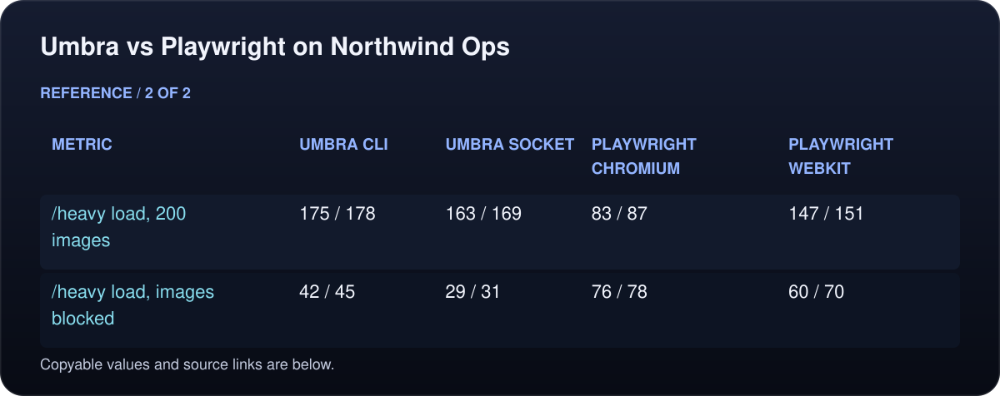
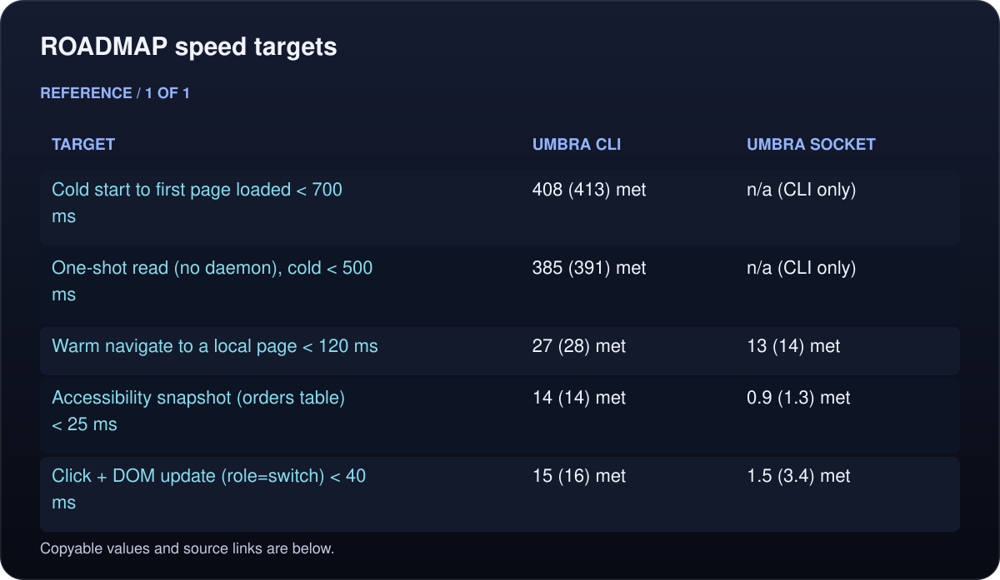

# Umbra vs Playwright on Northwind Ops

<!-- umbra-figure: docs-evaluation-latency-results-facts-e563211d98 -->
<picture>
  <source media="(max-width: 600px)" srcset="../../../assets/docs/docs-evaluation-latency-results-facts-e563211d98-1-mobile-d64cd90248.svg">
  
</picture>

Read the text, values and source links

Measured 2026-10-13 02:33 on a MacBookPro18,3 (Apple M1 Pro, 8 cores, 16 GB), macOS 27.0.1 (26A434). One-minute load average 2.66 at the start and 9.72 at the end (five-minute 4.81): no other lane's suites were running at the start, but something else started in roughly the last minute, when the Playwright WebKit rows (run last) were running. Against the earlier run (load 5.6 to 10.8), those rows are the same or faster (eval aside: 0.3 to 0.4 ms), except warm navigate, which went from 6.7 to 13 ms. Umbra's socket navigate made the same jump (7.1 to 13 ms) while load was still low, so the WebKit navigate change isn't the load spike; Chromium stayed at 6.5 ms.
umbra 0.2.0 built from 4f879a5 (HEAD moved to e0b33a3 during the run; that commit changes only docs, so Sources, Makefile and Info.plist are identical); Playwright 1.62.1 with chromium 151.0.7922.34 and webkit 26.5.
Each cell is p50 / p95 in milliseconds over 20 timed runs, after 2 untimed warm-up runs (the two cold rows have none: every run is cold). Every run is checked afterward (untimed): the page loaded, the switch flipped, the field holds the value, the images loaded or were blocked.

<!-- /umbra-figure -->

<!-- umbra-figure: docs-evaluation-latency-results-table-22b4397105 -->
<picture>
  <source media="(max-width: 600px)" srcset="../../../assets/docs/docs-evaluation-latency-results-table-22b4397105-1-mobile-4c1e3d9847.svg">
  
</picture>

<picture>
  <source media="(max-width: 600px)" srcset="../../../assets/docs/docs-evaluation-latency-results-table-22b4397105-2-mobile-aecaa521e9.svg">
  
</picture>

Read the text, values and source links

- **Metric:** Cold start to first page loaded
- **Umbra CLI:** 408 / 413
- **Umbra socket:** n/a (CLI only)
- **Playwright Chromium:** 153 / 163
- **Playwright WebKit:** 718 / 727

- **Metric:** One-shot read (no daemon), cold
- **Umbra CLI:** 385 / 391
- **Umbra socket:** n/a (CLI only)
- **Playwright Chromium:** —
- **Playwright WebKit:** —

- **Metric:** Warm navigate to a local page
- **Umbra CLI:** 27 / 28
- **Umbra socket:** 13 / 14
- **Playwright Chromium:** 6.5 / 7.2
- **Playwright WebKit:** 13 / 17

- **Metric:** Accessibility snapshot (orders table)
- **Umbra CLI:** 14 / 14
- **Umbra socket:** 0.9 / 1.3
- **Playwright Chromium:** 3.6 / 4.7
- **Playwright WebKit:** 4.4 / 5.4

- **Metric:** Click + DOM update (role=switch)
- **Umbra CLI:** 15 / 16
- **Umbra socket:** 1.5 / 3.4
- **Playwright Chromium:** 16 / 16
- **Playwright WebKit:** 66 / 67

- **Metric:** Fill a field (React-controlled input)
- **Umbra CLI:** 15 / 18
- **Umbra socket:** 1.3 / 2.6
- **Playwright Chromium:** 2.1 / 2.6
- **Playwright WebKit:** 3.0 / 3.5

- **Metric:** Viewport screenshot to a file
- **Umbra CLI:** 64 / 66
- **Umbra socket:** 50 / 51
- **Playwright Chromium:** 85 / 97
- **Playwright WebKit:** 57 / 58

- **Metric:** Eval round trip
- **Umbra CLI:** 12 / 14
- **Umbra socket:** 0.2 / 0.2
- **Playwright Chromium:** 0.3 / 0.5
- **Playwright WebKit:** 0.4 / 0.5

- **Metric:** /heavy load, 200 images
- **Umbra CLI:** 175 / 178
- **Umbra socket:** 163 / 169
- **Playwright Chromium:** 83 / 87
- **Playwright WebKit:** 147 / 151

- **Metric:** /heavy load, images blocked
- **Umbra CLI:** 42 / 45
- **Umbra socket:** 29 / 31
- **Playwright Chromium:** 76 / 78
- **Playwright WebKit:** 60 / 70

<!-- /umbra-figure -->

## ROADMAP speed targets

p50 against the target; p95 in parentheses.

<!-- umbra-figure: docs-evaluation-latency-results-table-faa415e590 -->
<picture>
  <source media="(max-width: 600px)" srcset="../../../assets/docs/docs-evaluation-latency-results-table-faa415e590-1-mobile-c0897a541f.svg">
  
</picture>

Read the text, values and source links

- **Target:** Cold start to first page loaded < 700 ms
- **Umbra CLI:** 408 (413) met
- **Umbra socket:** n/a (CLI only)

- **Target:** One-shot read (no daemon), cold < 500 ms
- **Umbra CLI:** 385 (391) met
- **Umbra socket:** n/a (CLI only)

- **Target:** Warm navigate to a local page < 120 ms
- **Umbra CLI:** 27 (28) met
- **Umbra socket:** 13 (14) met

- **Target:** Accessibility snapshot (orders table) < 25 ms
- **Umbra CLI:** 14 (14) met
- **Umbra socket:** 0.9 (1.3) met

- **Target:** Click + DOM update (role=switch) < 40 ms
- **Umbra CLI:** 15 (16) met
- **Umbra socket:** 1.5 (3.4) met

<!-- /umbra-figure -->

## What each path measures

- **Umbra CLI**: wall time of `umbra <command>` as a fresh process, as an agent's shell tool runs it (process start, connecting to the daemon, the command, printing). Cold start runs `umbra stop` first and waits for the daemon to exit, so it includes spawning the daemon and starting WebKit.
- **Umbra socket**: one persistent connection to the daemon's unix socket, one JSON line per command (what `umbra mcp` and other long-lived clients pay).
- **Playwright**: one persistent Node process per browser (`bench/pw.js`), headless, its best case. Cold start is `launch()` + `newContext()` + `newPage()` + `goto()` inside that process; Node's own start-up is not counted. Each context is non-persistent, so every launch uses a fresh temporary profile.

## Notes

- One-shot read: `umbra read <url> < /dev/null` with no daemon running, so it starts WebKit in its own process, loads /login and prints the HTML. Each run stops the daemon first and checks that none was started. Playwright has no counterpart row; its cold start row is the nearest comparison.
- Accessibility snapshot: Umbra `snapshot` against Playwright `page.locator('body').ariaSnapshot()` on /app/orders with 10 rows loaded.
- Click: the settings page's `role=switch` button, whose handler flips `aria-checked` synchronously. Playwright's click includes its actionability checks.
- Fill: the settings page's React-style controlled input, which ignores `.value` writes the framework never sees.
<!-- umbra-figure: docs-evaluation-latency-results-facts-233ae20ffa -->
<picture>
  <source media="(max-width: 600px)" srcset="../../../assets/docs/docs-evaluation-latency-results-facts-233ae20ffa-1-mobile-ab301125e8.svg">
  
</picture>

Read the text, values and source links

- Screenshots are the 1280×900 viewport at device pixel ratio 2 for every browser, written to a PNG file.

<!-- /umbra-figure -->
<!-- umbra-figure: docs-evaluation-latency-results-facts-425f64c489 -->
<picture>
  <source media="(max-width: 600px)" srcset="../../../assets/docs/docs-evaluation-latency-results-facts-425f64c489-1-mobile-288a901aad.svg">
  
</picture>

Read the text, values and source links

- Image blocking: Umbra `block images`; Playwright `page.route()` aborting image URLs (a glob, so other requests are not intercepted). The page serves 200 incompressible 96×96 PNGs (about 4.9 MB) with `Cache-Control: no-store`.

<!-- /umbra-figure -->
- The site is `bench/site/server.py` (Python, threaded, HTTP/1.1 keep-alive) on 127.0.0.1.
- "n/a (not built)" means the Umbra build lacks a command that metric needs; rerun once it lands.
