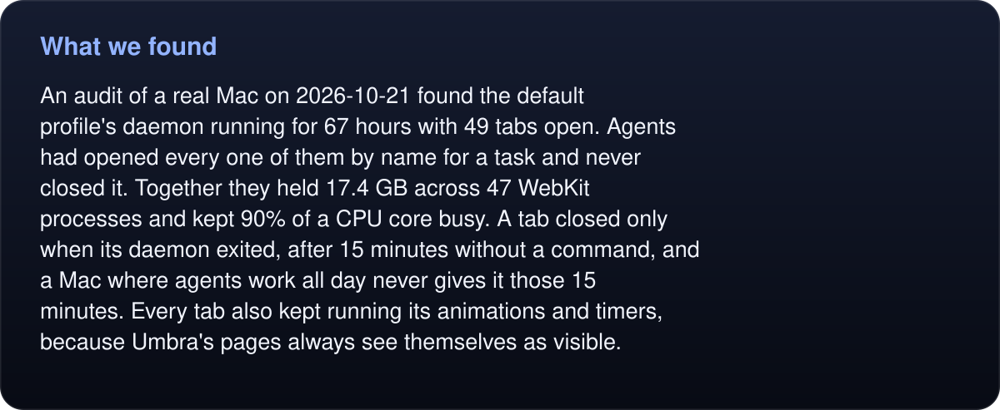
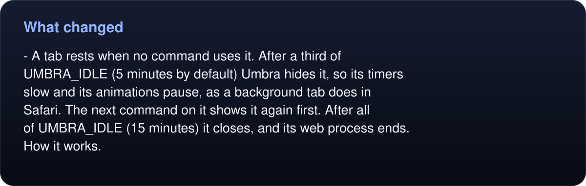
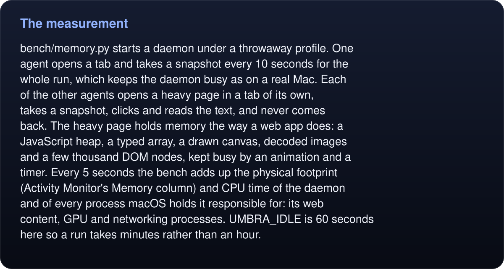
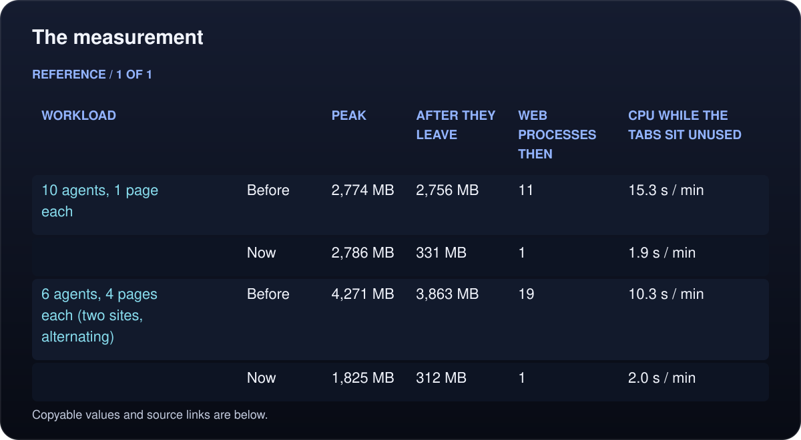
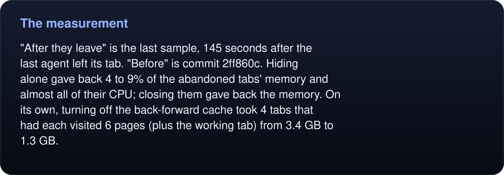
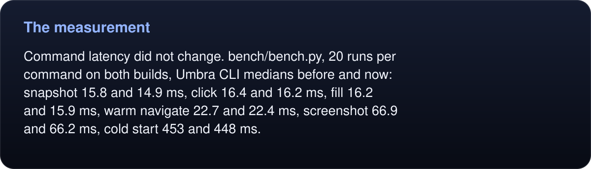

# Memory: the tabs agents leave behind

<p align="center">
  <picture>
    <source media="(max-width: 600px)" srcset="../../../assets/memory-mobile.svg">
    
  </picture>
</p>

## What we found

<!-- umbra-figure: docs-evaluation-memory-readme-facts-a5e21329cc -->
<picture>
  <source media="(max-width: 600px)" srcset="../../../assets/docs/docs-evaluation-memory-readme-facts-a5e21329cc-1-mobile-d5e99ba7ef.svg">
  
</picture>

<details>
<summary>Read the text, values and source links</summary>

An audit of a real Mac on 2026-10-21 found the default profile's daemon running for 67 hours with 49 tabs open. Agents had opened every one of them by name for a task and never closed it. Together they held 17.4 GB across 47 WebKit processes and kept 90% of a CPU core busy. A tab closed only when its daemon exited, after 15 minutes without a command, and a Mac where agents work all day never gives it those 15 minutes. Every tab also kept running its animations and timers, because Umbra's pages always see themselves as visible.

</details>
<!-- /umbra-figure -->

## What changed

<!-- umbra-figure: docs-evaluation-memory-readme-facts-c1d3e7642b -->
<picture>
  <source media="(max-width: 600px)" srcset="../../../assets/docs/docs-evaluation-memory-readme-facts-c1d3e7642b-1-mobile-74e8d499ec.svg">
  
</picture>

<details>
<summary>Read the text, values and source links</summary>

- **A tab rests when no command uses it.** After a third of `UMBRA_IDLE` (5 minutes by default) Umbra hides it, so its timers slow and its animations pause, as a background tab does in Safari. The next command on it shows it again first. After all of `UMBRA_IDLE` (15 minutes) it closes, and its web process ends. [How it works](../../how-it-works.md#the-daemon).

</details>
<!-- /umbra-figure -->
- **No back-forward cache.** WebKit kept each page a tab left frozen in memory, often in a process of its own, in case the tab went back. Going back now loads the page again, from the HTTP cache where it can.
- **Agents are asked to close their tabs** (`tab close NAME`) in the skill, the MCP instructions and `llms.txt`.

## The measurement

<!-- umbra-figure: docs-evaluation-memory-readme-facts-dd739ae7d3 -->
<picture>
  <source media="(max-width: 600px)" srcset="../../../assets/docs/docs-evaluation-memory-readme-facts-dd739ae7d3-1-mobile-4bec75515a.svg">
  
</picture>

<details>
<summary>Read the text, values and source links</summary>

`bench/memory.py` starts a daemon under a throwaway profile. One agent opens a tab and takes a snapshot every 10 seconds for the whole run, which keeps the daemon busy as on a real Mac. Each of the other agents opens a heavy page in a tab of its own, takes a snapshot, clicks and reads the text, and never comes back. The heavy page holds memory the way a web app does: a JavaScript heap, a typed array, a drawn canvas, decoded images and a few thousand DOM nodes, kept busy by an animation and a timer. Every 5 seconds the bench adds up the physical footprint (Activity Monitor's Memory column) and CPU time of the daemon and of every process macOS holds it responsible for: its web content, GPU and networking processes. `UMBRA_IDLE` is 60 seconds here so a run takes minutes rather than an hour.

</details>
<!-- /umbra-figure -->

<!-- umbra-figure: docs-evaluation-memory-readme-table-3968fb4ad1 -->
<picture>
  <source media="(max-width: 600px)" srcset="../../../assets/docs/docs-evaluation-memory-readme-table-3968fb4ad1-1-mobile-2e03130831.svg">
  
</picture>

<details>
<summary>Read the text, values and source links</summary>

- **Workload:** 10 agents, 1 page each
- **:** Before
- **Peak:** 2,774 MB
- **After they leave:** 2,756 MB
- **Web processes then:** 11
- **CPU while the tabs sit unused:** 15.3 s / min

- **Workload:**
- **:** Now
- **Peak:** 2,786 MB
- **After they leave:** **331 MB**
- **Web processes then:** **1**
- **CPU while the tabs sit unused:** **1.9 s / min**

- **Workload:** 6 agents, 4 pages each (two sites, alternating)
- **:** Before
- **Peak:** 4,271 MB
- **After they leave:** 3,863 MB
- **Web processes then:** 19
- **CPU while the tabs sit unused:** 10.3 s / min

- **Workload:**
- **:** Now
- **Peak:** **1,825 MB**
- **After they leave:** **312 MB**
- **Web processes then:** **1**
- **CPU while the tabs sit unused:** **2.0 s / min**

</details>
<!-- /umbra-figure -->

<!-- umbra-figure: docs-evaluation-memory-readme-facts-f2e14c3d16 -->
<picture>
  <source media="(max-width: 600px)" srcset="../../../assets/docs/docs-evaluation-memory-readme-facts-f2e14c3d16-1-mobile-6a421211a4.svg">
  
</picture>

<details>
<summary>Read the text, values and source links</summary>

"After they leave" is the last sample, 145 seconds after the last agent left its tab. "Before" is commit 2ff860c. Hiding alone gave back 4 to 9% of the abandoned tabs' memory and almost all of their CPU; closing them gave back the memory. On its own, turning off the back-forward cache took 4 tabs that had each visited 6 pages (plus the working tab) from 3.4 GB to 1.3 GB.

</details>
<!-- /umbra-figure -->

<!-- umbra-figure: docs-evaluation-memory-readme-facts-c3b30056ad -->
<picture>
  <source media="(max-width: 600px)" srcset="../../../assets/docs/docs-evaluation-memory-readme-facts-c3b30056ad-1-mobile-b636a23109.svg">
  
</picture>

<details>
<summary>Read the text, values and source links</summary>

Command latency did not change. `bench/bench.py`, 20 runs per command on both builds, Umbra CLI medians before and now: snapshot 15.8 and 14.9 ms, click 16.4 and 16.2 ms, fill 16.2 and 15.9 ms, warm navigate 22.7 and 22.4 ms, screenshot 66.9 and 66.2 ms, cold start 453 and 448 ms.

</details>
<!-- /umbra-figure -->

<!-- umbra-figure: docs-evaluation-memory-readme-facts-e8743c7dbc -->
<picture>
  <source media="(max-width: 600px)" srcset="../../../assets/docs/docs-evaluation-memory-readme-facts-e8743c7dbc-1-mobile-37ae4c0249.svg">
  
</picture>

<details>
<summary>Read the text, values and source links</summary>

Every sample, both builds and the latency medians are in [results.json](results.json). Measured on an M1 Pro MacBook Pro with 16 GB and macOS 27.0.1.

</details>
<!-- /umbra-figure -->

## Limits

- The pages are synthetic and local, so a real site's numbers differ. A real site's caches (images, compiled scripts, layers) are larger, so hiding may give back more than it did here; its live JavaScript data is what only closing gives back.
<!-- umbra-figure: docs-evaluation-memory-readme-facts-8273443379 -->
<picture>
  <source media="(max-width: 600px)" srcset="../../../assets/docs/docs-evaluation-memory-readme-facts-8273443379-1-mobile-84fb18e179.svg">
  
</picture>

<details>
<summary>Read the text, values and source links</summary>

- A tab an agent leaves still holds its memory until it closes: 15 minutes by default.

</details>
<!-- /umbra-figure -->
<!-- umbra-figure: docs-evaluation-memory-readme-facts-6b714ef0a4 -->
<picture>
  <source media="(max-width: 600px)" srcset="../../../assets/docs/docs-evaluation-memory-readme-facts-6b714ef0a4-1-mobile-a4527e255f.svg">
  
</picture>

<details>
<summary>Read the text, values and source links</summary>

- Measured but not adopted: one shared WebKit process pool for all tabs. It saves one spare web process (about 7 MB) per tab, through an API Apple has deprecated.

</details>
<!-- /umbra-figure -->

## Run it

```sh
make build
python3 bench/memory.py                                  # 10 agents, 1 page each
python3 bench/memory.py --abandoned 6 --pages 4          # 6 agents, 4 pages each
python3 bench/memory.py --umbra OTHER/Umbra.app/Contents/MacOS/umbra --json run.json
python3 assets/charts.py                                 # redraw the picture from results.json
```
