# MiniWoB++ external evaluation

Status: COMPLETE.

Pinned upstream tasks and BrowserGym setup/validation; fresh Codex sessions with filtered browser MCP tools.

<!-- umbra-figure: docs-evaluation-miniwob-2026-10-13-results-table-0b2e851a58 -->
<picture>
  <source media="(max-width: 600px)" srcset="../../../../assets/docs/docs-evaluation-miniwob-2026-10-13-results-table-0b2e851a58-1-mobile-55e5467d72.svg">
  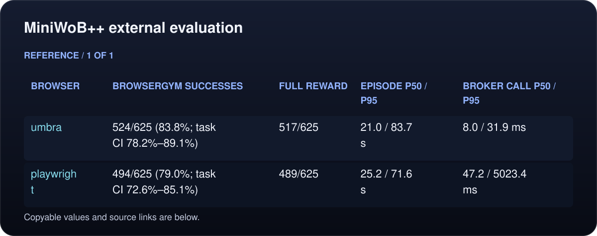
</picture>

Read the text, values and source links

- **Browser:** umbra
- **BrowserGym successes:** 524/625 (83.8%; task CI 78.2%–89.1%)
- **Full reward:** 517/625
- **Episode p50 / p95:** 21.0 / 83.7 s
- **Broker call p50 / p95:** 8.0 / 31.9 ms

- **Browser:** playwright
- **BrowserGym successes:** 494/625 (79.0%; task CI 72.6%–85.1%)
- **Full reward:** 489/625
- **Episode p50 / p95:** 25.2 / 71.6 s
- **Broker call p50 / p95:** 47.2 / 5023.4 ms

<!-- /umbra-figure -->

<!-- umbra-figure: docs-evaluation-miniwob-2026-10-13-results-facts-94e27cd931 -->
<picture>
  <source media="(max-width: 600px)" srcset="../../../../assets/docs/docs-evaluation-miniwob-2026-10-13-results-facts-94e27cd931-1-mobile-5854b4b8ba.svg">
  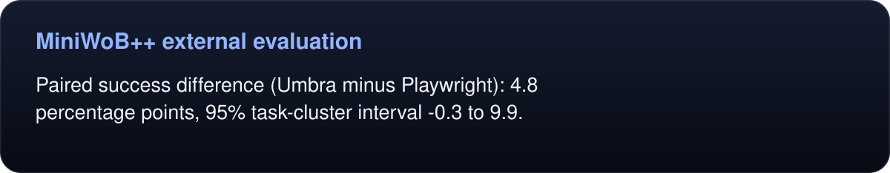
</picture>

Read the text, values and source links

Paired success difference (Umbra minus Playwright): 4.8 percentage points, 95% task-cluster interval -0.3 to 9.9.

<!-- /umbra-figure -->

<!-- umbra-figure: docs-evaluation-miniwob-2026-10-13-results-facts-a2ce5ba6b6 -->
<picture>
  <source media="(max-width: 600px)" srcset="../../../../assets/docs/docs-evaluation-miniwob-2026-10-13-results-facts-a2ce5ba6b6-1-mobile-2c2730ec78.svg">
  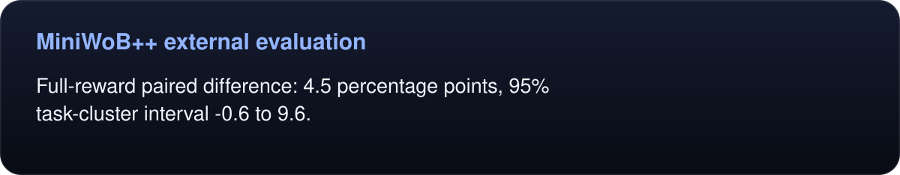
</picture>

Read the text, values and source links

Full-reward paired difference: 4.5 percentage points, 95% task-cluster interval -0.6 to 9.6.

<!-- /umbra-figure -->

Both primary score intervals include zero: these outcomes do not establish superiority. The asymmetric action budget prevents attributing the observed gap solely to browser quality.

## Frozen setup

- Umbra revision: `a215d69297124329c80ba743f773def3c950b257`; binary SHA-256 `96850cf40c9685dd00b40c5bf8304992f3fd2405367092e274534fd8a039c979`.
- MiniWoB++ revision: `33c3b4ddef8c6eb67c57a29663d844b1eda7e614`.
- BrowserGym revision: `e71419aef5759a11cb7896a26c36e5f7e92d82b2`.
- Model: `gpt-6.1-sol`, `high` effort; `codex-cli 0.162.1`.
- Task types: 125; 5 of the standard five repetitions; two arms.
- Upstream task order and RandomState(42) seed schedule preserved. No task excluded after seeing results.
<!-- umbra-figure: docs-evaluation-miniwob-2026-10-13-results-facts-51d50f7cb9 -->
<picture>
  <source media="(max-width: 600px)" srcset="../../../../assets/docs/docs-evaluation-miniwob-2026-10-13-results-facts-51d50f7cb9-1-mobile-2084d79f30.svg">
  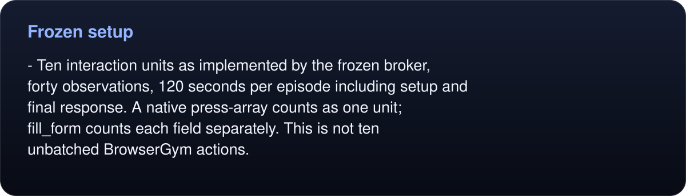
</picture>

Read the text, values and source links

- Ten interaction units as implemented by the frozen broker, forty observations, 120 seconds per episode including setup and final response. A native press-array counts as one unit; fill_form counts each field separately. This is not ten unbatched BrowserGym actions.

<!-- /umbra-figure -->
- Loopback HTTP only; disposable Umbra profiles and Chromium contexts. 4 concurrent episodes.
- No arbitrary JavaScript, filesystem tools, browser navigation, other MCP servers or account access in either arm.
- BrowserGym success is its unchanged `RAW_REWARD_GLOBAL > 0` check on a terminated episode. Full reward requires exactly 1.0.
- Attempts with missing/malformed traces, forbidden filesystem/command tools or another MCP server are invalidated by transcript audit. Started actions are audited even if they never completed.

## Coverage and failures

<!-- umbra-figure: docs-evaluation-miniwob-2026-10-13-results-table-09df2572f0 -->
<picture>
  <source media="(max-width: 600px)" srcset="../../../../assets/docs/docs-evaluation-miniwob-2026-10-13-results-table-09df2572f0-1-mobile-072ecdbf6d.svg">
  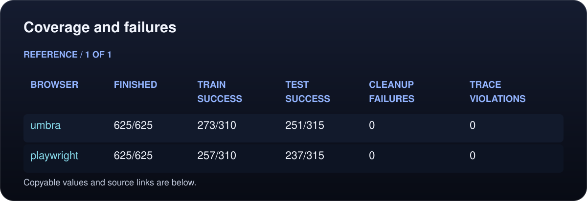
</picture>

Read the text, values and source links

- **Browser:** umbra
- **Finished:** 625/625
- **Train success:** 273/310
- **Test success:** 251/315
- **Cleanup failures:** 0
- **Trace violations:** 0

- **Browser:** playwright
- **Finished:** 625/625
- **Train success:** 257/310
- **Test success:** 237/315
- **Cleanup failures:** 0
- **Trace violations:** 0

<!-- /umbra-figure -->

<!-- umbra-figure: docs-evaluation-miniwob-2026-10-13-results-table-c0cc321306 -->
<picture>
  <source media="(max-width: 600px)" srcset="../../../../assets/docs/docs-evaluation-miniwob-2026-10-13-results-table-c0cc321306-1-mobile-a48931bbba.svg">
  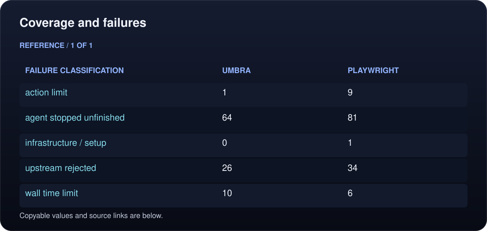
</picture>

Read the text, values and source links

- **Failure classification:** action limit
- **Umbra:** 1
- **Playwright:** 9

- **Failure classification:** agent stopped unfinished
- **Umbra:** 64
- **Playwright:** 81

- **Failure classification:** infrastructure / setup
- **Umbra:** 0
- **Playwright:** 1

- **Failure classification:** upstream rejected
- **Umbra:** 26
- **Playwright:** 34

- **Failure classification:** wall time limit
- **Umbra:** 10
- **Playwright:** 6

<!-- /umbra-figure -->

## Unbatched key-budget sensitivity

Post-hoc conservative diagnostic, not a replacement score: expand each key in a native press-array into its own interaction unit and exclude credit from outcomes reached after ten such units. Other interaction commands count once; fill_form counts fields. This does not rerun the agents with an enforced normalized budget, and counts individual character keys separately even where another typing API could express a string in one action.

<!-- umbra-figure: docs-evaluation-miniwob-2026-10-13-results-table-3e556fa2ad -->
<picture>
  <source media="(max-width: 600px)" srcset="../../../../assets/docs/docs-evaluation-miniwob-2026-10-13-results-table-3e556fa2ad-1-mobile-644f0a334e.svg">
  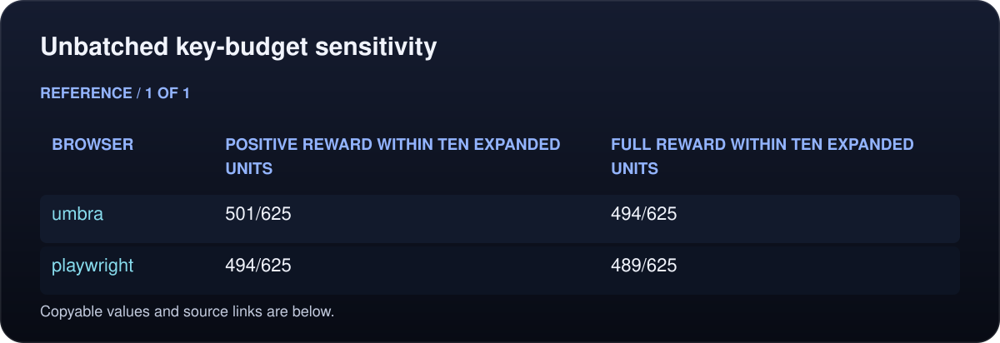
</picture>

Read the text, values and source links

- **Browser:** umbra
- **Positive reward within ten expanded units:** 501/625
- **Full reward within ten expanded units:** 494/625

- **Browser:** playwright
- **Positive reward within ten expanded units:** 494/625
- **Full reward within ten expanded units:** 489/625

<!-- /umbra-figure -->

The primary score remains the frozen protocol score. Its batching asymmetry prevents attributing a score difference solely to browser quality. A prospective comparison with normalized actions is required for that claim.

## Serialized clipboard diagnostic

<!-- umbra-figure: docs-evaluation-miniwob-2026-10-13-results-facts-421f722ffa -->
<picture>
  <source media="(max-width: 600px)" srcset="../../../../assets/docs/docs-evaluation-miniwob-2026-10-13-results-facts-421f722ffa-1-mobile-3701e95a74.svg">
  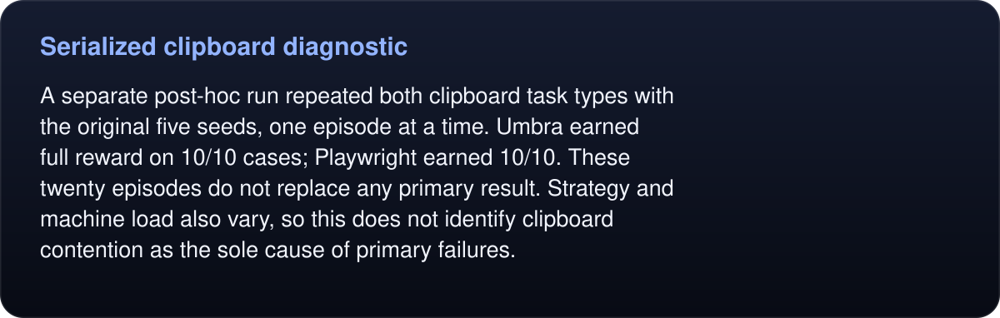
</picture>

Read the text, values and source links

A separate post-hoc run repeated both clipboard task types with the original five seeds, one episode at a time. Umbra earned full reward on 10/10 cases; Playwright earned 10/10. These twenty episodes do not replace any primary result. Strategy and machine load also vary, so this does not identify clipboard contention as the sole cause of primary failures.

<!-- /umbra-figure -->

[Diagnostic report](clipboard-serial/RESULTS.md).

## Per-task results

<!-- umbra-figure: docs-evaluation-miniwob-2026-10-13-results-table-c4f4b9f00b -->
<picture>
  <source media="(max-width: 600px)" srcset="../../../../assets/docs/docs-evaluation-miniwob-2026-10-13-results-table-c4f4b9f00b-1-mobile-cd014d9590.svg">
  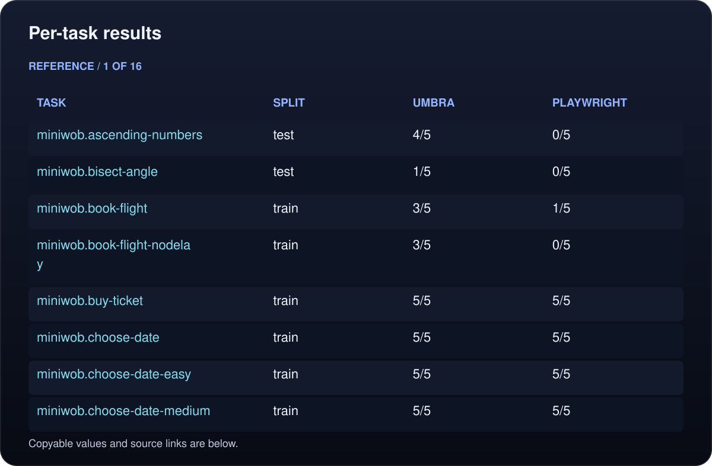
</picture>

<picture>
  <source media="(max-width: 600px)" srcset="../../../../assets/docs/docs-evaluation-miniwob-2026-10-13-results-table-c4f4b9f00b-2-mobile-7f15513cf1.svg">
  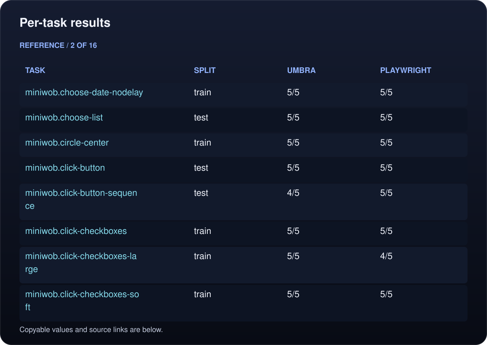
</picture>

<picture>
  <source media="(max-width: 600px)" srcset="../../../../assets/docs/docs-evaluation-miniwob-2026-10-13-results-table-c4f4b9f00b-3-mobile-ddcd361312.svg">
  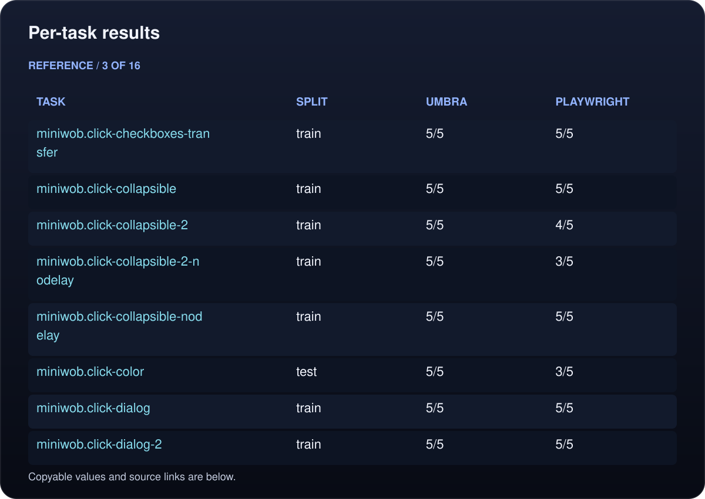
</picture>

<picture>
  <source media="(max-width: 600px)" srcset="../../../../assets/docs/docs-evaluation-miniwob-2026-10-13-results-table-c4f4b9f00b-4-mobile-d878d2651a.svg">
  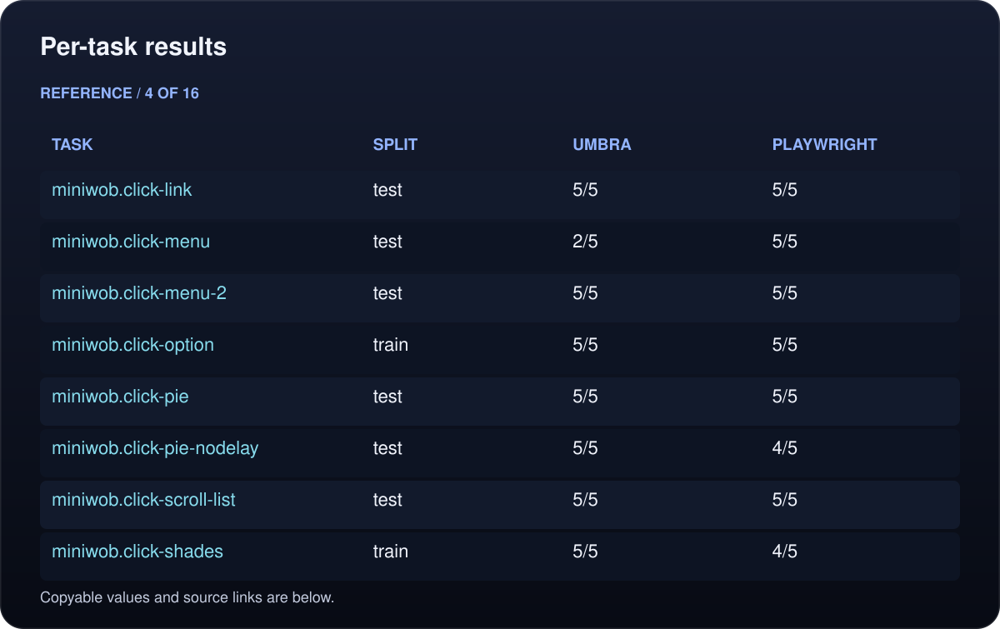
</picture>

<picture>
  <source media="(max-width: 600px)" srcset="../../../../assets/docs/docs-evaluation-miniwob-2026-10-13-results-table-c4f4b9f00b-5-mobile-e3037c0b5f.svg">
  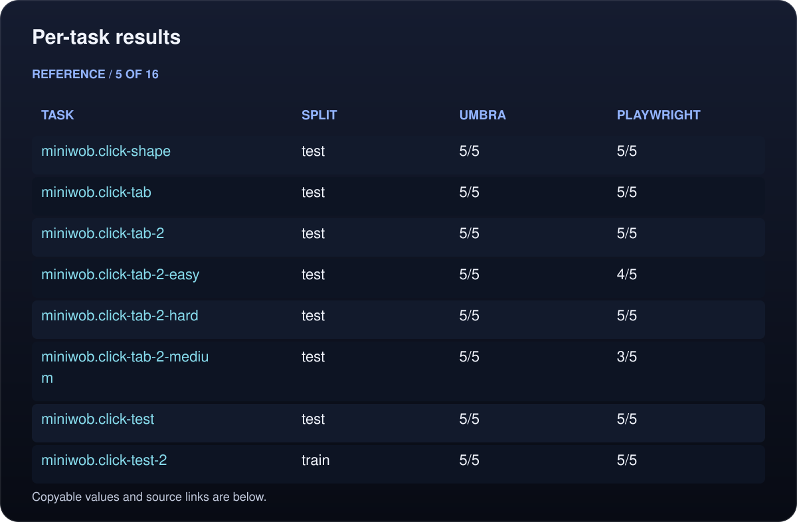
</picture>

<picture>
  <source media="(max-width: 600px)" srcset="../../../../assets/docs/docs-evaluation-miniwob-2026-10-13-results-table-c4f4b9f00b-6-mobile-e5827b8618.svg">
  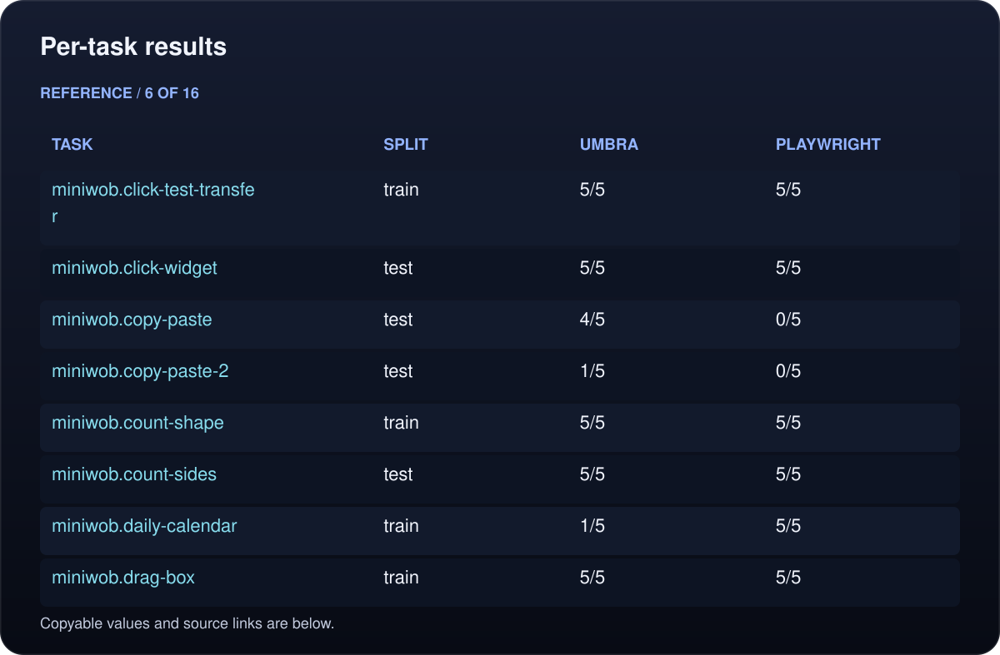
</picture>

<picture>
  <source media="(max-width: 600px)" srcset="../../../../assets/docs/docs-evaluation-miniwob-2026-10-13-results-table-c4f4b9f00b-7-mobile-ad2c1e9794.svg">
  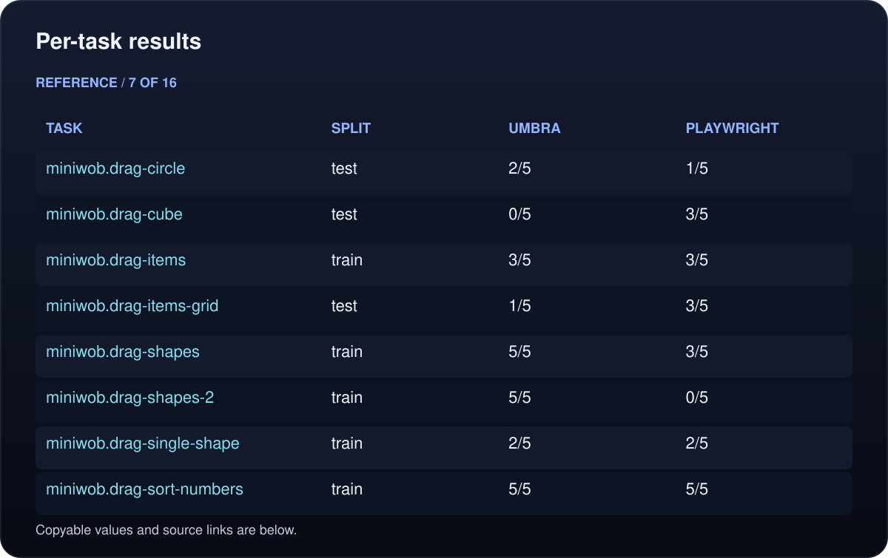
</picture>

<picture>
  <source media="(max-width: 600px)" srcset="../../../../assets/docs/docs-evaluation-miniwob-2026-10-13-results-table-c4f4b9f00b-8-mobile-4f062fc32d.svg">
  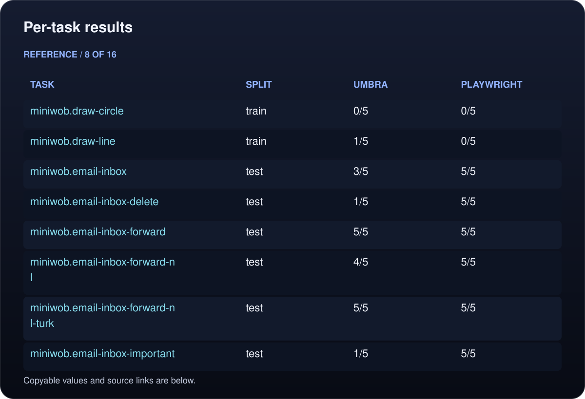
</picture>

<picture>
  <source media="(max-width: 600px)" srcset="../../../../assets/docs/docs-evaluation-miniwob-2026-10-13-results-table-c4f4b9f00b-9-mobile-e97c45f2b3.svg">
  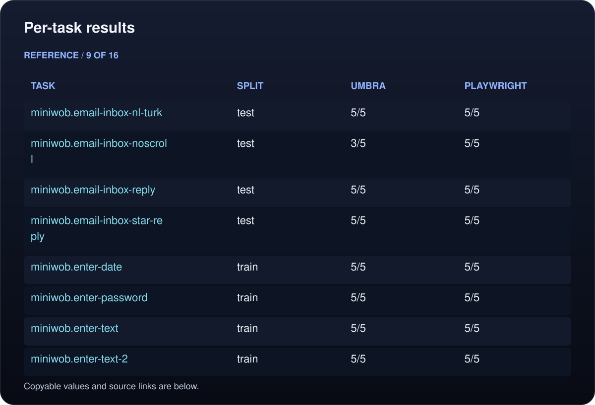
</picture>

<picture>
  <source media="(max-width: 600px)" srcset="../../../../assets/docs/docs-evaluation-miniwob-2026-10-13-results-table-c4f4b9f00b-10-mobile-bffe7f4b02.svg">
  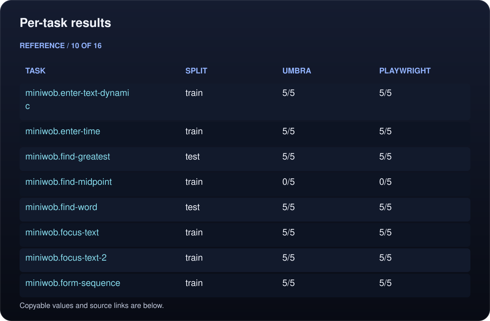
</picture>

<picture>
  <source media="(max-width: 600px)" srcset="../../../../assets/docs/docs-evaluation-miniwob-2026-10-13-results-table-c4f4b9f00b-11-mobile-ee79b7fc54.svg">
  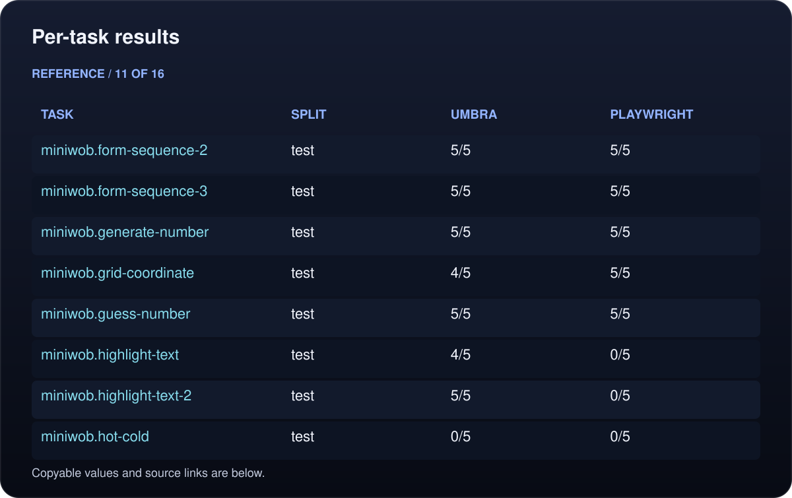
</picture>

<picture>
  <source media="(max-width: 600px)" srcset="../../../../assets/docs/docs-evaluation-miniwob-2026-10-13-results-table-c4f4b9f00b-12-mobile-47ddfeba22.svg">
  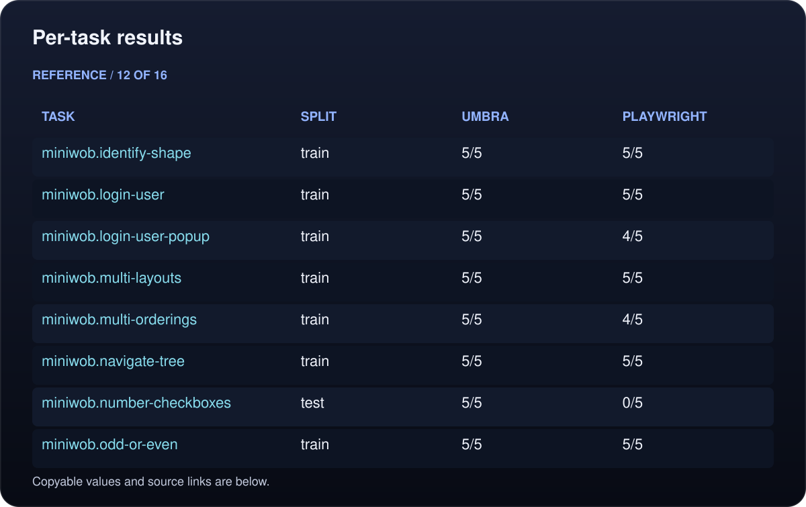
</picture>

<picture>
  <source media="(max-width: 600px)" srcset="../../../../assets/docs/docs-evaluation-miniwob-2026-10-13-results-table-c4f4b9f00b-13-mobile-2b19cfb882.svg">
  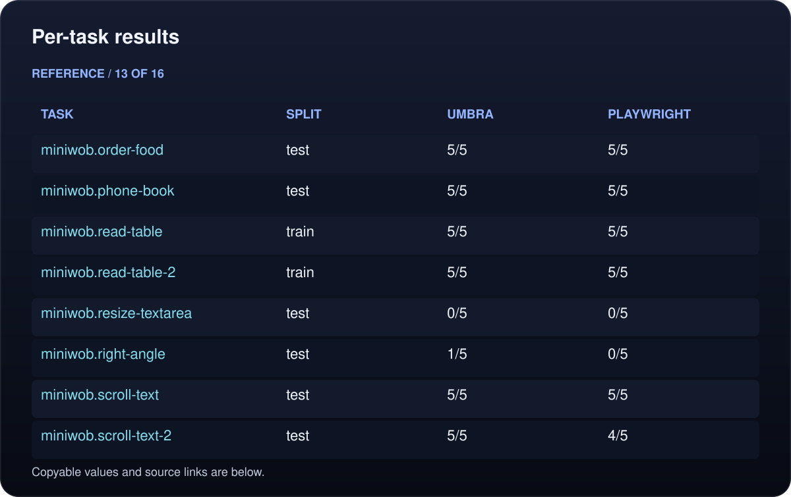
</picture>

<picture>
  <source media="(max-width: 600px)" srcset="../../../../assets/docs/docs-evaluation-miniwob-2026-10-13-results-table-c4f4b9f00b-14-mobile-9f4b49bfbd.svg">
  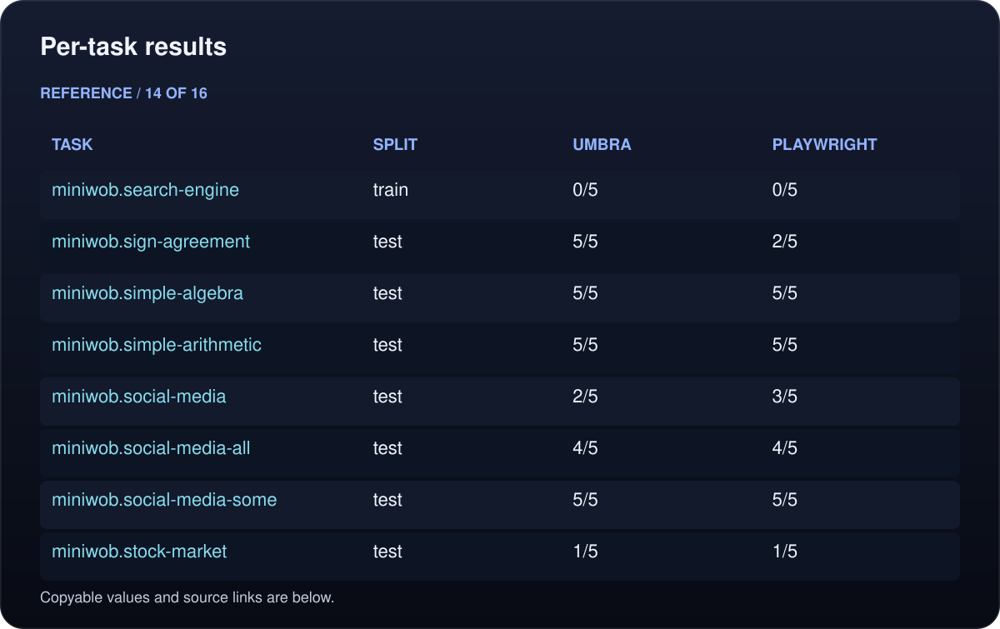
</picture>

<picture>
  <source media="(max-width: 600px)" srcset="../../../../assets/docs/docs-evaluation-miniwob-2026-10-13-results-table-c4f4b9f00b-15-mobile-43992b1c63.svg">
  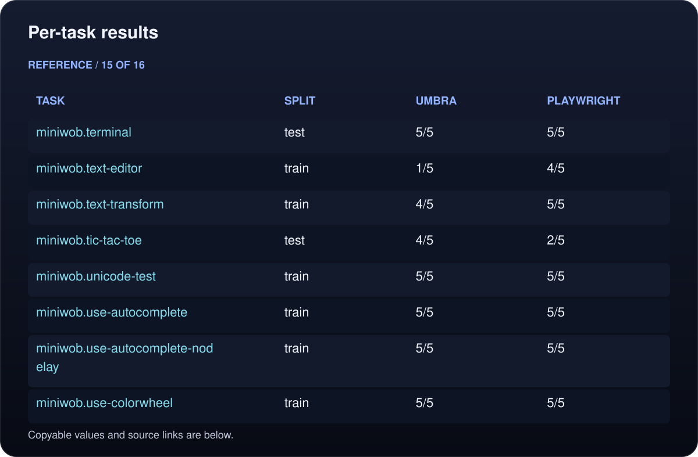
</picture>

<picture>
  <source media="(max-width: 600px)" srcset="../../../../assets/docs/docs-evaluation-miniwob-2026-10-13-results-table-c4f4b9f00b-16-mobile-988e9dffd9.svg">
  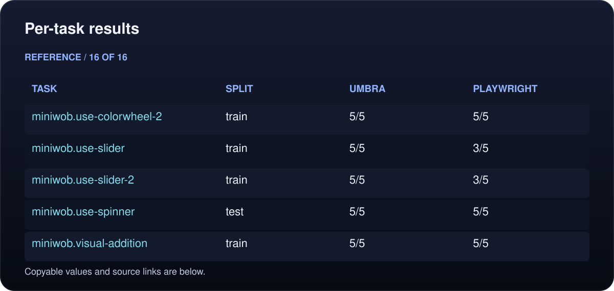
</picture>

Read the text, values and source links

- **Task:** miniwob.ascending-numbers
- **Split:** test
- **Umbra:** 4/5
- **Playwright:** 0/5

- **Task:** miniwob.bisect-angle
- **Split:** test
- **Umbra:** 1/5
- **Playwright:** 0/5

- **Task:** miniwob.book-flight
- **Split:** train
- **Umbra:** 3/5
- **Playwright:** 1/5

- **Task:** miniwob.book-flight-nodelay
- **Split:** train
- **Umbra:** 3/5
- **Playwright:** 0/5

- **Task:** miniwob.buy-ticket
- **Split:** train
- **Umbra:** 5/5
- **Playwright:** 5/5

- **Task:** miniwob.choose-date
- **Split:** train
- **Umbra:** 5/5
- **Playwright:** 5/5

- **Task:** miniwob.choose-date-easy
- **Split:** train
- **Umbra:** 5/5
- **Playwright:** 5/5

- **Task:** miniwob.choose-date-medium
- **Split:** train
- **Umbra:** 5/5
- **Playwright:** 5/5

- **Task:** miniwob.choose-date-nodelay
- **Split:** train
- **Umbra:** 5/5
- **Playwright:** 5/5

- **Task:** miniwob.choose-list
- **Split:** test
- **Umbra:** 5/5
- **Playwright:** 5/5

- **Task:** miniwob.circle-center
- **Split:** train
- **Umbra:** 5/5
- **Playwright:** 5/5

- **Task:** miniwob.click-button
- **Split:** test
- **Umbra:** 5/5
- **Playwright:** 5/5

- **Task:** miniwob.click-button-sequence
- **Split:** test
- **Umbra:** 4/5
- **Playwright:** 5/5

- **Task:** miniwob.click-checkboxes
- **Split:** train
- **Umbra:** 5/5
- **Playwright:** 5/5

- **Task:** miniwob.click-checkboxes-large
- **Split:** train
- **Umbra:** 5/5
- **Playwright:** 4/5

- **Task:** miniwob.click-checkboxes-soft
- **Split:** train
- **Umbra:** 5/5
- **Playwright:** 5/5

- **Task:** miniwob.click-checkboxes-transfer
- **Split:** train
- **Umbra:** 5/5
- **Playwright:** 5/5

- **Task:** miniwob.click-collapsible
- **Split:** train
- **Umbra:** 5/5
- **Playwright:** 5/5

- **Task:** miniwob.click-collapsible-2
- **Split:** train
- **Umbra:** 5/5
- **Playwright:** 4/5

- **Task:** miniwob.click-collapsible-2-nodelay
- **Split:** train
- **Umbra:** 5/5
- **Playwright:** 3/5

- **Task:** miniwob.click-collapsible-nodelay
- **Split:** train
- **Umbra:** 5/5
- **Playwright:** 5/5

- **Task:** miniwob.click-color
- **Split:** test
- **Umbra:** 5/5
- **Playwright:** 3/5

- **Task:** miniwob.click-dialog
- **Split:** train
- **Umbra:** 5/5
- **Playwright:** 5/5

- **Task:** miniwob.click-dialog-2
- **Split:** train
- **Umbra:** 5/5
- **Playwright:** 5/5

- **Task:** miniwob.click-link
- **Split:** test
- **Umbra:** 5/5
- **Playwright:** 5/5

- **Task:** miniwob.click-menu
- **Split:** test
- **Umbra:** 2/5
- **Playwright:** 5/5

- **Task:** miniwob.click-menu-2
- **Split:** test
- **Umbra:** 5/5
- **Playwright:** 5/5

- **Task:** miniwob.click-option
- **Split:** train
- **Umbra:** 5/5
- **Playwright:** 5/5

- **Task:** miniwob.click-pie
- **Split:** test
- **Umbra:** 5/5
- **Playwright:** 5/5

- **Task:** miniwob.click-pie-nodelay
- **Split:** test
- **Umbra:** 5/5
- **Playwright:** 4/5

- **Task:** miniwob.click-scroll-list
- **Split:** test
- **Umbra:** 5/5
- **Playwright:** 5/5

- **Task:** miniwob.click-shades
- **Split:** train
- **Umbra:** 5/5
- **Playwright:** 4/5

- **Task:** miniwob.click-shape
- **Split:** test
- **Umbra:** 5/5
- **Playwright:** 5/5

- **Task:** miniwob.click-tab
- **Split:** test
- **Umbra:** 5/5
- **Playwright:** 5/5

- **Task:** miniwob.click-tab-2
- **Split:** test
- **Umbra:** 5/5
- **Playwright:** 5/5

- **Task:** miniwob.click-tab-2-easy
- **Split:** test
- **Umbra:** 5/5
- **Playwright:** 4/5

- **Task:** miniwob.click-tab-2-hard
- **Split:** test
- **Umbra:** 5/5
- **Playwright:** 5/5

- **Task:** miniwob.click-tab-2-medium
- **Split:** test
- **Umbra:** 5/5
- **Playwright:** 3/5

- **Task:** miniwob.click-test
- **Split:** test
- **Umbra:** 5/5
- **Playwright:** 5/5

- **Task:** miniwob.click-test-2
- **Split:** train
- **Umbra:** 5/5
- **Playwright:** 5/5

- **Task:** miniwob.click-test-transfer
- **Split:** train
- **Umbra:** 5/5
- **Playwright:** 5/5

- **Task:** miniwob.click-widget
- **Split:** test
- **Umbra:** 5/5
- **Playwright:** 5/5

- **Task:** miniwob.copy-paste
- **Split:** test
- **Umbra:** 4/5
- **Playwright:** 0/5

- **Task:** miniwob.copy-paste-2
- **Split:** test
- **Umbra:** 1/5
- **Playwright:** 0/5

- **Task:** miniwob.count-shape
- **Split:** train
- **Umbra:** 5/5
- **Playwright:** 5/5

- **Task:** miniwob.count-sides
- **Split:** test
- **Umbra:** 5/5
- **Playwright:** 5/5

- **Task:** miniwob.daily-calendar
- **Split:** train
- **Umbra:** 1/5
- **Playwright:** 5/5

- **Task:** miniwob.drag-box
- **Split:** train
- **Umbra:** 5/5
- **Playwright:** 5/5

- **Task:** miniwob.drag-circle
- **Split:** test
- **Umbra:** 2/5
- **Playwright:** 1/5

- **Task:** miniwob.drag-cube
- **Split:** test
- **Umbra:** 0/5
- **Playwright:** 3/5

- **Task:** miniwob.drag-items
- **Split:** train
- **Umbra:** 3/5
- **Playwright:** 3/5

- **Task:** miniwob.drag-items-grid
- **Split:** test
- **Umbra:** 1/5
- **Playwright:** 3/5

- **Task:** miniwob.drag-shapes
- **Split:** train
- **Umbra:** 5/5
- **Playwright:** 3/5

- **Task:** miniwob.drag-shapes-2
- **Split:** train
- **Umbra:** 5/5
- **Playwright:** 0/5

- **Task:** miniwob.drag-single-shape
- **Split:** train
- **Umbra:** 2/5
- **Playwright:** 2/5

- **Task:** miniwob.drag-sort-numbers
- **Split:** train
- **Umbra:** 5/5
- **Playwright:** 5/5

- **Task:** miniwob.draw-circle
- **Split:** train
- **Umbra:** 0/5
- **Playwright:** 0/5

- **Task:** miniwob.draw-line
- **Split:** train
- **Umbra:** 1/5
- **Playwright:** 0/5

- **Task:** miniwob.email-inbox
- **Split:** test
- **Umbra:** 3/5
- **Playwright:** 5/5

- **Task:** miniwob.email-inbox-delete
- **Split:** test
- **Umbra:** 1/5
- **Playwright:** 5/5

- **Task:** miniwob.email-inbox-forward
- **Split:** test
- **Umbra:** 5/5
- **Playwright:** 5/5

- **Task:** miniwob.email-inbox-forward-nl
- **Split:** test
- **Umbra:** 4/5
- **Playwright:** 5/5

- **Task:** miniwob.email-inbox-forward-nl-turk
- **Split:** test
- **Umbra:** 5/5
- **Playwright:** 5/5

- **Task:** miniwob.email-inbox-important
- **Split:** test
- **Umbra:** 1/5
- **Playwright:** 5/5

- **Task:** miniwob.email-inbox-nl-turk
- **Split:** test
- **Umbra:** 5/5
- **Playwright:** 5/5

- **Task:** miniwob.email-inbox-noscroll
- **Split:** test
- **Umbra:** 3/5
- **Playwright:** 5/5

- **Task:** miniwob.email-inbox-reply
- **Split:** test
- **Umbra:** 5/5
- **Playwright:** 5/5

- **Task:** miniwob.email-inbox-star-reply
- **Split:** test
- **Umbra:** 5/5
- **Playwright:** 5/5

- **Task:** miniwob.enter-date
- **Split:** train
- **Umbra:** 5/5
- **Playwright:** 5/5

- **Task:** miniwob.enter-password
- **Split:** train
- **Umbra:** 5/5
- **Playwright:** 5/5

- **Task:** miniwob.enter-text
- **Split:** train
- **Umbra:** 5/5
- **Playwright:** 5/5

- **Task:** miniwob.enter-text-2
- **Split:** train
- **Umbra:** 5/5
- **Playwright:** 5/5

- **Task:** miniwob.enter-text-dynamic
- **Split:** train
- **Umbra:** 5/5
- **Playwright:** 5/5

- **Task:** miniwob.enter-time
- **Split:** train
- **Umbra:** 5/5
- **Playwright:** 5/5

- **Task:** miniwob.find-greatest
- **Split:** test
- **Umbra:** 5/5
- **Playwright:** 5/5

- **Task:** miniwob.find-midpoint
- **Split:** train
- **Umbra:** 0/5
- **Playwright:** 0/5

- **Task:** miniwob.find-word
- **Split:** test
- **Umbra:** 5/5
- **Playwright:** 5/5

- **Task:** miniwob.focus-text
- **Split:** train
- **Umbra:** 5/5
- **Playwright:** 5/5

- **Task:** miniwob.focus-text-2
- **Split:** train
- **Umbra:** 5/5
- **Playwright:** 5/5

- **Task:** miniwob.form-sequence
- **Split:** train
- **Umbra:** 5/5
- **Playwright:** 5/5

- **Task:** miniwob.form-sequence-2
- **Split:** test
- **Umbra:** 5/5
- **Playwright:** 5/5

- **Task:** miniwob.form-sequence-3
- **Split:** test
- **Umbra:** 5/5
- **Playwright:** 5/5

- **Task:** miniwob.generate-number
- **Split:** test
- **Umbra:** 5/5
- **Playwright:** 5/5

- **Task:** miniwob.grid-coordinate
- **Split:** test
- **Umbra:** 4/5
- **Playwright:** 5/5

- **Task:** miniwob.guess-number
- **Split:** test
- **Umbra:** 5/5
- **Playwright:** 5/5

- **Task:** miniwob.highlight-text
- **Split:** test
- **Umbra:** 4/5
- **Playwright:** 0/5

- **Task:** miniwob.highlight-text-2
- **Split:** test
- **Umbra:** 5/5
- **Playwright:** 0/5

- **Task:** miniwob.hot-cold
- **Split:** test
- **Umbra:** 0/5
- **Playwright:** 0/5

- **Task:** miniwob.identify-shape
- **Split:** train
- **Umbra:** 5/5
- **Playwright:** 5/5

- **Task:** miniwob.login-user
- **Split:** train
- **Umbra:** 5/5
- **Playwright:** 5/5

- **Task:** miniwob.login-user-popup
- **Split:** train
- **Umbra:** 5/5
- **Playwright:** 4/5

- **Task:** miniwob.multi-layouts
- **Split:** train
- **Umbra:** 5/5
- **Playwright:** 5/5

- **Task:** miniwob.multi-orderings
- **Split:** train
- **Umbra:** 5/5
- **Playwright:** 4/5

- **Task:** miniwob.navigate-tree
- **Split:** train
- **Umbra:** 5/5
- **Playwright:** 5/5

- **Task:** miniwob.number-checkboxes
- **Split:** test
- **Umbra:** 5/5
- **Playwright:** 0/5

- **Task:** miniwob.odd-or-even
- **Split:** train
- **Umbra:** 5/5
- **Playwright:** 5/5

- **Task:** miniwob.order-food
- **Split:** test
- **Umbra:** 5/5
- **Playwright:** 5/5

- **Task:** miniwob.phone-book
- **Split:** test
- **Umbra:** 5/5
- **Playwright:** 5/5

- **Task:** miniwob.read-table
- **Split:** train
- **Umbra:** 5/5
- **Playwright:** 5/5

- **Task:** miniwob.read-table-2
- **Split:** train
- **Umbra:** 5/5
- **Playwright:** 5/5

- **Task:** miniwob.resize-textarea
- **Split:** test
- **Umbra:** 0/5
- **Playwright:** 0/5

- **Task:** miniwob.right-angle
- **Split:** test
- **Umbra:** 1/5
- **Playwright:** 0/5

- **Task:** miniwob.scroll-text
- **Split:** test
- **Umbra:** 5/5
- **Playwright:** 5/5

- **Task:** miniwob.scroll-text-2
- **Split:** test
- **Umbra:** 5/5
- **Playwright:** 4/5

- **Task:** miniwob.search-engine
- **Split:** train
- **Umbra:** 0/5
- **Playwright:** 0/5

- **Task:** miniwob.sign-agreement
- **Split:** test
- **Umbra:** 5/5
- **Playwright:** 2/5

- **Task:** miniwob.simple-algebra
- **Split:** test
- **Umbra:** 5/5
- **Playwright:** 5/5

- **Task:** miniwob.simple-arithmetic
- **Split:** test
- **Umbra:** 5/5
- **Playwright:** 5/5

- **Task:** miniwob.social-media
- **Split:** test
- **Umbra:** 2/5
- **Playwright:** 3/5

- **Task:** miniwob.social-media-all
- **Split:** test
- **Umbra:** 4/5
- **Playwright:** 4/5

- **Task:** miniwob.social-media-some
- **Split:** test
- **Umbra:** 5/5
- **Playwright:** 5/5

- **Task:** miniwob.stock-market
- **Split:** test
- **Umbra:** 1/5
- **Playwright:** 1/5

- **Task:** miniwob.terminal
- **Split:** test
- **Umbra:** 5/5
- **Playwright:** 5/5

- **Task:** miniwob.text-editor
- **Split:** train
- **Umbra:** 1/5
- **Playwright:** 4/5

- **Task:** miniwob.text-transform
- **Split:** train
- **Umbra:** 4/5
- **Playwright:** 5/5

- **Task:** miniwob.tic-tac-toe
- **Split:** test
- **Umbra:** 4/5
- **Playwright:** 2/5

- **Task:** miniwob.unicode-test
- **Split:** train
- **Umbra:** 5/5
- **Playwright:** 5/5

- **Task:** miniwob.use-autocomplete
- **Split:** train
- **Umbra:** 5/5
- **Playwright:** 5/5

- **Task:** miniwob.use-autocomplete-nodelay
- **Split:** train
- **Umbra:** 5/5
- **Playwright:** 5/5

- **Task:** miniwob.use-colorwheel
- **Split:** train
- **Umbra:** 5/5
- **Playwright:** 5/5

- **Task:** miniwob.use-colorwheel-2
- **Split:** train
- **Umbra:** 5/5
- **Playwright:** 5/5

- **Task:** miniwob.use-slider
- **Split:** train
- **Umbra:** 5/5
- **Playwright:** 3/5

- **Task:** miniwob.use-slider-2
- **Split:** train
- **Umbra:** 5/5
- **Playwright:** 3/5

- **Task:** miniwob.use-spinner
- **Split:** test
- **Umbra:** 5/5
- **Playwright:** 5/5

- **Task:** miniwob.visual-addition
- **Split:** train
- **Umbra:** 5/5
- **Playwright:** 5/5

<!-- /umbra-figure -->

## Interpretation limits

This is a comparison on standard external tasks with their original grader. It uses an adapted MCP action/observation protocol, so these scores are not an official BrowserGym or MiniWoB leaderboard submission. Tool capabilities, browser engines and screenshots differ; the Playwright baseline uses Chromium. The 120-second cap is stricter than BrowserGym’s page timer. Scores support claims about this frozen agent/tool setup only.

The bootstrap groups all repetitions of each task together. Episode-level independence is not assumed. These intervals describe uncertainty over task types, not performance on every real website. Tasks are public and may be present in model training data.

Native copy/paste uses the Mac’s shared clipboard, which browser profiles do not isolate. Clipboard tasks ran concurrently; their outcomes cannot establish isolated clipboard reliability. They remain in the primary frozen denominator.

<!-- umbra-figure: docs-evaluation-miniwob-2026-10-13-results-facts-72d37c2dc6 -->
<picture>
  <source media="(max-width: 600px)" srcset="../../../../assets/docs/docs-evaluation-miniwob-2026-10-13-results-facts-72d37c2dc6-1-mobile-ab90f45be0.svg">
  
</picture>

Read the text, values and source links

Wall times include model inference and run under shared machine load. Broker call times include MCP handling, action waits, two upstream validation calls and image hashing; they are not pure engine latency. The Python Playwright control connection uses the upstream 100 ms slow-motion setting; the Umbra control connection has no equivalent delay. Broker durations therefore do not support a browser speedup claim. Installation is outside the timing. Codex reports token usage but no dollar cost for this subscription run.

<!-- /umbra-figure -->

The disposable environment uses Playwright Python 1.63.0 with browsergym-core 0.14.3, overriding that package’s legacy Playwright 1.44 pin. The upstream task code is imported from the pinned source checkout and calibrated with positive, negative and unfinished controls; the Gym runtime is not used. This environment is an adapter execution, not an unmodified BrowserGym installation.

### Primary sources

- [MiniWoB++](https://github.com/Farama-Foundation/miniwob-plusplus): external HTML tasks.
- [BrowserGym MiniWoB adapter](https://github.com/ServiceNow/BrowserGym/blob/e71419aef5759a11cb7896a26c36e5f7e92d82b2/browsergym/miniwob/src/browsergym/miniwob/base.py): unchanged setup and reward validation.
<!-- umbra-figure: docs-evaluation-miniwob-2026-10-13-results-facts-60c2b5e4f1 -->
<picture>
  <source media="(max-width: 600px)" srcset="../../../../assets/docs/docs-evaluation-miniwob-2026-10-13-results-facts-60c2b5e4f1-1-mobile-7137d4ffed.svg">
  
</picture>

Read the text, values and source links

- [BrowserGym benchmark configuration](https://github.com/ServiceNow/BrowserGym/blob/e71419aef5759a11cb7896a26c36e5f7e92d82b2/browsergym/experiments/src/browsergym/experiments/benchmark/configs.py): 125 tasks, five repeats and ten actions.

<!-- /umbra-figure -->
- [Playwright MCP](https://github.com/microsoft/playwright-mcp): comparator.
- [WebdriverIO benchmark](https://github.com/webdriverio/benchmark): Online-Mind2Web comparison; not executed because it requires live websites, gated tasks and paid judging.

Raw run directory: `/private/tmp/umbra-external-full-20261013`. `evidence-hashes.json` identifies the exact raw files. `results.json` retains every episode; `summary.json` holds aggregate measurements.
