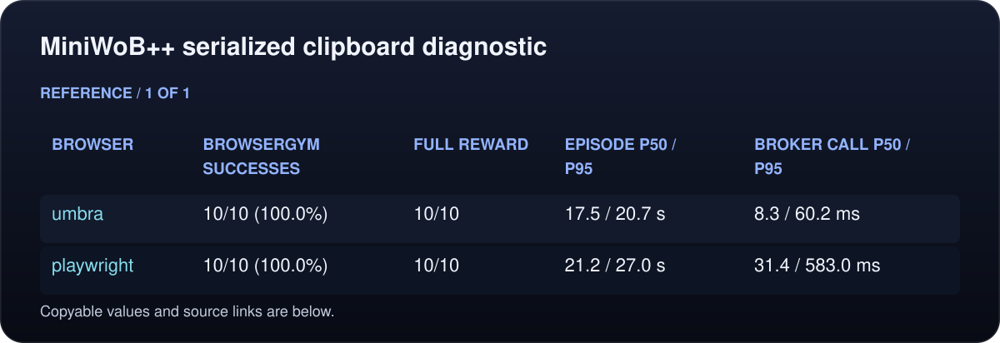
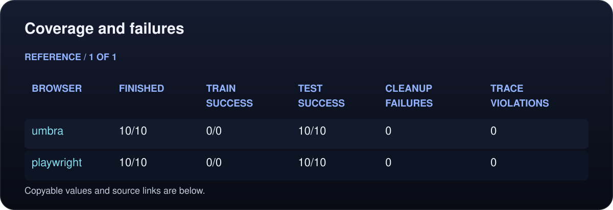
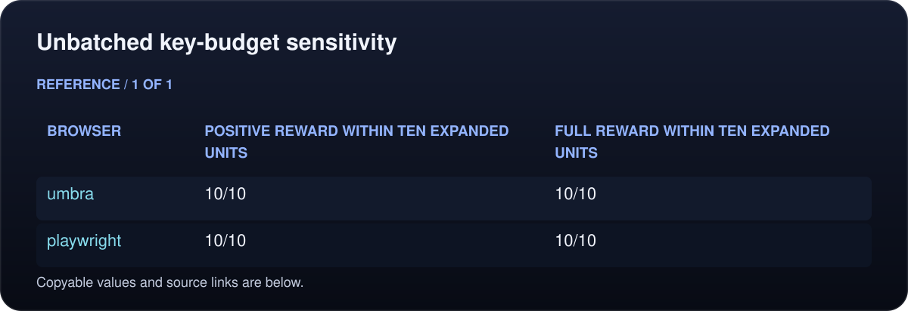
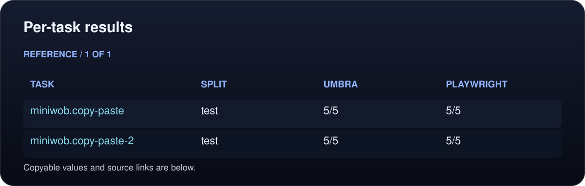
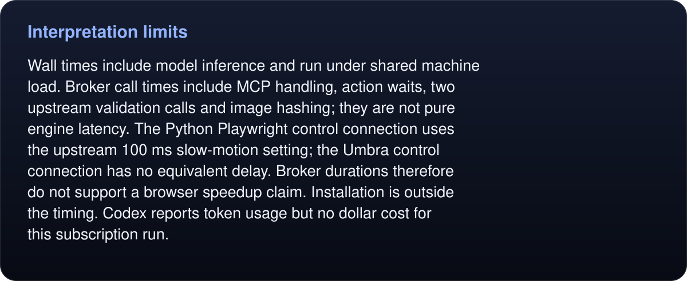

# MiniWoB++ serialized clipboard diagnostic

Status: COMPLETE.

Pinned upstream tasks and BrowserGym setup/validation; fresh Codex sessions with filtered browser MCP tools.

<!-- umbra-figure: docs-evaluation-miniwob-2026-10-13-clipboard-serial-results-table-0df759c00b -->
<picture>
  <source media="(max-width: 600px)" srcset="../../../../../assets/docs/docs-evaluation-miniwob-2026-10-13-clipboard-serial-results-table-0df759c00b-1-mobile-56a3dd63e1.svg">
  
</picture>

Read the text, values and source links

- **Browser:** umbra
- **BrowserGym successes:** 10/10 (100.0%)
- **Full reward:** 10/10
- **Episode p50 / p95:** 17.5 / 20.7 s
- **Broker call p50 / p95:** 8.3 / 60.2 ms

- **Browser:** playwright
- **BrowserGym successes:** 10/10 (100.0%)
- **Full reward:** 10/10
- **Episode p50 / p95:** 21.2 / 27.0 s
- **Broker call p50 / p95:** 31.4 / 583.0 ms

<!-- /umbra-figure -->

Post-hoc supplementary diagnostic only: the two clipboard task types ran one episode at a time. This does not replace the primary 125-task campaign or isolate the cause of its different outcomes. Ten successes per arm across two task types do not imply certain reliability; the degenerate bootstrap intervals in summary.json are not meaningful uncertainty estimates.

## Frozen setup

- Umbra revision: `a215d69297124329c80ba743f773def3c950b257`; binary SHA-256 `96850cf40c9685dd00b40c5bf8304992f3fd2405367092e274534fd8a039c979`.
- MiniWoB++ revision: `33c3b4ddef8c6eb67c57a29663d844b1eda7e614`.
- BrowserGym revision: `e71419aef5759a11cb7896a26c36e5f7e92d82b2`.
- Model: `gpt-6.1-sol`, `high` effort; `codex-cli 0.162.1`.
- Task types: 2; 5 of the standard five repetitions; two arms.
- The clipboard subset was selected after inspecting the primary campaign. The original five seeds were reused; original full-campaign scores remain primary.
<!-- umbra-figure: docs-evaluation-miniwob-2026-10-13-clipboard-serial-results-facts-51d50f7cb9 -->
<picture>
  <source media="(max-width: 600px)" srcset="../../../../../assets/docs/docs-evaluation-miniwob-2026-10-13-clipboard-serial-results-facts-51d50f7cb9-1-mobile-2084d79f30.svg">
  
</picture>

Read the text, values and source links

- Ten interaction units as implemented by the frozen broker, forty observations, 120 seconds per episode including setup and final response. A native press-array counts as one unit; fill_form counts each field separately. This is not ten unbatched BrowserGym actions.

<!-- /umbra-figure -->
- Loopback HTTP only; disposable Umbra profiles and Chromium contexts. 1 concurrent episodes.
- No arbitrary JavaScript, filesystem tools, browser navigation, other MCP servers or account access in either arm.
- BrowserGym success is its unchanged `RAW_REWARD_GLOBAL > 0` check on a terminated episode. Full reward requires exactly 1.0.
- Attempts with missing/malformed traces, forbidden filesystem/command tools or another MCP server are invalidated by transcript audit. Started actions are audited even if they never completed.

## Coverage and failures

<!-- umbra-figure: docs-evaluation-miniwob-2026-10-13-clipboard-serial-results-table-fc0d88220a -->
<picture>
  <source media="(max-width: 600px)" srcset="../../../../../assets/docs/docs-evaluation-miniwob-2026-10-13-clipboard-serial-results-table-fc0d88220a-1-mobile-8be1ecd1df.svg">
  
</picture>

Read the text, values and source links

- **Browser:** umbra
- **Finished:** 10/10
- **Train success:** 0/0
- **Test success:** 10/10
- **Cleanup failures:** 0
- **Trace violations:** 0

- **Browser:** playwright
- **Finished:** 10/10
- **Train success:** 0/0
- **Test success:** 10/10
- **Cleanup failures:** 0
- **Trace violations:** 0

<!-- /umbra-figure -->

<!-- umbra-figure: docs-evaluation-miniwob-2026-10-13-clipboard-serial-results-table-b1635774e9 -->

Read the text, values and source links

<!-- /umbra-figure -->

## Unbatched key-budget sensitivity

Post-hoc conservative diagnostic, not a replacement score: expand each key in a native press-array into its own interaction unit and exclude credit from outcomes reached after ten such units. Other interaction commands count once; fill_form counts fields. This does not rerun the agents with an enforced normalized budget, and counts individual character keys separately even where another typing API could express a string in one action.

<!-- umbra-figure: docs-evaluation-miniwob-2026-10-13-clipboard-serial-results-table-ca7200ba07 -->
<picture>
  <source media="(max-width: 600px)" srcset="../../../../../assets/docs/docs-evaluation-miniwob-2026-10-13-clipboard-serial-results-table-ca7200ba07-1-mobile-3b4baa70a0.svg">
  
</picture>

Read the text, values and source links

- **Browser:** umbra
- **Positive reward within ten expanded units:** 10/10
- **Full reward within ten expanded units:** 10/10

- **Browser:** playwright
- **Positive reward within ten expanded units:** 10/10
- **Full reward within ten expanded units:** 10/10

<!-- /umbra-figure -->

The original full-campaign score remains primary. This supplementary diagnostic retains the same asymmetric interaction budget.

## Per-task results

<!-- umbra-figure: docs-evaluation-miniwob-2026-10-13-clipboard-serial-results-table-fedda28f96 -->
<picture>
  <source media="(max-width: 600px)" srcset="../../../../../assets/docs/docs-evaluation-miniwob-2026-10-13-clipboard-serial-results-table-fedda28f96-1-mobile-5944413f76.svg">
  
</picture>

Read the text, values and source links

- **Task:** miniwob.copy-paste
- **Split:** test
- **Umbra:** 5/5
- **Playwright:** 5/5

- **Task:** miniwob.copy-paste-2
- **Split:** test
- **Umbra:** 5/5
- **Playwright:** 5/5

<!-- /umbra-figure -->

## Interpretation limits

This is a comparison on standard external tasks with their original grader. It uses an adapted MCP action/observation protocol, so these scores are not an official BrowserGym or MiniWoB leaderboard submission. Tool capabilities, browser engines and screenshots differ; the Playwright baseline uses Chromium. The 120-second cap is stricter than BrowserGym’s page timer. Scores support claims about this frozen agent/tool setup only.

The bootstrap groups all repetitions of each task together. Episode-level independence is not assumed. These intervals describe uncertainty over task types, not performance on every real website. Tasks are public and may be present in model training data.

Native copy/paste uses the Mac’s shared clipboard, which browser profiles do not isolate. These diagnostic episodes ran serially, but the clipboard remained shared with the user. Agent strategy and machine load also differed; serial success does not prove clipboard contention caused the primary failures.

<!-- umbra-figure: docs-evaluation-miniwob-2026-10-13-clipboard-serial-results-facts-72d37c2dc6 -->
<picture>
  <source media="(max-width: 600px)" srcset="../../../../../assets/docs/docs-evaluation-miniwob-2026-10-13-clipboard-serial-results-facts-72d37c2dc6-1-mobile-ab90f45be0.svg">
  
</picture>

Read the text, values and source links

Wall times include model inference and run under shared machine load. Broker call times include MCP handling, action waits, two upstream validation calls and image hashing; they are not pure engine latency. The Python Playwright control connection uses the upstream 100 ms slow-motion setting; the Umbra control connection has no equivalent delay. Broker durations therefore do not support a browser speedup claim. Installation is outside the timing. Codex reports token usage but no dollar cost for this subscription run.

<!-- /umbra-figure -->

The disposable environment uses Playwright Python 1.63.0 with browsergym-core 0.14.3, overriding that package’s legacy Playwright 1.44 pin. The upstream task code is imported from the pinned source checkout and calibrated with positive, negative and unfinished controls; the Gym runtime is not used. This environment is an adapter execution, not an unmodified BrowserGym installation.

### Primary sources

- [MiniWoB++](https://github.com/Farama-Foundation/miniwob-plusplus): external HTML tasks.
- [BrowserGym MiniWoB adapter](https://github.com/ServiceNow/BrowserGym/blob/e71419aef5759a11cb7896a26c36e5f7e92d82b2/browsergym/miniwob/src/browsergym/miniwob/base.py): unchanged setup and reward validation.
<!-- umbra-figure: docs-evaluation-miniwob-2026-10-13-clipboard-serial-results-facts-60c2b5e4f1 -->
<picture>
  <source media="(max-width: 600px)" srcset="../../../../../assets/docs/docs-evaluation-miniwob-2026-10-13-clipboard-serial-results-facts-60c2b5e4f1-1-mobile-7137d4ffed.svg">
  
</picture>

Read the text, values and source links

- [BrowserGym benchmark configuration](https://github.com/ServiceNow/BrowserGym/blob/e71419aef5759a11cb7896a26c36e5f7e92d82b2/browsergym/experiments/src/browsergym/experiments/benchmark/configs.py): 125 tasks, five repeats and ten actions.

<!-- /umbra-figure -->
- [Playwright MCP](https://github.com/microsoft/playwright-mcp): comparator.
- [WebdriverIO benchmark](https://github.com/webdriverio/benchmark): Online-Mind2Web comparison; not executed because it requires live websites, gated tasks and paid judging.

Raw run directory: `/private/tmp/umbra-external-clipboard-20261013`. `evidence-hashes.json` identifies the exact raw files. `results.json` retains every episode; `summary.json` holds aggregate measurements.
