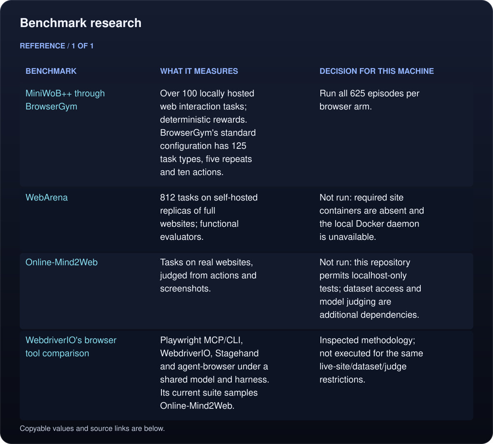

# External agent browser evaluation

This harness runs **MiniWoB++ tasks written upstream**, with **BrowserGym's unchanged task setup and reward validation**, through Umbra MCP and Playwright MCP. It compares the same Codex model on the same seeded tasks. The custom Northwind Ops tasks remain useful regression checks; their results do not establish general browser-agent reliability.

The [completed 1,250-episode report](miniwob/2026-10-13/RESULTS.md) gives all outcomes, task-grouped uncertainty and action-budget sensitivity. A separate [serialized clipboard diagnostic](miniwob/2026-10-13/clipboard-serial/RESULTS.md) retains the original primary scores. [Verification and evidence retention](miniwob/2026-10-13/VERIFICATION.md) records the checks and raw archive.

## Benchmark research

<!-- umbra-figure: docs-evaluation-protocol-table-3f971f5b5f -->
<picture>
  <source media="(max-width: 600px)" srcset="../../assets/docs/docs-evaluation-protocol-table-3f971f5b5f-1-mobile-35a7097059.svg">
  
</picture>

<details>
<summary>Read the text, values and source links</summary>

- **Benchmark:** [MiniWoB++](https://github.com/Farama-Foundation/miniwob-plusplus) through [BrowserGym](https://github.com/ServiceNow/BrowserGym)
- **What it measures:** Over 100 locally hosted web interaction tasks; deterministic rewards. BrowserGym's standard configuration has 125 task types, five repeats and ten actions.
- **Decision for this machine:** Run all 625 episodes per browser arm.

- **Benchmark:** [WebArena](https://github.com/web-arena-x/webarena)
- **What it measures:** 812 tasks on self-hosted replicas of full websites; functional evaluators.
- **Decision for this machine:** Not run: required site containers are absent and the local Docker daemon is unavailable.

- **Benchmark:** [Online-Mind2Web](https://github.com/OSU-NLP-Group/Online-Mind2Web)
- **What it measures:** Tasks on real websites, judged from actions and screenshots.
- **Decision for this machine:** Not run: this repository permits localhost-only tests; dataset access and model judging are additional dependencies.

- **Benchmark:** [WebdriverIO's browser tool comparison](https://github.com/webdriverio/benchmark)
- **What it measures:** Playwright MCP/CLI, WebdriverIO, Stagehand and agent-browser under a shared model and harness. Its current suite samples Online-Mind2Web.
- **Decision for this machine:** Inspected methodology; not executed for the same live-site/dataset/judge restrictions.

</details>
<!-- /umbra-figure -->

Playwright is a browser automation tool, not one universal agent benchmark. MiniWoB++ and WebArena are established external tasks; the WebdriverIO comparison is a third-party benchmark that includes Playwright. This harness does not claim Microsoft adopted or endorsed this evaluation.

## Protocol and limits

- Freeze upstream revisions, task list, seeds, model configuration, action limits and source/binary hashes before running agents.
- Run both arms for every task and seed, with a shuffled arm order and fresh agent/browser state.
- Use the upstream BrowserGym classes directly. `UmbraPage` translates the small Page interface those classes need into Umbra daemon calls; scoring stays in upstream `validate()`.
- Agents get filtered MCP tools. Arbitrary JavaScript, source/filesystem access, other browser tools and navigation are unavailable. The agent can read the goal, observe the page, and interact with it.
- Keep ten interaction units and forty observation calls per episode. A Playwright `fill_form` counts one unit per field; a native `press` array counts one unit per tool request, even when it contains several keys. This is an adapted budget, not ten unbatched BrowserGym actions. There is a 120-second wall cap, including setup and final-answer generation.
- BrowserGym counts positive raw reward as success, including partial reward on some tasks. Report that score and a stricter score requiring exactly 1.0.
- Keep every frozen episode in the denominator. Report setup failures, timeouts, unfinished episodes and invalid traces separately.
- Estimate uncertainty by bootstrapping task types, keeping all their repetitions paired. Repeated seeds are not assumed independent.
- Use only the build output, throwaway Umbra profiles and loopback HTTP. Stop daemons and delete the profile stores, support files and downloads after every episode. Chromium contexts are also disposable.

This is an **adapted MCP comparison on standard tasks**, not an official BrowserGym leaderboard run. BrowserGym's high-level action set, observation pipeline and screenshot scaling are not used. WebKit and Chromium can render differently. The capability restrictions apply to both arms, but their remaining tool surfaces differ. Four concurrent episodes share machine and model-service load. Report broker-call duration separately from end-to-end episode time; neither establishes pure engine latency. Public tasks may appear in model training data.

Native copy/paste can use the Mac's shared clipboard; it is not isolated by browser profiles. The campaign runs clipboard tasks concurrently too, so their outcomes require that additional caveat. The primary report retains them in the frozen denominator.

## Reproduce

`requirements.txt` freezes the disposable Python environment used for the run. The result manifest pins the repositories and executable versions. Do not install or modify the owner's Umbra app or CLI.

```sh
make build
WORK=$(mktemp -d /private/tmp/umbra-external.XXXXXX)
git clone https://github.com/Farama-Foundation/miniwob-plusplus.git "$WORK/miniwob"
git -C "$WORK/miniwob" checkout 33c3b4ddef8c6eb67c57a29663d844b1eda7e614
git clone https://github.com/ServiceNow/BrowserGym.git "$WORK/browsergym"
git -C "$WORK/browsergym" checkout e71419aef5759a11cb7896a26c36e5f7e92d82b2
uv venv "$WORK/env"
uv pip install --python "$WORK/env/bin/python" --no-deps -r bench/external/requirements.txt
npm install --prefix "$WORK/tools" @playwright/mcp@0.0.83

# Use a disposable Chromium executable from Playwright's cache, not a personal browser profile.
CHROMIUM='/absolute/path/to/cached/Google Chrome for Testing'
"$WORK/env/bin/python" bench/external/check.py \
  --browsergym "$WORK/browsergym" --miniwob "$WORK/miniwob" \
  --chromium "$CHROMIUM" --out "$WORK/check.json"

"$WORK/env/bin/python" bench/external/run.py freeze \
  --out "$WORK/full" --browsergym "$WORK/browsergym" --miniwob "$WORK/miniwob" \
  --playwright-mcp "$WORK/tools/node_modules/@playwright/mcp/cli.js" \
  --chromium "$CHROMIUM" --repeats 5 --timeout 120
"$WORK/env/bin/python" bench/external/run.py run --out "$WORK/full" --jobs 4
"$WORK/env/bin/python" bench/external/report.py \
  --root "$WORK/full" --out "$WORK/report"
```

`freeze` creates a new directory and refuses to overwrite one. `run` resumes only cases without a `run.json`; it verifies the harness and binary hashes. Use a new frozen directory for a changed harness, binary, model or task selection. A pilot can use `--tasks miniwob.click-test-2,miniwob.enter-text --repeats 1`; do not present a pilot as the full suite.

The full lock is installed without resolving dependencies because `browsergym-core==0.14.3` pins an old Playwright driver (1.44), while this adapter uses driver 1.63 with the cached Chromium and current Playwright MCP. The legacy package dependency check therefore reports that one incompatibility. The task classes are imported from the pinned source checkout; the Gym runtime is not used. This difference is part of the adapted protocol and is recorded in the manifest.

The report includes JSON measurements, a per-task Markdown table and SHA-256 digests of every raw evidence file. Candidate transcripts retain actual tool calls and token usage. `check.py` calibrates the upstream grader against unfinished, correct and wrong actions in both engines.
