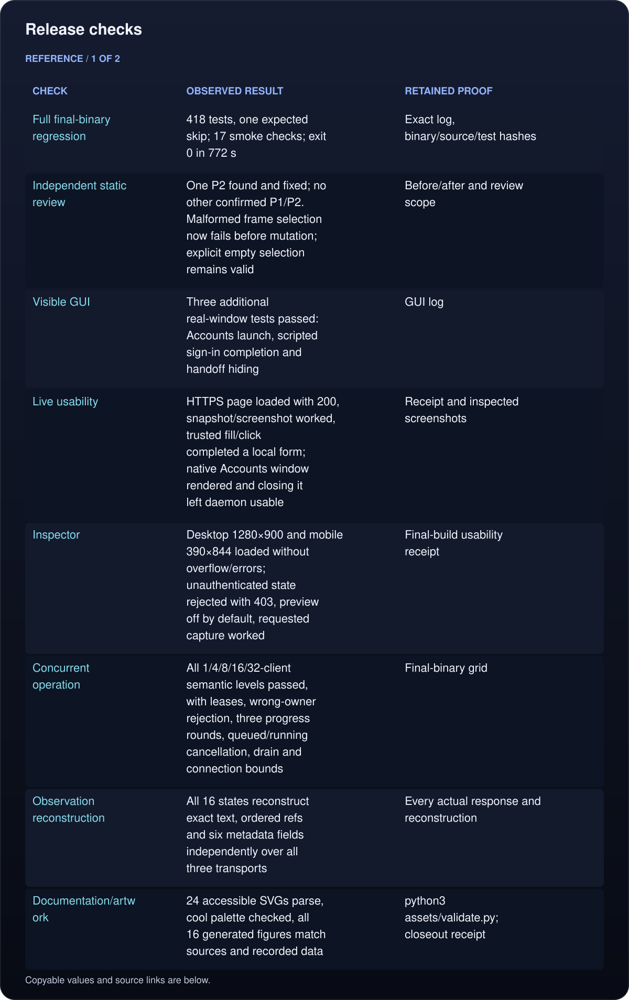
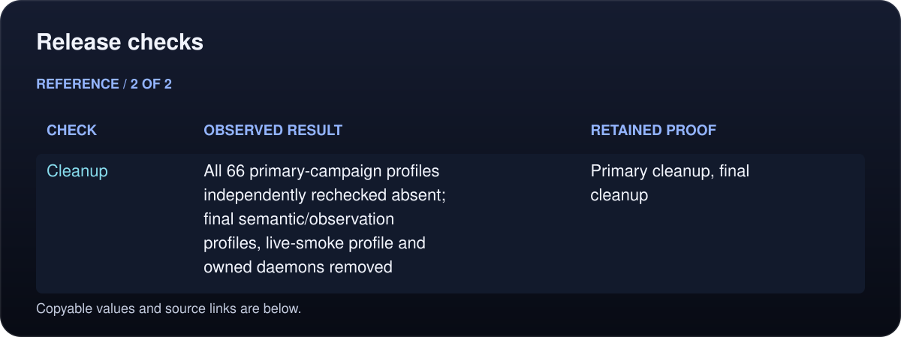
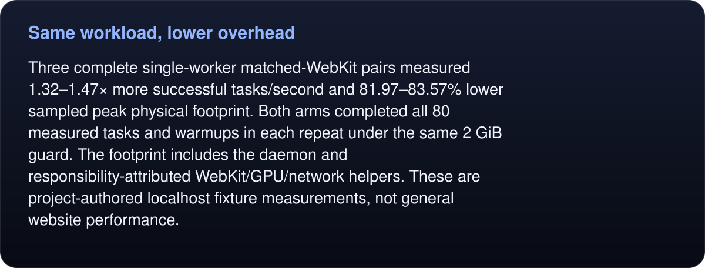
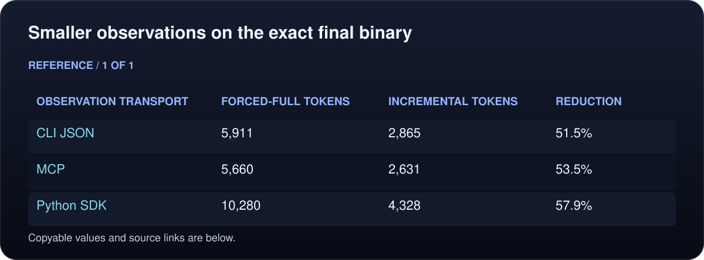
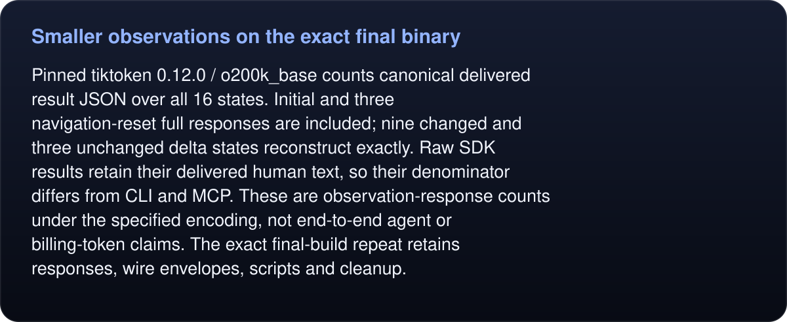
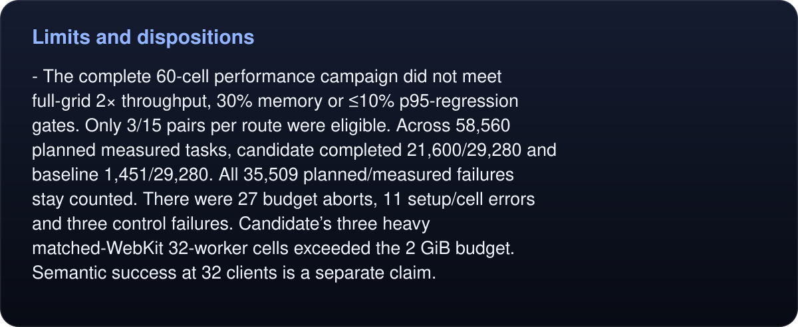

# Runtime release verification — 2026-10-23

The runtime implementation is verified and closed out at the user’s request. The user accepted the scoped benchmark results, asked to highlight the successful measurements, authorized push, and explicitly removed the 24-hour soak requirement. Unmet stretch targets and unexecuted research campaigns remain visible below.

Final product commit: `9542ee5`. Final built binary SHA-256: `bace278786dd13901a428728c8dbc1e0ef542f78feaf7ba6c26df38ab212ad1e`. Python SDK SHA-256: `1de49bf4f21951045660ce112fa94dc888fba1ffaba166c94974b882f88acfdb`. Later commits contain documentation/evidence, without changing product source.

## Release checks

<!-- umbra-figure: docs-evaluation-runtime-results-table-9dd6814e0c -->
<picture>
  <source media="(max-width: 600px)" srcset="../../../assets/docs/docs-evaluation-runtime-results-table-9dd6814e0c-1-mobile-a93f6f74a4.svg">
  
</picture>

<picture>
  <source media="(max-width: 600px)" srcset="../../../assets/docs/docs-evaluation-runtime-results-table-9dd6814e0c-2-mobile-8ad3addab1.svg">
  
</picture>

Read the text, values and source links

- **Check:** Full final-binary regression
- **Observed result:** 418 tests, one expected skip; 17 smoke checks; exit 0 in 772 s
- **Retained proof:** [Exact log, binary/source/test hashes](verification/full-v7/README.md)

- **Check:** Independent static review
- **Observed result:** One P2 found and fixed; no other confirmed P1/P2. Malformed frame selection now fails before mutation; explicit empty selection remains valid
- **Retained proof:** [Before/after and review scope](verification/frame-select/receipt.json)

- **Check:** Visible GUI
- **Observed result:** Three additional real-window tests passed: Accounts launch, scripted sign-in completion and handoff hiding
- **Retained proof:** [GUI log](verification/live-app/visible-gui.log)

- **Check:** Live usability
- **Observed result:** HTTPS page loaded with 200, snapshot/screenshot worked, trusted fill/click completed a local form; native Accounts window rendered and closing it left daemon usable
- **Retained proof:** [Receipt and inspected screenshots](verification/live-app/README.md)

- **Check:** Inspector
- **Observed result:** Desktop 1280×900 and mobile 390×844 loaded without overflow/errors; unauthenticated state rejected with 403, preview off by default, requested capture worked
- **Retained proof:** [Final-build usability receipt](verification/live-app/receipt.json)

- **Check:** Concurrent operation
- **Observed result:** All 1/4/8/16/32-client semantic levels passed, with leases, wrong-owner rejection, three progress rounds, queued/running cancellation, drain and connection bounds
- **Retained proof:** [Final-binary grid](verification/final-runtime/README.md)

- **Check:** Observation reconstruction
- **Observed result:** All 16 states reconstruct exact text, ordered refs and six metadata fields independently over all three transports
- **Retained proof:** [Every actual response and reconstruction](verification/final-observation/results.json)

- **Check:** Documentation/artwork
- **Observed result:** 24 accessible SVGs parse, cool palette checked, all 16 generated figures match sources and recorded data
- **Retained proof:** `python3 assets/validate.py`; closeout receipt

- **Check:** Cleanup
- **Observed result:** All 66 primary-campaign profiles independently rechecked absent; final semantic/observation profiles, live-smoke profile and owned daemons removed
- **Retained proof:** [Primary cleanup](primary-v2/cleanup-verified.json), [final cleanup](verification/final-cleanup.json)

<!-- /umbra-figure -->

## Benchmarks we can claim

### Same workload, lower overhead

<!-- umbra-figure: docs-evaluation-runtime-results-facts-c709a05b24 -->
<picture>
  <source media="(max-width: 600px)" srcset="../../../assets/docs/docs-evaluation-runtime-results-facts-c709a05b24-1-mobile-1c1dcc88aa.svg">
  
</picture>

Read the text, values and source links

Three complete single-worker matched-WebKit pairs measured **1.32–1.47× more successful tasks/second** and **81.97–83.57% lower sampled peak physical footprint**. Both arms completed all 80 measured tasks and warmups in each repeat under the same 2 GiB guard. The footprint includes the daemon and responsibility-attributed WebKit/GPU/network helpers. These are project-authored localhost fixture measurements, not general website performance.

<!-- /umbra-figure -->

Native-form polling delay fell substantially; unchanged full-WebKit retrieval still limits throughput. The [full report](primary-v2/README.md) gives task distributions, repeat spread, sampling limits and before/after retained-process evidence. That campaign measured binary `0f2db45988f472004708411947026319678e6d26f500cabe913f91a9646dcfc9`, before only the final frame-select input guard. Its original samples are never relabelled as the final binary.

### Smaller observations on the exact final binary

<!-- umbra-figure: docs-evaluation-runtime-results-table-891fffa560 -->
<picture>
  <source media="(max-width: 600px)" srcset="../../../assets/docs/docs-evaluation-runtime-results-table-891fffa560-1-mobile-13f6ed423f.svg">
  
</picture>

Read the text, values and source links

- **Observation transport:** CLI JSON
- **Forced-full tokens:** 5,911
- **Incremental tokens:** 2,865
- **Reduction:** 51.5%

- **Observation transport:** MCP
- **Forced-full tokens:** 5,660
- **Incremental tokens:** 2,631
- **Reduction:** 53.5%

- **Observation transport:** Python SDK
- **Forced-full tokens:** 10,280
- **Incremental tokens:** 4,328
- **Reduction:** 57.9%

<!-- /umbra-figure -->

<!-- umbra-figure: docs-evaluation-runtime-results-facts-aa464fae14 -->
<picture>
  <source media="(max-width: 600px)" srcset="../../../assets/docs/docs-evaluation-runtime-results-facts-aa464fae14-1-mobile-d8fa4c8fb1.svg">
  
</picture>

Read the text, values and source links

Pinned tiktoken 0.12.0 / o200k_base counts canonical delivered result JSON over all 16 states. Initial and three navigation-reset full responses are included; nine changed and three unchanged delta states reconstruct exactly. Raw SDK results retain their delivered human text, so their denominator differs from CLI and MCP. These are observation-response counts under the specified encoding, not end-to-end agent or billing-token claims. The [exact final-build repeat](verification/final-observation/README.md) retains responses, wire envelopes, scripts and cleanup.

<!-- /umbra-figure -->

## Limits and dispositions

<!-- umbra-figure: docs-evaluation-runtime-results-facts-c5a2e0e807 -->
<picture>
  <source media="(max-width: 600px)" srcset="../../../assets/docs/docs-evaluation-runtime-results-facts-c5a2e0e807-1-mobile-e2636ee061.svg">
  
</picture>

Read the text, values and source links

- The complete 60-cell performance campaign did **not** meet full-grid 2× throughput, 30% memory or ≤10% p95-regression gates. Only 3/15 pairs per route were eligible. Across 58,560 planned measured tasks, candidate completed 21,600/29,280 and baseline 1,451/29,280. All 35,509 planned/measured failures stay counted. There were 27 budget aborts, 11 setup/cell errors and three control failures. Candidate’s three heavy matched-WebKit 32-worker cells exceeded the 2 GiB budget. Semantic success at 32 clients is a separate claim.

<!-- /umbra-figure -->
- The public-HTTP path intentionally changes static/JSON retrieval to no-cookie/no-JavaScript HTTP. Very short candidate windows have sparse resource/control samples. Its large descriptive ratios are retained in raw data and are not promoted as an engine-only or whole-grid speedup.
- New full external MiniWoB campaigns (initial/candidate Umbra and candidate/Playwright, 1,250 frozen cases each) were prepared but not executed for this closeout. The secondary common-admission experiment was not executed. These remain future research, with no passing score or current capability-preservation claim. Existing October 13 external results remain explicitly dated to that build. [Prepared protocols](external/PREPARATION.md).
- The user removed the 24-hour soak requirement. No 24-hour run or long-duration stability claim is made; the optional diagnostic tool remains available.
- GitHub’s CI and Probe workflows were observed as `disabled_manually`; no remote CI pass is claimed. All release checks above ran locally. Workflow state was read directly from GitHub metadata.
- The verified artifact is the built app and published source. The owner’s installed app/default signed-in store were preserved according to repository safety rules.

## Evidence integrity

[Primary v2](primary-v2/README.md) retains all 242 raw files in a compressed archive with per-file SHA-256 hashes, including failed cells and 66 cleanup receipts. The earlier failed [primary v1](primary-v1/README.md), [full v5 regression](verification/full-v5/README.md), and passing [full v6 checkpoint](verification/full-v6/README.md) remain as history. The final source fix has independent review and before/after public-command tests, followed by the complete final regression and exact-binary semantic/observation repeats.
