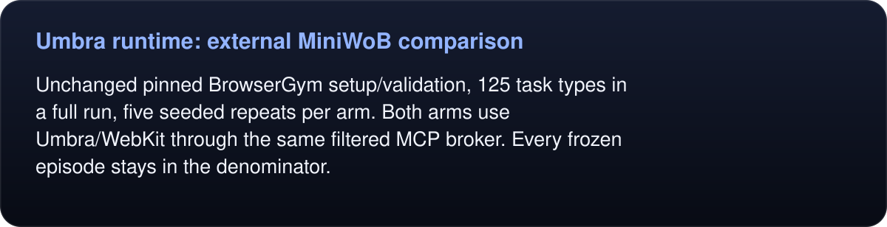
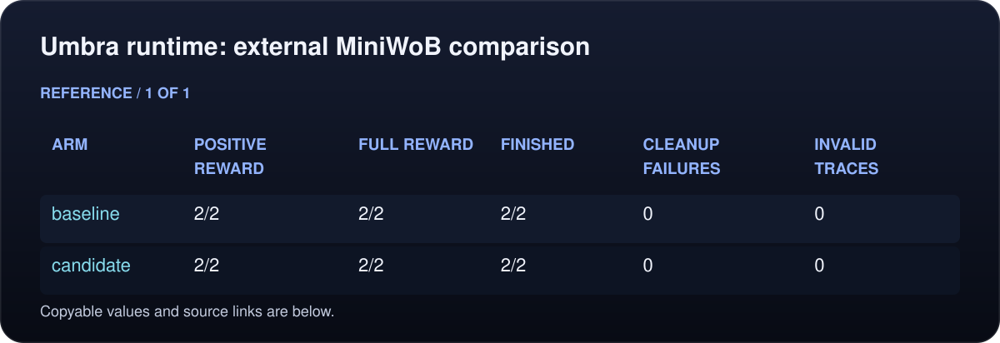
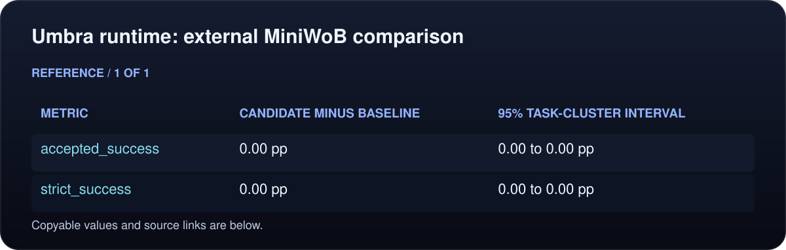
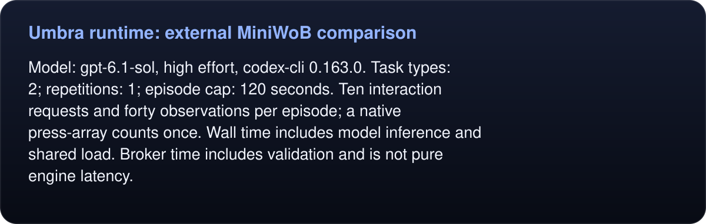
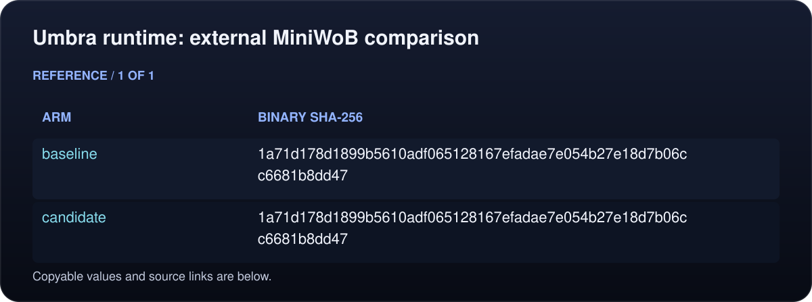
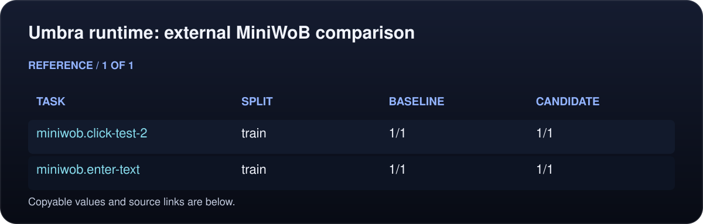

# Umbra runtime: external MiniWoB comparison

PLUMBING DIAGNOSTIC ONLY. This is a selected task subset and/or both arms use the same binary; it cannot establish runtime non-regression.

<!-- umbra-figure: docs-evaluation-runtime-external-baseline-plumbing-pilot-results-facts-caf9cf176a -->
<picture>
  <source media="(max-width: 600px)" srcset="../../../../../assets/docs/docs-evaluation-runtime-external-baseline-plumbing-pilot-results-facts-caf9cf176a-1-mobile-ce2ed1359f.svg">
  
</picture>

Read the text, values and source links

Status: COMPLETE. 4/4 frozen episodes finished.

<!-- /umbra-figure -->

<!-- umbra-figure: docs-evaluation-runtime-external-baseline-plumbing-pilot-results-facts-08ca5162fb -->
<picture>
  <source media="(max-width: 600px)" srcset="../../../../../assets/docs/docs-evaluation-runtime-external-baseline-plumbing-pilot-results-facts-08ca5162fb-1-mobile-349e9af321.svg">
  
</picture>

Read the text, values and source links

Unchanged pinned BrowserGym setup/validation, 125 task types in a full run, five seeded repeats per arm. Both arms use Umbra/WebKit through the same filtered MCP broker. Every frozen episode stays in the denominator.

<!-- /umbra-figure -->

<!-- umbra-figure: docs-evaluation-runtime-external-baseline-plumbing-pilot-results-table-6767196d34 -->
<picture>
  <source media="(max-width: 600px)" srcset="../../../../../assets/docs/docs-evaluation-runtime-external-baseline-plumbing-pilot-results-table-6767196d34-1-mobile-ee88128375.svg">
  
</picture>

Read the text, values and source links

- **Arm:** baseline
- **Positive reward:** 2/2
- **Full reward:** 2/2
- **Finished:** 2/2
- **Cleanup failures:** 0
- **Invalid traces:** 0

- **Arm:** candidate
- **Positive reward:** 2/2
- **Full reward:** 2/2
- **Finished:** 2/2
- **Cleanup failures:** 0
- **Invalid traces:** 0

<!-- /umbra-figure -->

<!-- umbra-figure: docs-evaluation-runtime-external-baseline-plumbing-pilot-results-table-0850013ab1 -->
<picture>
  <source media="(max-width: 600px)" srcset="../../../../../assets/docs/docs-evaluation-runtime-external-baseline-plumbing-pilot-results-table-0850013ab1-1-mobile-676cc1ccab.svg">
  
</picture>

Read the text, values and source links

- **Metric:** accepted_success
- **Candidate minus baseline:** 0.00 pp
- **95% task-cluster interval:** 0.00 to 0.00 pp

- **Metric:** strict_success
- **Candidate minus baseline:** 0.00 pp
- **95% task-cluster interval:** 0.00 to 0.00 pp

<!-- /umbra-figure -->

Observed aggregate score comparison only. A nonnegative difference does not prove statistical noninferiority, per-task equivalence or reliability outside this frozen suite.

Bootstrap: 10,000 paired task-type samples, RandomState(42); all repetitions stay grouped. Public tasks may be present in model training. This adapted MCP protocol is not an official BrowserGym leaderboard submission.

<!-- umbra-figure: docs-evaluation-runtime-external-baseline-plumbing-pilot-results-facts-b4707d1469 -->
<picture>
  <source media="(max-width: 600px)" srcset="../../../../../assets/docs/docs-evaluation-runtime-external-baseline-plumbing-pilot-results-facts-b4707d1469-1-mobile-ae5b2e2375.svg">
  
</picture>

Read the text, values and source links

Model: `gpt-6.1-sol`, `high` effort, `codex-cli 0.163.0`. Task types: 2; repetitions: 1; episode cap: 120 seconds. Ten interaction requests and forty observations per episode; a native press-array counts once. Wall time includes model inference and shared load. Broker time includes validation and is not pure engine latency.

<!-- /umbra-figure -->

Native copy/paste uses the shared macOS clipboard. Profiles isolate browser data, but do not isolate that clipboard. No arbitrary scripts, filesystem tools, source, reward or upstream internals are exposed to the model. The trusted controller alone calls upstream setup and validate. Exact binary, harness, source and raw-file hashes are retained.

<!-- umbra-figure: docs-evaluation-runtime-external-baseline-plumbing-pilot-results-table-98b16a2ab2 -->
<picture>
  <source media="(max-width: 600px)" srcset="../../../../../assets/docs/docs-evaluation-runtime-external-baseline-plumbing-pilot-results-table-98b16a2ab2-1-mobile-7e60155043.svg">
  
</picture>

Read the text, values and source links

- **Arm:** baseline
- **Binary SHA-256:** `1a71d178d1899b5610adf065128167efadae7e054b27e18d7b06cc6681b8dd47`

- **Arm:** candidate
- **Binary SHA-256:** `1a71d178d1899b5610adf065128167efadae7e054b27e18d7b06cc6681b8dd47`

<!-- /umbra-figure -->

<!-- umbra-figure: docs-evaluation-runtime-external-baseline-plumbing-pilot-results-table-824fad88cd -->

Read the text, values and source links

<!-- /umbra-figure -->

<!-- umbra-figure: docs-evaluation-runtime-external-baseline-plumbing-pilot-results-table-534660ed63 -->
<picture>
  <source media="(max-width: 600px)" srcset="../../../../../assets/docs/docs-evaluation-runtime-external-baseline-plumbing-pilot-results-table-534660ed63-1-mobile-d07bc66e35.svg">
  
</picture>

Read the text, values and source links

- **Task:** miniwob.click-test-2
- **Split:** train
- **Baseline:** 1/1
- **Candidate:** 1/1

- **Task:** miniwob.enter-text
- **Split:** train
- **Baseline:** 1/1
- **Candidate:** 1/1

<!-- /umbra-figure -->

Raw evidence: `/private/var/folders/l0/f73q0dln26v1fk40dxfc_w9h0000gn/T/umbra-runtime-k_tqurzx/external-plumbing-pilot-v2`.
