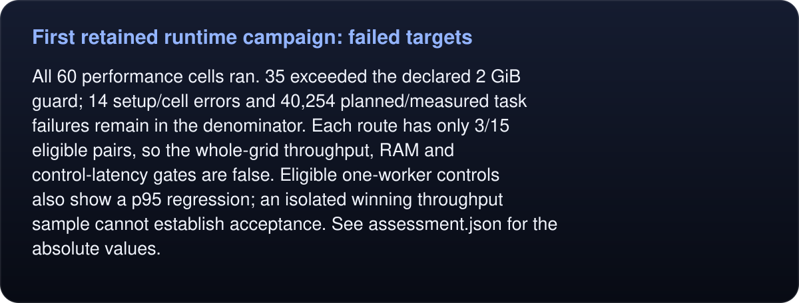
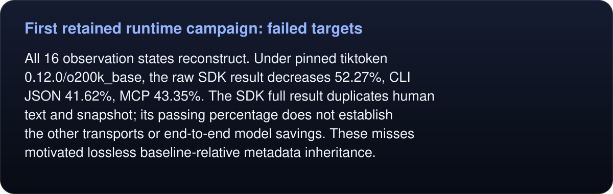
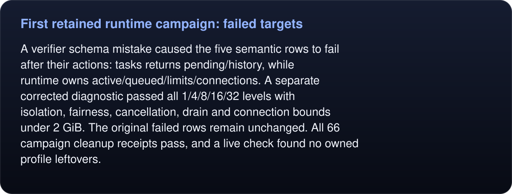

# First retained runtime campaign: failed targets

This is the completed first candidate experiment, retained before the pop-up lifetime and metadata-efficiency corrections. It is not the final performance result.

<!-- umbra-figure: docs-evaluation-runtime-primary-v1-readme-facts-e246600aa0 -->
<picture>
  <source media="(max-width: 600px)" srcset="../../../../assets/docs/docs-evaluation-runtime-primary-v1-readme-facts-e246600aa0-1-mobile-b834afd211.svg">
  
</picture>

Read the text, values and source links

All 60 performance cells ran. 35 exceeded the declared 2 GiB guard; 14 setup/cell errors and 40,254 planned/measured task failures remain in the denominator. Each route has only 3/15 eligible pairs, so the whole-grid throughput, RAM and control-latency gates are false. Eligible one-worker controls also show a p95 regression; an isolated winning throughput sample cannot establish acceptance. See `assessment.json` for the absolute values.

<!-- /umbra-figure -->

<!-- umbra-figure: docs-evaluation-runtime-primary-v1-readme-facts-af7d5e5b2e -->
<picture>
  <source media="(max-width: 600px)" srcset="../../../../assets/docs/docs-evaluation-runtime-primary-v1-readme-facts-af7d5e5b2e-1-mobile-61ed0d7fdc.svg">
  
</picture>

Read the text, values and source links

All 16 observation states reconstruct. Under pinned tiktoken 0.12.0/o200k_base, the raw SDK result decreases 52.27%, CLI JSON 41.62%, MCP 43.35%. The SDK full result duplicates human text and snapshot; its passing percentage does not establish the other transports or end-to-end model savings. These misses motivated lossless baseline-relative metadata inheritance.

<!-- /umbra-figure -->

<!-- umbra-figure: docs-evaluation-runtime-primary-v1-readme-facts-8302301aa1 -->
<picture>
  <source media="(max-width: 600px)" srcset="../../../../assets/docs/docs-evaluation-runtime-primary-v1-readme-facts-8302301aa1-1-mobile-18158eef4b.svg">
  
</picture>

Read the text, values and source links

A verifier schema mistake caused the five semantic rows to fail after their actions: `tasks` returns pending/history, while `runtime` owns active/queued/limits/connections. A separate corrected diagnostic passed all 1/4/8/16/32 levels with isolation, fairness, cancellation, drain and connection bounds under 2 GiB. The original failed rows remain unchanged. All 66 campaign cleanup receipts pass, and a live check found no owned profile leftovers.

<!-- /umbra-figure -->

`raw.tar.gz` contains every original result/log plus the original harness from commit 7193dcd. `archive.json` pins its hash and every raw file. `metadata-verifier.json` records the exact reconstruction adapter’s positive and negative checks: inherit only from the requested baseline in delta mode, and require every metadata field to equal the forced-full result. Full/reset replies cannot inherit. Payloads and token denominators are counted as delivered.

The secondary campaign was held after the concrete pop-up retention defect was found. Fresh complete primary and secondary campaigns are required against the corrected final artifact.
