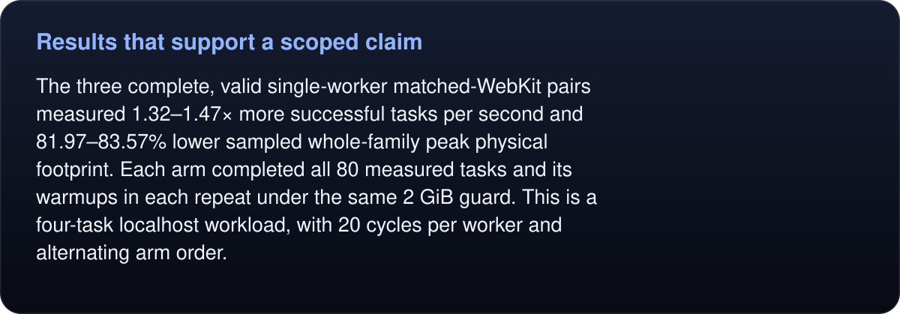
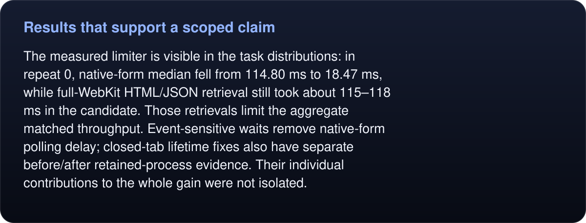
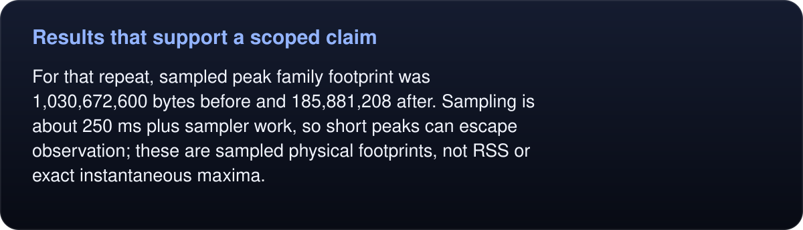
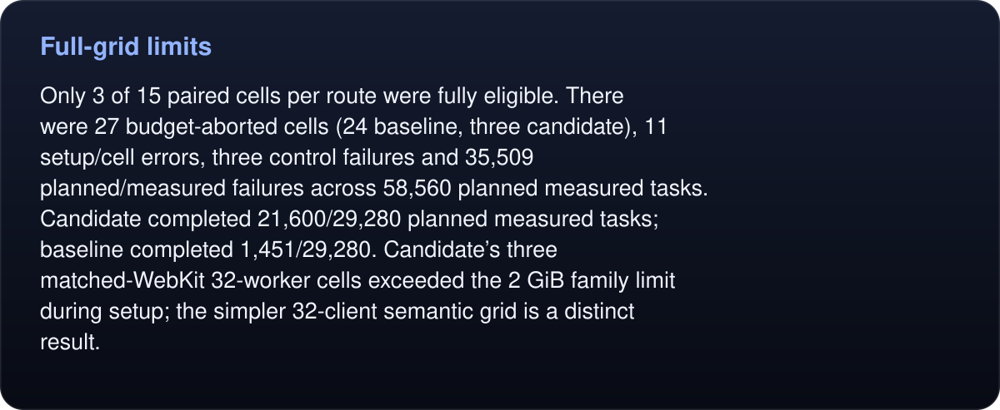
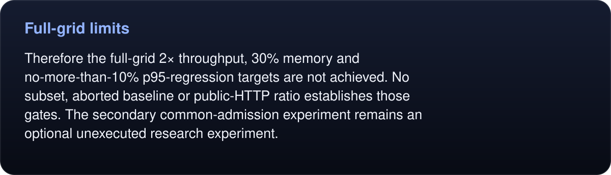
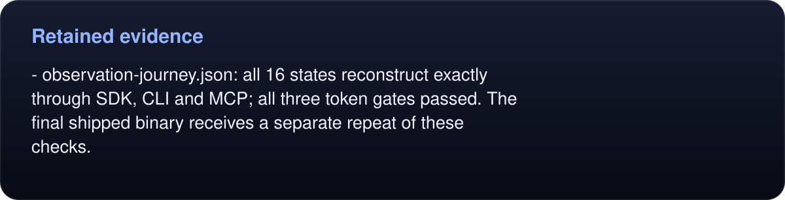

# Runtime primary comparison — 2026-10-23

<!-- umbra-figure: docs-evaluation-runtime-primary-v2-readme-facts-14fbc542dd -->
<picture>
  <source media="(max-width: 600px)" srcset="../../../../assets/docs/docs-evaluation-runtime-primary-v2-readme-facts-14fbc542dd-1-mobile-5f9efad46e.svg">
  
</picture>

Read the text, values and source links

All 60 frozen performance cells completed, followed by the 1/4/8/16/32-client semantic grid and 16-state observation journey. The campaign exited 1 because broad performance acceptance gates were not met. Every failed or uncompleted task remains in the denominator.

<!-- /umbra-figure -->

The measured candidate was `0f2db45988f472004708411947026319678e6d26f500cabe913f91a9646dcfc9`; baseline was `1a71d178d1899b5610adf065128167efadae7e054b27e18d7b06cc6681b8dd47`. This candidate predates the final one-line frame-select input guard, which was independently reviewed and received its own final-build regression. Do not relabel the performance samples as another binary.

## Results that support a scoped claim

<!-- umbra-figure: docs-evaluation-runtime-primary-v2-readme-facts-0c294693b3 -->
<picture>
  <source media="(max-width: 600px)" srcset="../../../../assets/docs/docs-evaluation-runtime-primary-v2-readme-facts-0c294693b3-1-mobile-f0dce77b38.svg">
  
</picture>

Read the text, values and source links

The three complete, valid single-worker matched-WebKit pairs measured **1.32–1.47× more successful tasks per second** and **81.97–83.57% lower sampled whole-family peak physical footprint**. Each arm completed all 80 measured tasks and its warmups in each repeat under the same 2 GiB guard. This is a four-task localhost workload, with 20 cycles per worker and alternating arm order.

<!-- /umbra-figure -->

<!-- umbra-figure: docs-evaluation-runtime-primary-v2-readme-facts-612b4ed6d7 -->
<picture>
  <source media="(max-width: 600px)" srcset="../../../../assets/docs/docs-evaluation-runtime-primary-v2-readme-facts-612b4ed6d7-1-mobile-5832e4b75a.svg">
  
</picture>

Read the text, values and source links

The measured limiter is visible in the task distributions: in repeat 0, native-form median fell from 114.80 ms to 18.47 ms, while full-WebKit HTML/JSON retrieval still took about 115–118 ms in the candidate. Those retrievals limit the aggregate matched throughput. Event-sensitive waits remove native-form polling delay; closed-tab lifetime fixes also have separate before/after retained-process evidence. Their individual contributions to the whole gain were not isolated.

<!-- /umbra-figure -->

<!-- umbra-figure: docs-evaluation-runtime-primary-v2-readme-facts-1d67187c4e -->
<picture>
  <source media="(max-width: 600px)" srcset="../../../../assets/docs/docs-evaluation-runtime-primary-v2-readme-facts-1d67187c4e-1-mobile-9c8f2d73cb.svg">
  
</picture>

Read the text, values and source links

For that repeat, sampled peak family footprint was 1,030,672,600 bytes before and 185,881,208 after. Sampling is about 250 ms plus sampler work, so short peaks can escape observation; these are sampled physical footprints, not RSS or exact instantaneous maxima.

<!-- /umbra-figure -->

The public-HTTP route also has three valid single-worker pairs, but changes candidate HTML/JSON retrieval to its no-cookie/no-JavaScript HTTP path. Its very short candidate windows have sparse memory/control samples. Raw ratios remain in `summary.json`; they are not an engine-only speedup and are not promoted as a broad browser claim.

## Full-grid limits

<!-- umbra-figure: docs-evaluation-runtime-primary-v2-readme-facts-b6b5137185 -->
<picture>
  <source media="(max-width: 600px)" srcset="../../../../assets/docs/docs-evaluation-runtime-primary-v2-readme-facts-b6b5137185-1-mobile-b218cefb59.svg">
  
</picture>

Read the text, values and source links

Only 3 of 15 paired cells per route were fully eligible. There were 27 budget-aborted cells (24 baseline, three candidate), 11 setup/cell errors, three control failures and 35,509 planned/measured failures across 58,560 planned measured tasks. Candidate completed 21,600/29,280 planned measured tasks; baseline completed 1,451/29,280. Candidate’s three matched-WebKit 32-worker cells exceeded the 2 GiB family limit during setup; the simpler 32-client semantic grid is a distinct result.

<!-- /umbra-figure -->

<!-- umbra-figure: docs-evaluation-runtime-primary-v2-readme-facts-e77d19737b -->
<picture>
  <source media="(max-width: 600px)" srcset="../../../../assets/docs/docs-evaluation-runtime-primary-v2-readme-facts-e77d19737b-1-mobile-c7b11d74de.svg">
  
</picture>

Read the text, values and source links

Therefore the full-grid 2× throughput, 30% memory and no-more-than-10% p95-regression targets are **not achieved**. No subset, aborted baseline or public-HTTP ratio establishes those gates. The secondary common-admission experiment remains an optional unexecuted research experiment.

<!-- /umbra-figure -->

## Retained evidence

- `summary.json`: every paired comparison, repeat spread and route gate.
- `runtime-grid-summary.json`: compact dispositions for all five passing ownership/fairness/cancellation levels; the complete `runtime-grid.json` is retained inside the raw archive.
<!-- umbra-figure: docs-evaluation-runtime-primary-v2-readme-facts-b22843ef2c -->
<picture>
  <source media="(max-width: 600px)" srcset="../../../../assets/docs/docs-evaluation-runtime-primary-v2-readme-facts-b22843ef2c-1-mobile-05d21e6a1d.svg">
  
</picture>

Read the text, values and source links

- `observation-journey.json`: all 16 states reconstruct exactly through SDK, CLI and MCP; all three token gates passed. The final shipped binary receives a separate repeat of these checks.

<!-- /umbra-figure -->
- `manifest.json`, `live.json`, `runner.log`: immutable hashes, terminal state and original invocation.
- `raw.tar.gz`, `archive.json`: all 242 raw files with byte counts and SHA-256 hashes, including every failure and all 66 successful cleanup receipts.

The 24-hour soak requirement was explicitly removed by the user; no long-duration stability result is claimed.
