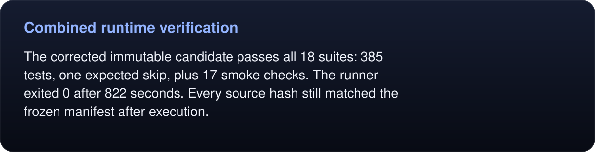

# Combined runtime verification

<!-- umbra-figure: docs-evaluation-runtime-verification-full-suite-facts-fbb72e3fdd -->
<picture>
  <source media="(max-width: 600px)" srcset="../../../../assets/docs/docs-evaluation-runtime-verification-full-suite-facts-fbb72e3fdd-1-mobile-574d36e006.svg">
  
</picture>

Read the text, values and source links

The corrected immutable candidate passes all 18 suites: 385 tests, one expected skip, plus 17 smoke checks. The runner exited 0 after 822 seconds. Every source hash still matched the frozen manifest after execution.

<!-- /umbra-figure -->

- Product source: `40bd72afe5c9d907e29786350d0e21538c0bde39`.
- Binary SHA-256: `b3cab7cfd178ffc10613ec83ae42499148bd4704892491fcad5342a4dd7f5cab`.
- Frozen Python SDK SHA-256: `1de49bf4f21951045660ce112fa94dc888fba1ffaba166c94974b882f88acfdb`.
- [Exact terminal log](full-suite.log) and [suite/source/hash receipt](full-suite.json).

The run includes legacy CLI/daemon/MCP contracts; owned scheduling, overload, headroom and cancellation; same-label request reuse; native capture cleanup; idle/watch disposal; frames/events; workflows/checkpoints/partial failures; diagnostics, recording, process accounting; and real Python, TypeScript, Swift SDK clients. Tests use disposable profiles and localhost fixtures.

[Two earlier failed gates](REGRESSIONS.md) were corrected without changing their assertions. No installed binary or default profile was modified. This receipt proves the functional suite for this artifact; throughput, RAM, observation-token and 24-hour targets require their separate measurements.
