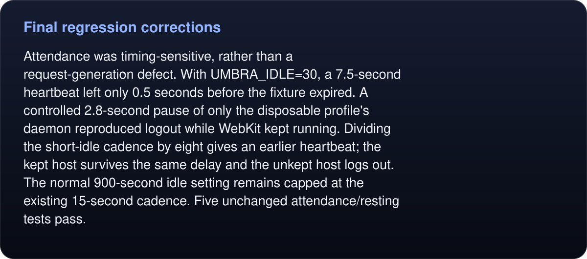

# Final regression corrections

The combined run caught two failures before performance measurements began. Existing assertions were retained.

The launch-agent executable must be fully canonical. Foundation returned a `/var` alias for a bundle beneath `/private/var`; POSIX `realpath` now produces the canonical program string. The unchanged launch-agent test passes against the copied app. Launch verification binaries through their canonical path too: starting WebKit through `/var` can add a sandbox-extension warning to stderr.

<!-- umbra-figure: docs-evaluation-runtime-verification-regressions-facts-d3c034c164 -->
<picture>
  <source media="(max-width: 600px)" srcset="../../../../assets/docs/docs-evaluation-runtime-verification-regressions-facts-d3c034c164-1-mobile-7aa857aa39.svg">
  
</picture>

<details>
<summary>Read the text, values and source links</summary>

Attendance was timing-sensitive, rather than a request-generation defect. With `UMBRA_IDLE=30`, a 7.5-second heartbeat left only 0.5 seconds before the fixture expired. A controlled 2.8-second pause of only the disposable profile's daemon reproduced logout while WebKit kept running. Dividing the short-idle cadence by eight gives an earlier heartbeat; the kept host survives the same delay and the unkept host logs out. The normal 900-second idle setting remains capped at the existing 15-second cadence. Five unchanged attendance/resting tests pass.

</details>
<!-- /umbra-figure -->

`regressions.json` pins binary and raw-evidence hashes. The before/after traces are fault-injection checks, not performance measurements. Repeat the exact probe with each canonical binary:

```sh
PYTHONPATH=tests UMBRA=/absolute/canonical/path/to/umbra \
  python3 docs/evaluation/runtime/verification/attendance-scheduler-delay.py
```

The helper always creates a disposable profile, resumes its own paused daemon in `finally`, then stops and removes its profile. No installed/default profile is used.
