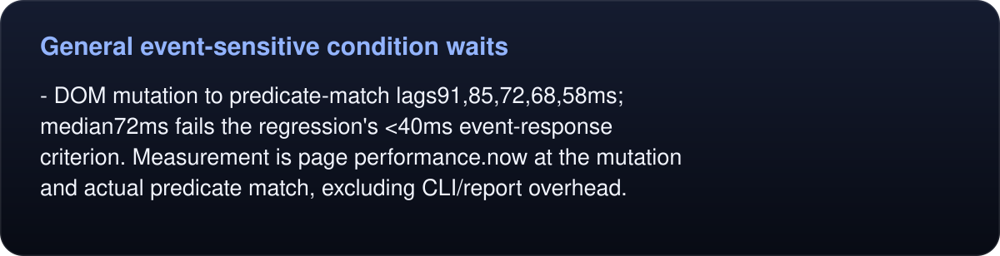
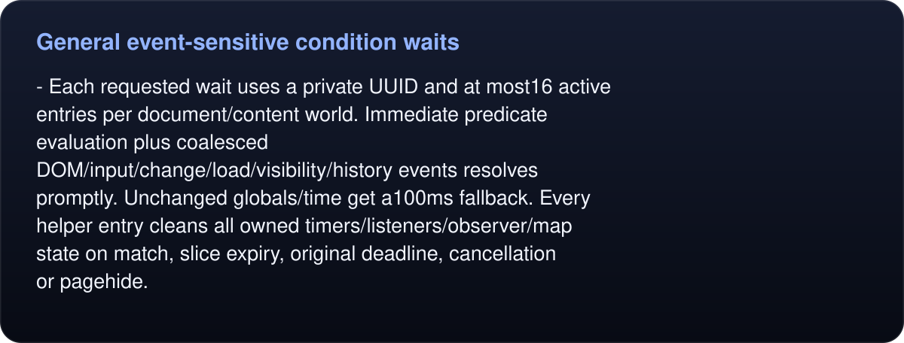
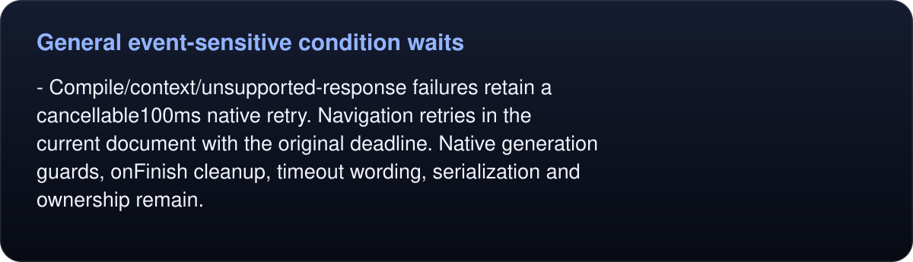
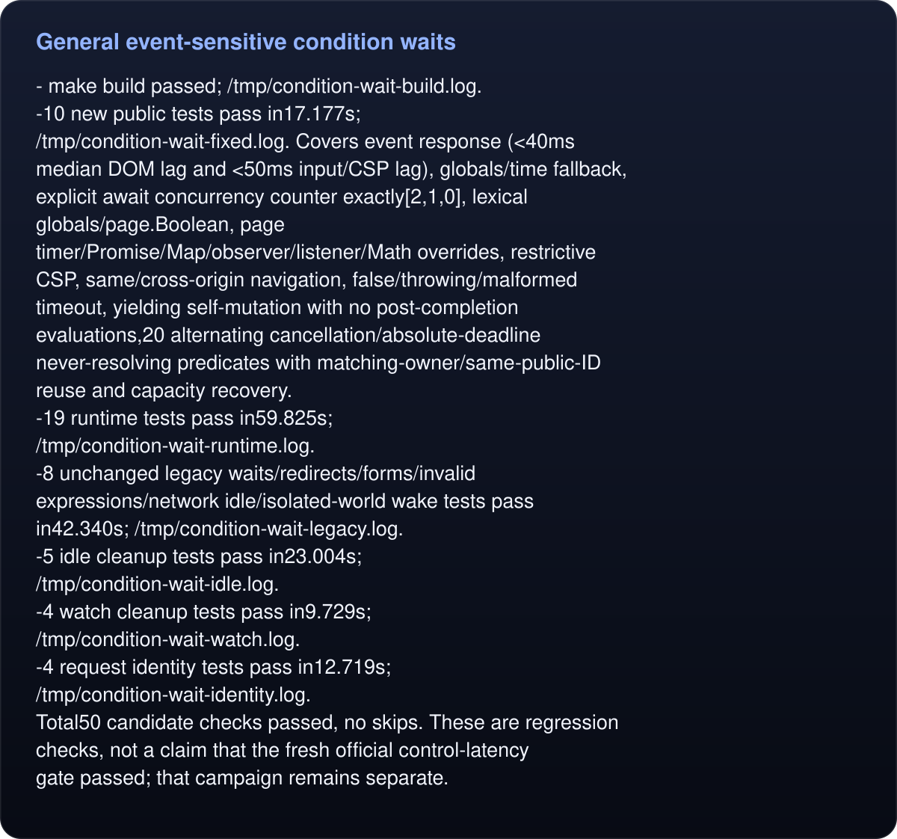
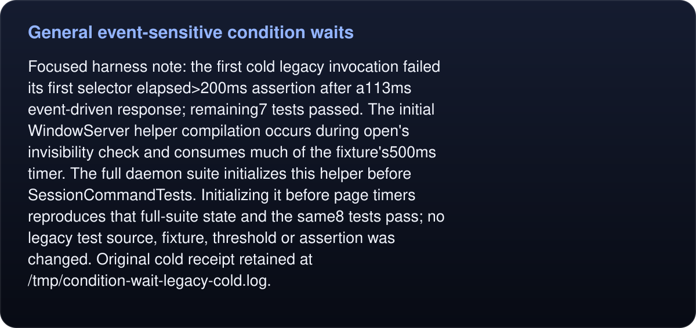

# General event-sensitive condition waits

Deliverable: /tmp/condition-wait.patch; only Sources/Engine.swift and new tests/test_condition_wait.py. No Runtime/scheduler/benchmark changes, flags, root edits, commits or installs by this lane.
Baseline SHA256:563cf5b925e6a7778f0a708e78638062bc8c9fa018639dc3e2d32e70a9e33e5e.
Frozen candidate SHA256:40a4027289ace1cf4cc61bc78ad4bf015292ff12eb10e7cab66399fd63cd234c.

Baseline-red public checks (/tmp/condition-wait-baseline.log):
<!-- umbra-figure: docs-evaluation-runtime-verification-condition-waits-lane-receipt-facts-cc7dfae911 -->
<picture>
  <source media="(max-width: 600px)" srcset="../../../../../assets/docs/docs-evaluation-runtime-verification-condition-waits-lane-receipt-facts-cc7dfae911-1-mobile-774993628c.svg">
  
</picture>

<details>
<summary>Read the text, values and source links</summary>

- DOM mutation to predicate-match lags91,85,72,68,58ms; median72ms fails the regression's <40ms event-response criterion. Measurement is page performance.now at the mutation and actual predicate match, excluding CLI/report overhead.

</details>
<!-- /umbra-figure -->
<!-- umbra-figure: docs-evaluation-runtime-verification-condition-waits-lane-receipt-facts-524cd2e8b7 -->
<picture>
  <source media="(max-width: 600px)" srcset="../../../../../assets/docs/docs-evaluation-runtime-verification-condition-waits-lane-receipt-facts-524cd2e8b7-1-mobile-b9ba983c78.svg">
  
</picture>

<details>
<summary>Read the text, values and source links</summary>

- Overridden page.Boolean makes a true condition using global names time out. Baseline2 tests,2 failures in3.772s.

</details>
<!-- /umbra-figure -->

Implementation:
- One fixed-source document-start page-world bootstrap per shared user-content-controller, deduplicated before creating the web view. It captures original timer, Promise, observer, listener and map operations; API is frozen and non-enumerable. Idle documents get no active observer/listener/timer.
<!-- umbra-figure: docs-evaluation-runtime-verification-condition-waits-lane-receipt-facts-4dc6c8a584 -->
<picture>
  <source media="(max-width: 600px)" srcset="../../../../../assets/docs/docs-evaluation-runtime-verification-condition-waits-lane-receipt-facts-4dc6c8a584-1-mobile-7cd89d984b.svg">
  
</picture>

<details>
<summary>Read the text, values and source links</summary>

- Each requested wait uses a private UUID and at most16 active entries per document/content world. Immediate predicate evaluation plus coalesced DOM/input/change/load/visibility/history events resolves promptly. Unchanged globals/time get a100ms fallback. Every helper entry cleans all owned timers/listeners/observer/map state on match, slice expiry, original deadline, cancellation or pagehide.

</details>
<!-- /umbra-figure -->
- Native-compiled async predicate closure uses !! and remains outside the bootstrap/helper lexical scope, preserving page-global identifiers and supplied arguments. No eval or Function construction, and the selected content world is unchanged. The small page-world helper is instrumentation for the explicitly requested page-world predicate; isolated waits bootstrap the same helper in their isolated world on demand.
- A slice does not end while its async predicate is in flight, except at the original absolute deadline/cancellation; no overlapping copies. Mutation rechecks yield through captured macrotasks, not microtask recursion.
<!-- umbra-figure: docs-evaluation-runtime-verification-condition-waits-lane-receipt-facts-e74cbb99e8 -->
<picture>
  <source media="(max-width: 600px)" srcset="../../../../../assets/docs/docs-evaluation-runtime-verification-condition-waits-lane-receipt-facts-e74cbb99e8-1-mobile-35c77222e7.svg">
  
</picture>

<details>
<summary>Read the text, values and source links</summary>

- Compile/context/unsupported-response failures retain a cancellable100ms native retry. Navigation retries in the current document with the original deadline. Native generation guards, onFinish cleanup, timeout wording, serialization and ownership remain.

</details>
<!-- /umbra-figure -->

Validation against successful frozen build:
<!-- umbra-figure: docs-evaluation-runtime-verification-condition-waits-lane-receipt-facts-938b4b5179 -->
<picture>
  <source media="(max-width: 600px)" srcset="../../../../../assets/docs/docs-evaluation-runtime-verification-condition-waits-lane-receipt-facts-938b4b5179-1-mobile-4219a73ff7.svg">
  
</picture>

<details>
<summary>Read the text, values and source links</summary>

- make build passed; /tmp/condition-wait-build.log.
-10 new public tests pass in17.177s; /tmp/condition-wait-fixed.log. Covers event response (<40ms median DOM lag and <50ms input/CSP lag), globals/time fallback, explicit await concurrency counter exactly[2,1,0], lexical globals/page.Boolean, page timer/Promise/Map/observer/listener/Math overrides, restrictive CSP, same/cross-origin navigation, false/throwing/malformed timeout, yielding self-mutation with no post-completion evaluations,20 alternating cancellation/absolute-deadline never-resolving predicates with matching-owner/same-public-ID reuse and capacity recovery.
-19 runtime tests pass in59.825s; /tmp/condition-wait-runtime.log.
-8 unchanged legacy waits/redirects/forms/invalid expressions/network idle/isolated-world wake tests pass in42.340s; /tmp/condition-wait-legacy.log.
-5 idle cleanup tests pass in23.004s; /tmp/condition-wait-idle.log.
-4 watch cleanup tests pass in9.729s; /tmp/condition-wait-watch.log.
-4 request identity tests pass in12.719s; /tmp/condition-wait-identity.log.
Total50 candidate checks passed, no skips. These are regression checks, not a claim that the fresh official control-latency gate passed; that campaign remains separate.

</details>
<!-- /umbra-figure -->

<!-- umbra-figure: docs-evaluation-runtime-verification-condition-waits-lane-receipt-facts-1492414279 -->
<picture>
  <source media="(max-width: 600px)" srcset="../../../../../assets/docs/docs-evaluation-runtime-verification-condition-waits-lane-receipt-facts-1492414279-1-mobile-7ca73e4527.svg">
  
</picture>

<details>
<summary>Read the text, values and source links</summary>

Focused harness note: the first cold legacy invocation failed its first selector elapsed>200ms assertion after a113ms event-driven response; remaining7 tests passed. The initial WindowServer helper compilation occurs during open's invisibility check and consumes much of the fixture's500ms timer. The full daemon suite initializes this helper before SessionCommandTests. Initializing it before page timers reproduces that full-suite state and the same8 tests pass; no legacy test source, fixture, threshold or assertion was changed. Original cold receipt retained at /tmp/condition-wait-legacy-cold.log.

</details>
<!-- /umbra-figure -->

Repeat the unchanged legacy subset with full-suite helper initialization:
```sh
PYTHONPATH=/Users/randyren/Developer/umbra/tests UMBRA=/absolute/canonical/path/to/umbra python3 /tmp/condition-wait-legacy-driver.py
```

Patch application check against root passed at delivery. Parent should add test_condition_wait to tests/run.sh's explicit suite list. Final process inspection found no daemon from the isolated build; test cleanup removed its disposable stores/files/agents. Hash receipt: /tmp/condition-wait-hashes.json.
