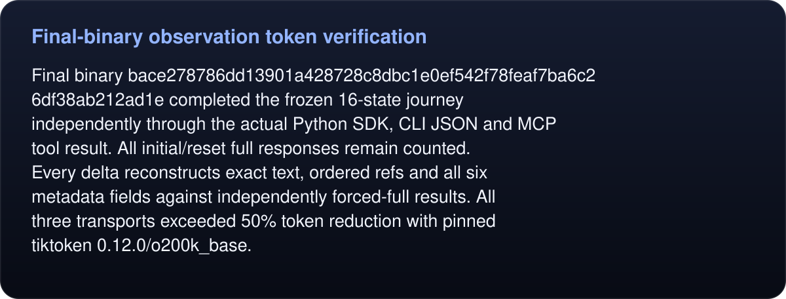

# Final-binary observation token verification

<!-- umbra-figure: docs-evaluation-runtime-verification-final-observation-readme-facts-8727cdc90e -->
<picture>
  <source media="(max-width: 600px)" srcset="../../../../../assets/docs/docs-evaluation-runtime-verification-final-observation-readme-facts-8727cdc90e-1-mobile-527b25aede.svg">
  
</picture>

Read the text, values and source links

Final binary `bace278786dd13901a428728c8dbc1e0ef542f78feaf7ba6c26df38ab212ad1e` completed the frozen 16-state journey independently through the actual Python SDK, CLI JSON and MCP tool result. All initial/reset full responses remain counted. Every delta reconstructs exact text, ordered refs and all six metadata fields against independently forced-full results. All three transports exceeded 50% token reduction with pinned tiktoken 0.12.0/o200k_base.

<!-- /umbra-figure -->

`results.json` retains every raw response, reconstruction, tokenizer count, command and cleanup result. Raw SDK results retain their delivered human text, so their denominator differs from CLI and MCP. These are observation-response counts under the specified encoding, not end-to-end agent or billing-token claims. `run.py` is the exact local repeat using the unchanged frozen harness function; its run-specific paths can be adapted.
