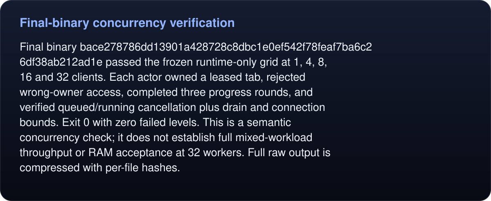

# Final-binary concurrency verification

<!-- umbra-figure: docs-evaluation-runtime-verification-final-runtime-readme-facts-79d75cb0e6 -->
<picture>
  <source media="(max-width: 600px)" srcset="../../../../../assets/docs/docs-evaluation-runtime-verification-final-runtime-readme-facts-79d75cb0e6-1-mobile-ed75058fc1.svg">
  
</picture>

Read the text, values and source links

Final binary `bace278786dd13901a428728c8dbc1e0ef542f78feaf7ba6c26df38ab212ad1e` passed the frozen runtime-only grid at 1, 4, 8, 16 and 32 clients. Each actor owned a leased tab, rejected wrong-owner access, completed three progress rounds, and verified queued/running cancellation plus drain and connection bounds. Exit 0 with zero failed levels. This is a semantic concurrency check; it does not establish full mixed-workload throughput or RAM acceptance at 32 workers. Full raw output is compressed with per-file hashes.

<!-- /umbra-figure -->
