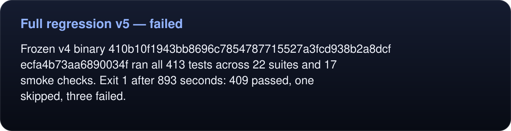

# Full regression v5 — failed

<!-- umbra-figure: docs-evaluation-runtime-verification-full-v5-readme-facts-1b8513b14d -->
<picture>
  <source media="(max-width: 600px)" srcset="../../../../../assets/docs/docs-evaluation-runtime-verification-full-v5-readme-facts-1b8513b14d-1-mobile-d3e118de62.svg">
  
</picture>

Read the text, values and source links

Frozen v4 binary `410b10f1943bb8696c7854787715527a3fcd938b2a8dcfecfa4b73aa6890034f` ran all 413 tests across 22 suites and 17 smoke checks. Exit 1 after 893 seconds: 409 passed, one skipped, three failed.

<!-- /umbra-figure -->

The three failures all concern named sign-in timeout/deadline errors being replaced by the client reply timeout. Client and daemon used the same deadline, so the client stopped receiving as daemon cancellation began producing its detailed error. This is a failed regression receipt, not a passing subset or performance result. The benchmark gate remained closed.

The exact raw log and candidate/source hashes are retained beside this file. A subsequent fix must preserve execution deadlines while allowing bounded error delivery, reject late success, and pass the original assertions.
