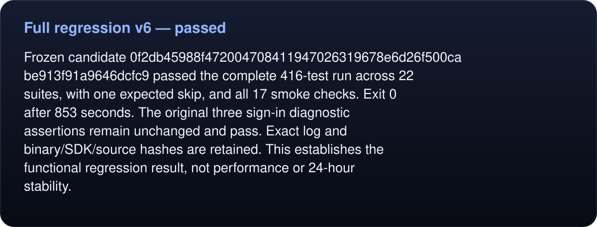

# Full regression v6 — passed

<!-- umbra-figure: docs-evaluation-runtime-verification-full-v6-readme-facts-238abb3fb3 -->
<picture>
  <source media="(max-width: 600px)" srcset="../../../../../assets/docs/docs-evaluation-runtime-verification-full-v6-readme-facts-238abb3fb3-1-mobile-214801dca5.svg">
  
</picture>

Read the text, values and source links

Frozen candidate `0f2db45988f472004708411947026319678e6d26f500cabe913f91a9646dcfc9` passed the complete 416-test run across 22 suites, with one expected skip, and all 17 smoke checks. Exit 0 after 853 seconds. The original three sign-in diagnostic assertions remain unchanged and pass. Exact log and binary/SDK/source hashes are retained. This establishes the functional regression result, not performance or 24-hour stability.

<!-- /umbra-figure -->
