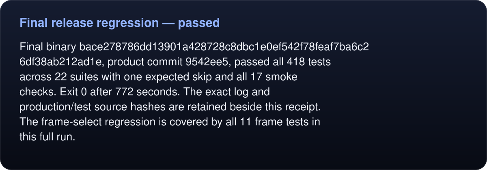

# Final release regression — passed

<!-- umbra-figure: docs-evaluation-runtime-verification-full-v7-readme-facts-f2d603b7e7 -->
<picture>
  <source media="(max-width: 600px)" srcset="../../../../../assets/docs/docs-evaluation-runtime-verification-full-v7-readme-facts-f2d603b7e7-1-mobile-8ca8d1ff4f.svg">
  
</picture>

Read the text, values and source links

Final binary `bace278786dd13901a428728c8dbc1e0ef542f78feaf7ba6c26df38ab212ad1e`, product commit `9542ee5`, passed all 418 tests across 22 suites with one expected skip and all 17 smoke checks. Exit 0 after 772 seconds. The exact log and production/test source hashes are retained beside this receipt. The frame-select regression is covered by all 11 frame tests in this full run.

<!-- /umbra-figure -->
