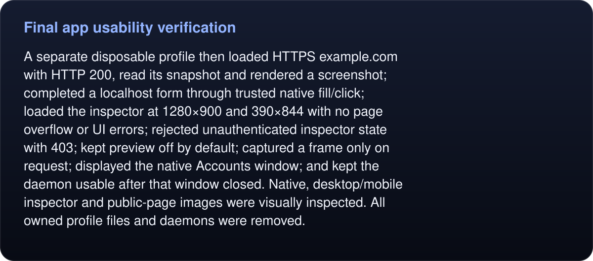

# Final app usability verification

Final binary `bace278786dd13901a428728c8dbc1e0ef542f78feaf7ba6c26df38ab212ad1e` passed three additional visible GUI tests: empty account-window launch, scripted sign-in closing its page, and handoff hiding again.

<!-- umbra-figure: docs-evaluation-runtime-verification-live-app-readme-facts-91129a2175 -->
<picture>
  <source media="(max-width: 600px)" srcset="../../../../../assets/docs/docs-evaluation-runtime-verification-live-app-readme-facts-91129a2175-1-mobile-c0a2f43e9c.svg">
  
</picture>

Read the text, values and source links

A separate disposable profile then loaded HTTPS example.com with HTTP 200, read its snapshot and rendered a screenshot; completed a localhost form through trusted native fill/click; loaded the inspector at 1280×900 and 390×844 with no page overflow or UI errors; rejected unauthenticated inspector state with 403; kept preview off by default; captured a frame only on request; displayed the native Accounts window; and kept the daemon usable after that window closed. Native, desktop/mobile inspector and public-page images were visually inspected. All owned profile files and daemons were removed.

<!-- /umbra-figure -->

The initial manual check expected example.com’s old heading. The live site now has multilingual paragraph content without that heading, so the readiness assertion timed out despite successful navigation. A second check confirmed HTTP 200/title/document completion and exposed the stale snapshot assertion. The final check uses the actual observed page content. No product code changed for these check corrections. The failed attempt logs are retained; no long-running public-site monitoring was configured.

`receipt.json` and screenshots contain only the disposable profile, public example page and synthetic fixture. Inspector bearer credentials are not retained. `run.py` is the exact local verification script; its local paths identify this run and can be adapted for reproduction.
