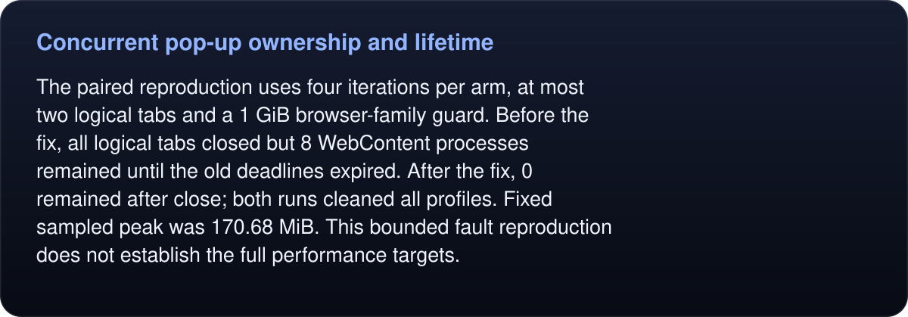

# Concurrent pop-up ownership and lifetime

A native click could mistake an independent request’s scratch tab for its pop-up. Its follow-up deadline then retained that tab and the strong before-action tab snapshot after successful completion.

The correction records native opener identity, snapshots tab IDs, and clears the follow timer on completion/cancellation. The two public ownership checks plus 24 existing frame/observation/pop-up checks pass. Genuine native pop-ups and trusted input remain supported.

<!-- umbra-figure: docs-evaluation-runtime-verification-popup-lifetime-readme-facts-045aae3893 -->
<picture>
  <source media="(max-width: 600px)" srcset="../../../../../assets/docs/docs-evaluation-runtime-verification-popup-lifetime-readme-facts-045aae3893-1-mobile-b077f194b2.svg">
  
</picture>

Read the text, values and source links

The paired reproduction uses four iterations per arm, at most two logical tabs and a 1 GiB browser-family guard. Before the fix, all logical tabs closed but 8 WebContent processes remained until the old deadlines expired. After the fix, 0 remained after close; both runs cleaned all profiles. Fixed sampled peak was 170.68 MiB. This bounded fault reproduction does not establish the full performance targets.

<!-- /umbra-figure -->

Raw traces, exact probe and source/file hashes are retained here. The tested isolated patch binary is distinguished from the combined candidate in `receipt.json`; Engine/Interact source hashes match the integrated correction.
