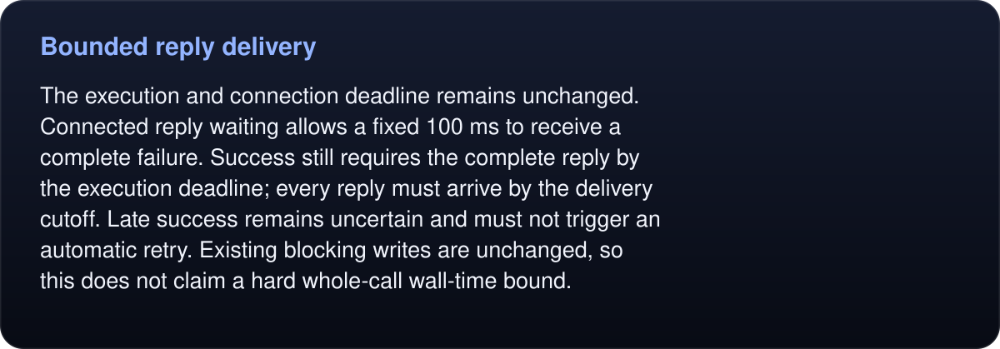

# Bounded reply delivery

The client and runtime formerly stopped at the same deadline. Runtime cancellation performs cleanup before producing its command-specific failure, so the client could discard that error. The exact three sign-in cases failed before this fix and pass afterward.

<!-- umbra-figure: docs-evaluation-runtime-verification-reply-delivery-readme-facts-0989d1d1f9 -->
<picture>
  <source media="(max-width: 600px)" srcset="../../../../../assets/docs/docs-evaluation-runtime-verification-reply-delivery-readme-facts-0989d1d1f9-1-mobile-673fe146e7.svg">
  
</picture>

Read the text, values and source links

The execution and connection deadline remains unchanged. Connected reply waiting allows a fixed 100 ms to receive a complete failure. Success still requires the complete reply by the execution deadline; every reply must arrive by the delivery cutoff. Late success remains uncertain and must not trigger an automatic retry. Existing blocking writes are unchanged, so this does not claim a hard whole-call wall-time bound.

<!-- /umbra-figure -->

Latest isolated-source evidence: 21 distinct tests passed (13 transport, three original sign-in cases, five MCP), plus 18 repeated checks. Logs retain baseline failures, passing checks and cleanup evidence. Root's combined build still requires the full suite; this receipt alone does not establish a performance result.
