# How Umbra works

Umbra is a Swift program, in [Sources/](../Sources/), compiled into a small macOS app bundle. This page covers the daemon and socket, bounded scheduling, tabs, input, the cookie store and profiles. [Runtime usage](runtime/README.md) explains ownership, observations, workflows, resource presets and inspection. [AGENTS.md](../AGENTS.md) has the same architecture from a contributor's side.

<picture>
  <source media="(max-width: 600px)" srcset="../assets/how-it-works-mobile.svg">
  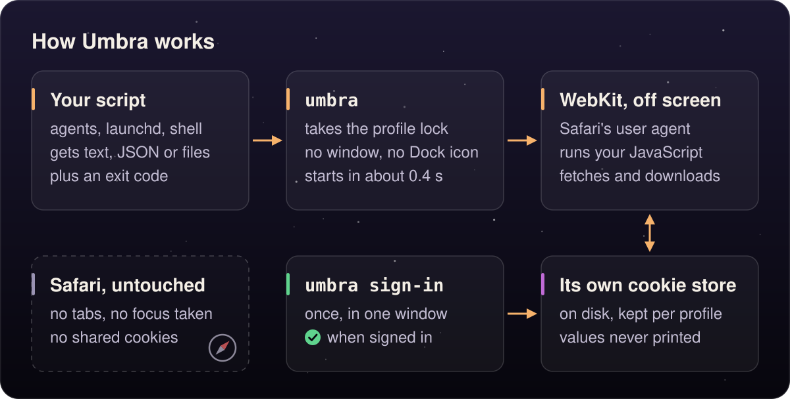
</picture>

## The app

`make build` compiles the sources with `swiftc` into `build/Umbra.app` and signs it ad hoc. `Info.plist` is linked into the binary itself (`-sectcreate __TEXT __info_plist`), so the bundle identifier `com.randyren.umbra` holds however you launch it: from the app, through the `~/.local/bin/umbra` symlink, or from a copy of the binary. That matters because the identifier decides where WebKit keeps the cookie store.

Headless work runs under the *prohibited* activation policy. The process has no Dock icon and no menu bar, and it can never become the active app. While the sign-in window is open the daemon switches to the *regular* policy (a Dock icon and a menu bar), and `handoff` uses the *accessory* policy, which allows a window but shows no Dock icon and no Command-Tab entry. Both switch back when their window closes.

## The daemon

The first session command for a profile (`open`, `snapshot`, anything but the one-shots) starts a daemon, `umbra serve`, in the background. One daemon per profile owns WebKit, the tabs and the cookie store, and every later command and every `umbra mcp` call goes to it. A second daemon for the same profile notices the first one's lock and bows out.

<!-- umbra-figure: docs-how-it-works-table-0c227516e6 -->
<picture>
  <source media="(max-width: 600px)" srcset="../assets/docs/docs-how-it-works-table-0c227516e6-1-mobile-2d10ff0081.svg">
  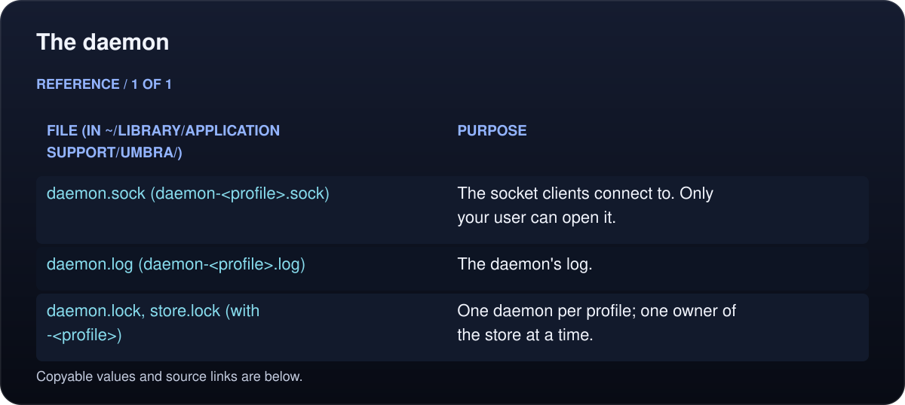
</picture>

<details>
<summary>Read the text, values and source links</summary>

- **File (in `~/Library/Application Support/Umbra/`):** `daemon.sock` (`daemon-<profile>.sock`)
- **Purpose:** The socket clients connect to. Only your user can open it.

- **File (in `~/Library/Application Support/Umbra/`):** `daemon.log` (`daemon-<profile>.log`)
- **Purpose:** The daemon's log.

- **File (in `~/Library/Application Support/Umbra/`):** `daemon.lock`, `store.lock` (with `-<profile>`)
- **Purpose:** One daemon per profile; one owner of the store at a time.

</details>
<!-- /umbra-figure -->

<!-- umbra-figure: docs-how-it-works-facts-c3d09b5503 -->
<picture>
  <source media="(max-width: 600px)" srcset="../assets/docs/docs-how-it-works-facts-c3d09b5503-1-mobile-2153ecc0c8.svg">
  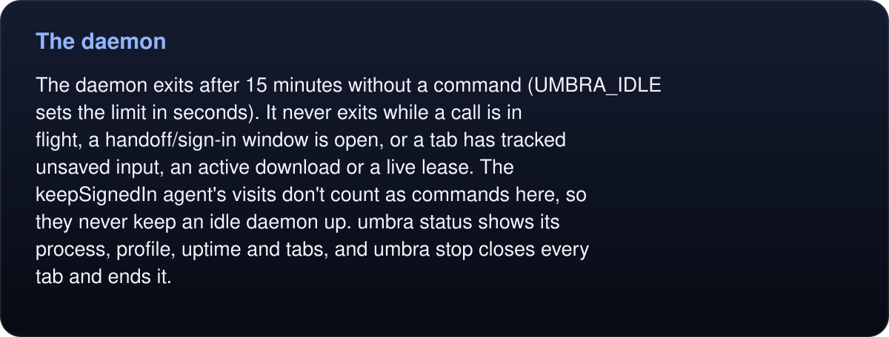
</picture>

<details>
<summary>Read the text, values and source links</summary>

The daemon exits after 15 minutes without a command (`UMBRA_IDLE` sets the limit in seconds). It never exits while a call is in flight, a handoff/sign-in window is open, or a tab has tracked unsaved input, an active download or a live lease. The `keepSignedIn` agent's visits don't count as commands here, so they never keep an idle daemon up. `umbra status` shows its process, profile, uptime and tabs, and `umbra stop` closes every tab and ends it.

</details>
<!-- /umbra-figure -->

<!-- umbra-figure: docs-how-it-works-facts-be32a7d1dd -->
<picture>
  <source media="(max-width: 600px)" srcset="../assets/docs/docs-how-it-works-facts-be32a7d1dd-1-mobile-a208257876.svg">
  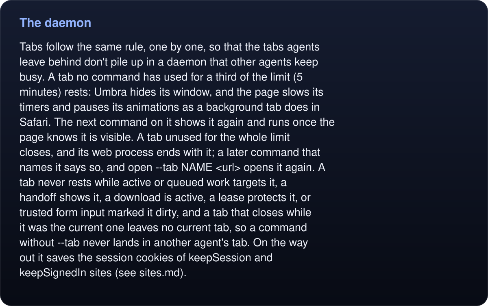
</picture>

<details>
<summary>Read the text, values and source links</summary>

Tabs follow the same rule, one by one, so that the tabs agents leave behind don't pile up in a daemon that other agents keep busy. A tab no command has used for a third of the limit (5 minutes) rests: Umbra hides its window, and the page slows its timers and pauses its animations as a background tab does in Safari. The next command on it shows it again and runs once the page knows it is visible. A tab unused for the whole limit closes, and its web process ends with it; a later command that names it says so, and `open --tab NAME <url>` opens it again. A tab never rests while active or queued work targets it, a handoff shows it, a download is active, a lease protects it, or trusted form input marked it dirty, and a tab that closes while it was the current one leaves no current tab, so a command without `--tab` never lands in another agent's tab. On the way out it saves the session cookies of `keepSession` and `keepSignedIn` sites (see [sites.md](sites.md#keepsession)).

</details>
<!-- /umbra-figure -->

### The protocol

The socket takes one JSON object per line. Connections are persistent and serial within a connection; each accepted connection gets a thread, bounded by `UMBRA_CONNECTIONS` (default 64). Request buffers, admitted argument bytes, pending jobs and replies have separate bounds. The main-thread runtime admits jobs and serializes each tab’s operations while allowing independent tabs to progress:

```
→ {"id": 1, "command": "get", "args": {"target": "text=Save changes"}}
← {"result":{"visible":true,"ref":"e1","name":"Save changes","enabled":true,"text":"Save changes","box":{"y":524,"height":39,"width":123,"x":1104},"desc":"button \"Save changes\"","role":"button"},"ok":true,"id":1}
→ {"id": 2, "command": "click", "args": {"target": "#nope", "timeout": 1}}
← {"id":2,"error":{"message":"timed out after 1 s: nothing matches #nope","code":2},"ok":false}
```

A result has a short human `text`, which is what the CLI prints, plus structured fields, which `--json` prints. Binary data comes back base64 in `data` with a `mime` type, or is written to the `path` the caller gave. The error `code` is the exit code the CLI exits with. The socket envelope `id` correlates a response; `args.request` identifies a scheduled request for `tasks` and `cancel`. They are separate fields. The [SDKs](../sdk/README.md) set them consistently by default, bound replies, enforce absolute deadlines and use separate cancellation connections.

Commands are declared once in a registry: name, help, parameters, aliases, whether they use a tab, whether MCP exposes them, and a default timeout. The CLI's argument parser, `umbra help`, `umbra schema` and the MCP tool list are all generated from it, so the three surfaces can't disagree.

## Scheduling and ownership

[Runtime.swift](../Sources/Runtime.swift) owns the admitted jobs, tab leases, per-tab lanes, deadlines and a bounded metadata history. A tab is resolved before dispatch, and ownership is checked at admission and again before queued work starts. Coordinator jobs (`batch` and `workflow`) submit their individual child operations through the same scheduler and share the parent’s identity/deadline.

`agent` and `task` are cooperating labels, not credentials. A profile’s macOS user can choose those labels or another profile. Leases live only in the daemon’s memory and end with it; workflow checkpoints persist separately on disk. Cancellation ends request scheduling/continuations but cannot undo already-dispatched page JavaScript or side effects.

Memory pressure reduces admission capacity and reclaims clean abandoned tabs. Queued work, leases, handoffs, downloads and tracked dirty input protect a tab. The runtime’s memory counter is the daemon’s own footprint, excluding WebKit helpers; whole-browser measurements require separate process accounting. [Limits and environment variables](runtime/README.md#capacity-and-memory-pressure).

## Tabs

<!-- umbra-figure: docs-how-it-works-facts-1028429c68 -->
<picture>
  <source media="(max-width: 600px)" srcset="../assets/docs/docs-how-it-works-facts-1028429c68-1-mobile-1caa8282ff.svg">
  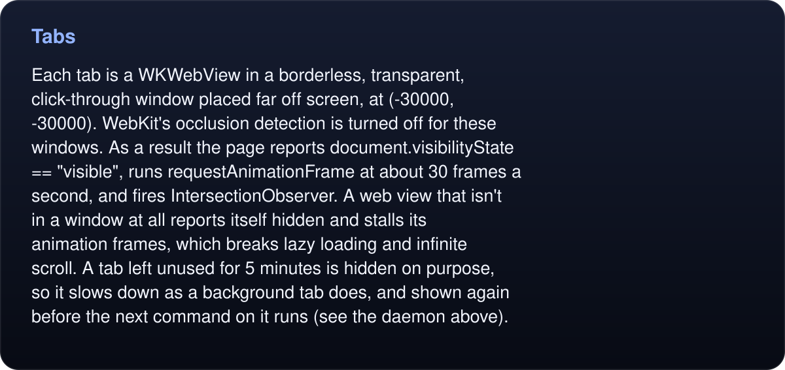
</picture>

<details>
<summary>Read the text, values and source links</summary>

Each tab is a `WKWebView` in a borderless, transparent, click-through window placed far off screen, at (-30000, -30000). WebKit's occlusion detection is turned off for these windows. As a result the page reports `document.visibilityState == "visible"`, runs `requestAnimationFrame` at about 30 frames a second, and fires `IntersectionObserver`. A web view that isn't in a window at all reports itself hidden and stalls its animation frames, which breaks lazy loading and infinite scroll. A tab left unused for 5 minutes is hidden on purpose, so it slows down as a background tab does, and shown again before the next command on it runs (see [the daemon](#the-daemon) above).

</details>
<!-- /umbra-figure -->

A tab also handles:

- **Navigation.** `open` waits for the load and reports the title, URL and HTTP status. With `--until JS`, it also waits for a condition across redirects.
- **Pop-ups.** `target=_blank` links and `window.open` become tabs of their own, named in the reply of the click that opened them.
- **Dialogs.** Alerts, confirms and prompts never block. Each is answered the way `dialog` last set (accept by default) and logged.
- **File choosers.** `upload` answers the chooser that a click opens.
- **Downloads.** Files the page downloads go to `~/Downloads/Umbra/` (`~/Downloads/Umbra/<profile>/` for a profile), and `downloads` lists them.
- **Handoff.** `handoff` moves the tab's window on screen with a message, then hides it again when the person closes it, the `--until` condition holds, or the timeout passes.

## Snapshot, refs and actions

Snapshot, refs and actions run in an isolated JavaScript world. They share the page's DOM but not its globals, so the page can't see them, and a page that replaces `document.querySelector` or `Element.prototype.click` can't break them. Only `eval` and `read` scripts run in the page's own world.

`snapshot` walks the DOM, including open shadow roots and same-origin iframes, and writes one line per element: its role, name, state, value and, for anything interactive, a ref such as `e5`. Cross-origin iframes are marked in the top-level snapshot; `frames` and explicit `frame` operations reach registered documents through native WebKit frame evaluation. Their document handles become stale on navigation. A ref stays attached to the same element until the page navigates; after that, refs are numbered afresh. `observe` retains a bounded document-local baseline cache and returns ordered line patches. `extract` traverses tables/forms/lists into typed records with source refs; `watch` installs bounded, one-result DOM event observers.

Actions resolve their target (a ref, `text=`, or a CSS selector), wait until it's visible, enabled, scrolled into view and not covered, and then act through native input:

- **Clicks, hovers, scrolls and mouse drags** are `NSEvent`s sent straight to the web view, so they arrive in the page with `isTrusted == true`. Window coordinates are the CSS viewport's, with y flipped.
- **`fill` and `type`** focus the field with a native click and insert the text with `insertText`, the way an input method does. Framework-controlled inputs (React and friends) accept it. Date, time, color and range inputs are set directly.
- **`press`** sends key events one by one, so each key fires its own `keydown`.
- **HTML5 drag and drop** is dispatched as page events, because a native drag session would act on the real desktop.
- **Frame input** maps through ancestor geometry and hit tests before native delivery; unavailable, transformed, zoomed, hidden or offscreen frame targets are refused.
- **Coordinate pointer input** can reach canvas pixels, but provides no semantic interpretation or application-success proof.

## The cookie store

Umbra uses a persistent `WKWebsiteDataStore(forIdentifier:)`. That API arrived in macOS 14, which sets the minimum version. The store holds cookies, local storage and caches, and WebKit keeps it at:

```
~/Library/WebKit/com.randyren.umbra/WebsiteDataStore/<identifier>/
```

The default store's identifier is the fixed UUID `6F1C7A52-3D0B-4E8F-9A61-F1A57C0DE001`. It was carried over from FIRST's earlier helper so that tool's signed-in store moved to Umbra intact. Safari's data lives elsewhere, so neither browser can see the other's cookies. All of a profile's tabs share its store.

<!-- umbra-figure: docs-how-it-works-facts-391e81018b -->
<picture>
  <source media="(max-width: 600px)" srcset="../assets/docs/docs-how-it-works-facts-391e81018b-1-mobile-f57c6c68a7.svg">
  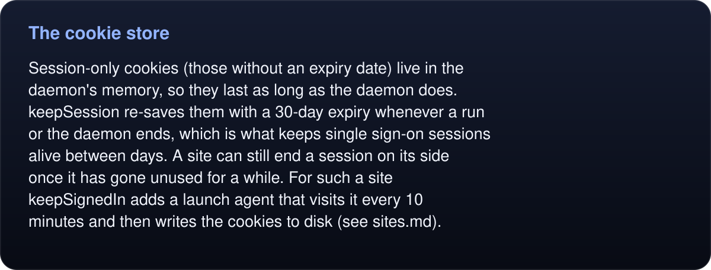
</picture>

<details>
<summary>Read the text, values and source links</summary>

Session-only cookies (those without an expiry date) live in the daemon's memory, so they last as long as the daemon does. `keepSession` re-saves them with a 30-day expiry whenever a run or the daemon ends, which is what keeps single sign-on sessions alive between days. A site can still end a session on its side once it has gone unused for a while. For such a site `keepSignedIn` adds a launch agent that visits it every 10 minutes and then writes the cookies to disk (see [sites.md](sites.md#keepsignedin)).

</details>
<!-- /umbra-figure -->

Changing either the bundle identifier or the store identifier gives you a new, empty store, which signs every site out. If you fork Umbra under your own identifier, expect to sign in again.

## Profiles

`--profile NAME` or `UMBRA_PROFILE=NAME` selects a different profile: its own store, daemon, socket, log, locks and download folder. The store's identifier is derived from the name: the first 32 hex digits of SHA-256 of `umbra profile <name>`, grouped 8-4-4-4-12 as a UUID. The same name always maps to the same store, so a profile persists between runs. Profile names longer than 24 characters get a hashed socket name, to stay under the system's path limit for sockets.

The [profile lanes diagram](../assets/profile-lanes.svg) shows separate identities: each profile has its own current tab and signed-in state. Cooperating agents may also share a profile using explicit named tabs and leases; they still share cookies and require matching ownership labels.

To delete a profile, stop its daemon, remove its `keepSignedIn` launch agent if it has one, and remove its files:

```sh
umbra --profile work stop
launchctl bootout gui/$(id -u)/com.randyren.umbra.keep-signed-in.work 2>/dev/null
rm -f ~/Library/LaunchAgents/com.randyren.umbra.keep-signed-in.work.plist
id=$(python3 -c 'import hashlib, sys; h = hashlib.sha256(("umbra profile " + sys.argv[1]).encode()).hexdigest()[:32]; print("-".join([h[:8], h[8:12], h[12:16], h[16:20], h[20:]]))' work)
rm -rf ~/Library/WebKit/com.randyren.umbra/WebsiteDataStore/$id
rm -f ~/Library/Application\ Support/Umbra/*-work.*
rm -rf ~/Downloads/Umbra/work
```

## Who owns the store

Only one process at a time works with a profile's store, through an exclusive `flock` on its `store.lock`:

- **A running daemon** holds the lock for its whole life. One-shot commands for that profile then go through the daemon, which runs them in a scratch tab, so they see the daemon's session.
- **Without a daemon,** a one-shot takes the lock itself, so one-shot runs take turns. Time spent waiting for the lock doesn't count toward `--timeout`. The kernel releases the lock when the process ends, even if it crashes.
- **`umbra sign-in`** asks the daemon (starting it if needed) to show its window, so signing in shares the daemon's store and lock, and other commands keep working meanwhile.

## The one-shot commands

`read`, `fetch` and `download` keep the contract that scheduled scripts rely on: one process, a result on stdout and an exit code.

- **`read`** loads the URL in a scratch tab and waits for the first finished navigation. It then waits out `--wait`, checks `--until` until it holds, checks `--cookie` against the page's current host (exit 3 if it's missing), and runs stdin as the body of an async function in the page's world. With an empty script it prints `document.documentElement.outerHTML`. A string prints as is, an object or array as JSON with sorted keys, a number or boolean as text, and `null` or `undefined` prints nothing.
- **`fetch`** loads the `--from` page (by default `/robots.txt` on the URL's own origin), runs `fetch(url, {credentials: 'include'})` inside it, and prints the body as text. A non-2xx status prints the body anyway and exits 5. Because the request comes from the page, the browser's rules apply: the right cookies are attached, and a cross-origin URL needs CORS. Use `download` for binary files.
- **`download`** loads the URL as a top-level navigation and turns the response into a download, as a click in Safari would, so the site's cookies are sent and redirects to storage hosts are followed. A non-2xx response exits 5 without writing anything. Otherwise the bytes go to `.<name>.umbra-part` beside the target and are renamed over it once complete, so readers never see half a file.

<!-- umbra-figure: docs-how-it-works-facts-315120c018 -->
<picture>
  <source media="(max-width: 600px)" srcset="../assets/docs/docs-how-it-works-facts-315120c018-1-mobile-ed44b4ab04.svg">
  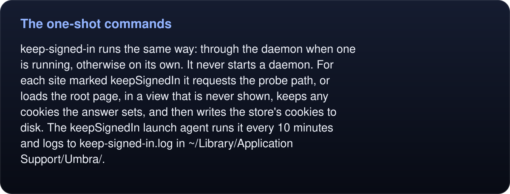
</picture>

<details>
<summary>Read the text, values and source links</summary>

`keep-signed-in` runs the same way: through the daemon when one is running, otherwise on its own. It never starts a daemon. For each site marked `keepSignedIn` it requests the probe path, or loads the root page, in a view that is never shown, keeps any cookies the answer sets, and then writes the store's cookies to disk. The `keepSignedIn` launch agent runs it every 10 minutes and logs to `keep-signed-in.log` in `~/Library/Application Support/Umbra/`.

</details>
<!-- /umbra-figure -->

<!-- umbra-figure: docs-how-it-works-table-f4601beaf7 -->
<picture>
  <source media="(max-width: 600px)" srcset="../assets/docs/docs-how-it-works-table-f4601beaf7-1-mobile-e9922ab58b.svg">
  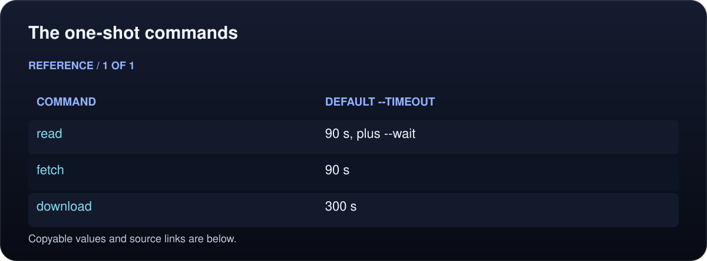
</picture>

<details>
<summary>Read the text, values and source links</summary>

- **Command:** `read`
- **Default `--timeout`:** 90 s, plus `--wait`

- **Command:** `fetch`
- **Default `--timeout`:** 90 s

- **Command:** `download`
- **Default `--timeout`:** 300 s

</details>
<!-- /umbra-figure -->

<!-- umbra-figure: docs-how-it-works-facts-3feef8ab12 -->
<picture>
  <source media="(max-width: 600px)" srcset="../assets/docs/docs-how-it-works-facts-3feef8ab12-1-mobile-7485416dd5.svg">
  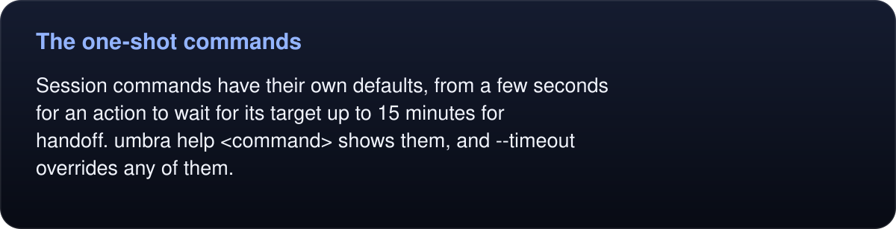
</picture>

<details>
<summary>Read the text, values and source links</summary>

Session commands have their own defaults, from a few seconds for an action to wait for its target up to 15 minutes for `handoff`. `umbra help <command>` shows them, and `--timeout` overrides any of them.

</details>
<!-- /umbra-figure -->

## The user agent

Umbra sets WebKit's application name to `Version/<Safari version> Safari/605.1.15`, reading the version from `/Applications/Safari.app`. WebKit fills in the rest, so sites see the same user agent the installed Safari sends. On a Mac with Safari 27.0.1:

```
Mozilla/5.0 (Macintosh; Intel Mac OS X 10_15_7) AppleWebKit/605.1.15 (KHTML, like Gecko) Version/27.0.1 Safari/605.1.15
```

<!-- umbra-figure: docs-how-it-works-facts-06b92756b3 -->
<picture>
  <source media="(max-width: 600px)" srcset="../assets/docs/docs-how-it-works-facts-06b92756b3-1-mobile-0ebe8f8da2.svg">
  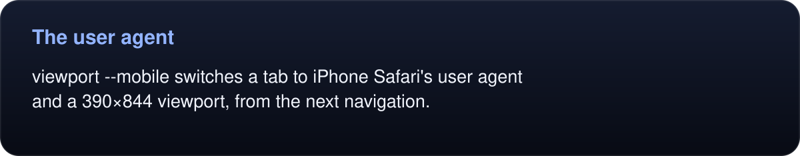
</picture>

<details>
<summary>Read the text, values and source links</summary>

`viewport --mobile` switches a tab to iPhone Safari's user agent and a 390×844 viewport, from the next navigation.

</details>
<!-- /umbra-figure -->

## The sign-in window

The daemon shows the sign-in window, for `umbra sign-in`, for an MCP client calling `sign-in`, and when the person opens Umbra.app. Opening the app while the daemon runs reaches the daemon, because macOS hands a launch to the running app; it answers with the window.

The window is a way to sign in, never a way to browse a site:

<!-- umbra-figure: docs-how-it-works-facts-8f42eba867 -->
<picture>
  <source media="(max-width: 600px)" srcset="../assets/docs/docs-how-it-works-facts-8f42eba867-1-mobile-3adf520e87.svg">
  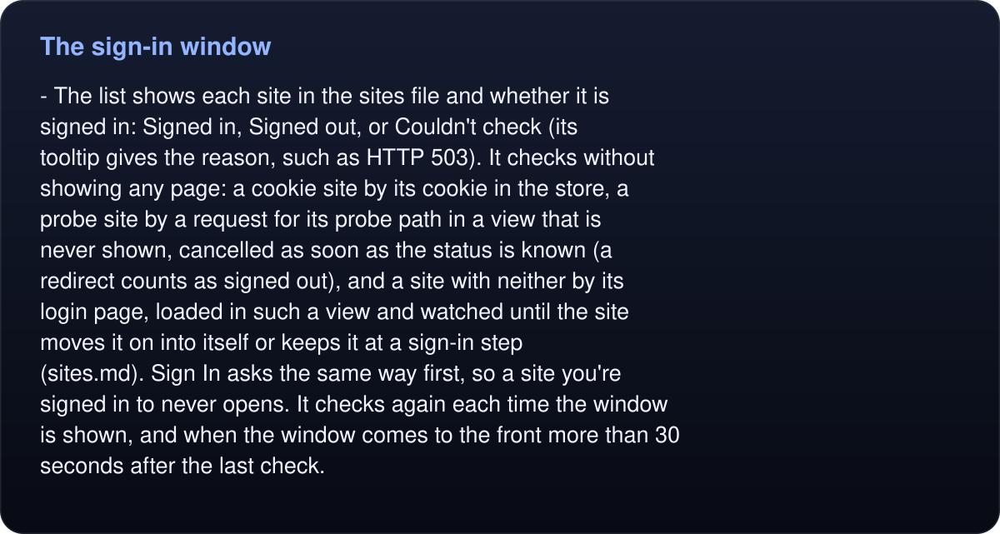
</picture>

<details>
<summary>Read the text, values and source links</summary>

- **The list** shows each site in the sites file and whether it is signed in: Signed in, Signed out, or Couldn't check (its tooltip gives the reason, such as `HTTP 503`). It checks without showing any page: a cookie site by its cookie in the store, a probe site by a request for its probe path in a view that is never shown, cancelled as soon as the status is known (a redirect counts as signed out), and a site with neither by its login page, loaded in such a view and watched until the site moves it on into itself or keeps it at a sign-in step ([sites.md](sites.md#signed-in-checks-cookie-or-probe)). Sign In asks the same way first, so a site you're signed in to never opens. It checks again each time the window is shown, and when the window comes to the front more than 30 seconds after the last check.

</details>
<!-- /umbra-figure -->
- **Logos** are each site's own icon, found as Safari finds one: the icons its home page names (a home-screen icon first), else `/apple-touch-icon.png`, else `/favicon.ico`. They are fetched without cookies, never from the login page, and kept in `~/Library/Application Support/Umbra/Logos/` for a week; a site without one gets a letter tile.
- **A login page** appears only when the person clicks Sign In, or when `umbra sign-in <site>` names a site that is signed out. Every main-frame response in it is checked before it is shown: once the site counts as signed in, that response is cancelled and the page is closed, so the signed-in site never renders. A cookie site is also checked whenever the store's cookies change, which catches sign-ins made by a script. A probe site is checked once the flow is back on its domain, since single sign-on pages often live elsewhere.
<!-- umbra-figure: docs-how-it-works-facts-44b9e4c876 -->
<picture>
  <source media="(max-width: 600px)" srcset="../assets/docs/docs-how-it-works-facts-44b9e4c876-1-mobile-2b61fba775.svg">
  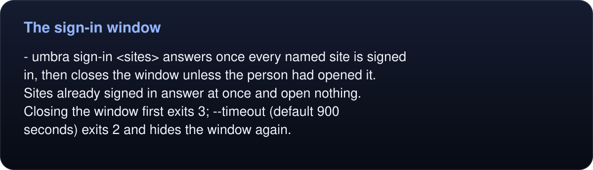
</picture>

<details>
<summary>Read the text, values and source links</summary>

- **`umbra sign-in <sites>`** answers once every named site is signed in, then closes the window unless the person had opened it. Sites already signed in answer at once and open nothing. Closing the window first exits 3; `--timeout` (default 900 seconds) exits 2 and hides the window again.

</details>
<!-- /umbra-figure -->
- **Sign Out…** in a row's **…** menu (and `umbra sign-out <site>`) deletes the cookies within the site's domain from the profile's store.
- **Keep Signed In** in the same menu sets or removes the site's `keepSignedIn` in the sites file and installs or removes the launch agent, as `umbra keep-signed-in` does; a kept row says so under its domain. If that fails, an alert says why and nothing changes. **Check Again** checks that site now.
- **Add Account** (and `umbra sign-in <login URL> --save NAME`) adds a site to the sites file and opens its login page. Umbra records the domain's cookie names once that page has loaded; when the person clicks Done, and a page has loaded since the login page, the session-like cookie that appeared since becomes the site's `cookie` (closing the window learns nothing), so later checks and sign-ins work as for any listed site.
- **Session-only sign-ins are kept.** When the cookie a site's sign-in rests on has no expiry date (it would be gone when the daemon next exits), Umbra sets `keepSession` on that site in the sites file before it answers.

While the window is open the daemon has a Dock icon and a menu bar with an Edit menu, so Command-V can paste a password and Command-W can close the window. Quit, from the menu or the Dock, closes the sign-in window and ends any handoff, and leaves the daemon running for agents; logging out, restarting or shutting down quits it after the cookies are on disk. Every sign-in writes the store's cookies to disk at once, keeping the session cookies of `keepSession` and `keepSignedIn` sites, and the daemon does the same every five minutes, so a daemon that crashes or is killed loses little. Passkeys and Touch ID prompts don't work in this window; sign in with a password and a push approval or a one-time code.
