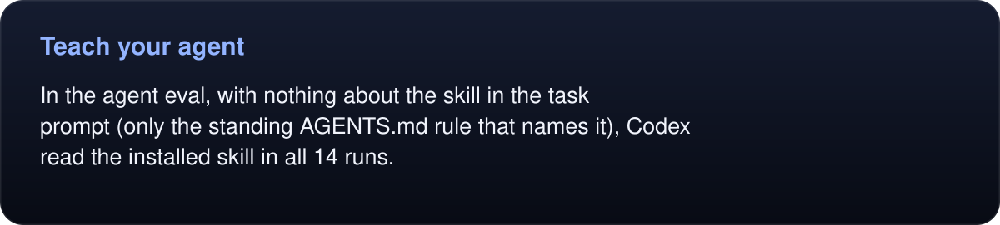

# Install

You need macOS 14 Sonoma or later and the Xcode Command Line Tools (`xcode-select --install`).

```sh
git clone https://github.com/randyren278/umbra.git
cd umbra
make install
```

`make install` builds `Umbra.app`, copies it to `~/Applications` and links `~/.local/bin/umbra` to the binary inside it. If a daemon from an older install is running, it's stopped first. Nothing else on the system changes. Put `~/.local/bin` on your `PATH` if it isn't already, and check with `umbra --version`.

To install elsewhere, set the directories: `make install APPDIR=~/Apps BINDIR=~/bin`. `make uninstall` (with the same overrides) stops the daemon and removes the app, the link and any `keepSignedIn` launch agents. Your sign-ins stay in `~/Library/WebKit/com.randyren.umbra/`; delete that folder to sign out everywhere. `scripts/doctor.sh` checks the macOS version, the compiler, the link, the binary and your sites file.

Prebuilt zips are built on Apple Silicon and signed ad hoc, not notarized, so macOS blocks a downloaded copy until you clear its quarantine flag with `xattr -dr com.apple.quarantine Umbra.app`. On an Intel Mac, build from source.


## Quick start

### From a shell

```sh
umbra open example.com              # loads and waits; prints title, URL and HTTP status
umbra snapshot --interactive        # the page as an outline with refs
umbra click "text=Learn more"       # trusted click; follows the navigation
umbra markdown --main               # read the main content as markdown
umbra stop                          # optional: the daemon also exits after 15 idle minutes
```

The first command starts the daemon, and every command after that reuses it. `umbra help <command>` lists a command's parameters, and `umbra schema` prints every command as JSON.

### Over MCP

`umbra mcp` is a stdio MCP server whose tools are Umbra's commands, run against the same daemon and tabs as the CLI. Print the setup for your install:

```sh
umbra mcp --print-config
```

It prints ready-to-run lines for Claude Code and Codex and JSON blocks for Claude Desktop and Cursor, using the full path of your `umbra`. For a `make install`:

```sh
claude mcp add --scope user umbra -- ~/Applications/Umbra.app/Contents/MacOS/umbra mcp   # Claude Code
codex mcp add umbra -- ~/Applications/Umbra.app/Contents/MacOS/umbra mcp                 # Codex
```

Leave out `--scope user` to add it to the current project only. [docs/mcp.md](mcp.md) covers the other clients, profiles, image results and progress for long calls.

### Teach your agent

[`skill/SKILL.md`](../skill/SKILL.md) is an agent skill that teaches the loop, the targets, waiting, sign-in and handoff, and the rules. Claude Code and Codex both load it from their skills folder; a link keeps it current as you pull:

```sh
mkdir -p ~/.claude/skills ~/.codex/skills
ln -s "$PWD/skill" ~/.claude/skills/umbra    # Claude Code
ln -s "$PWD/skill" ~/.codex/skills/umbra     # Codex
```

<!-- umbra-figure: docs-install-facts-05218ac2b9 -->
<picture>
  <source media="(max-width: 600px)" srcset="../assets/docs/docs-install-facts-05218ac2b9-1-mobile-233c834f85.svg">
  
</picture>

<details>
<summary>Read the text, values and source links</summary>

In the [agent eval](evaluation/README.md), with nothing about the skill in the task prompt (only the standing `AGENTS.md` rule that names it), Codex read the installed skill in all 14 runs.

</details>
<!-- /umbra-figure -->

For other agents, [docs/agents.md](agents.md) has a short block to paste into `AGENTS.md` or a system prompt.
