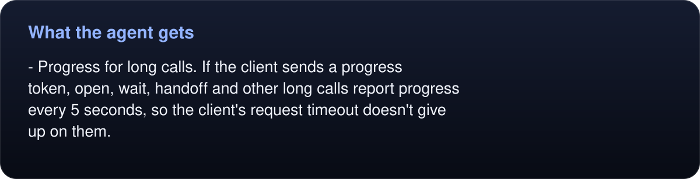
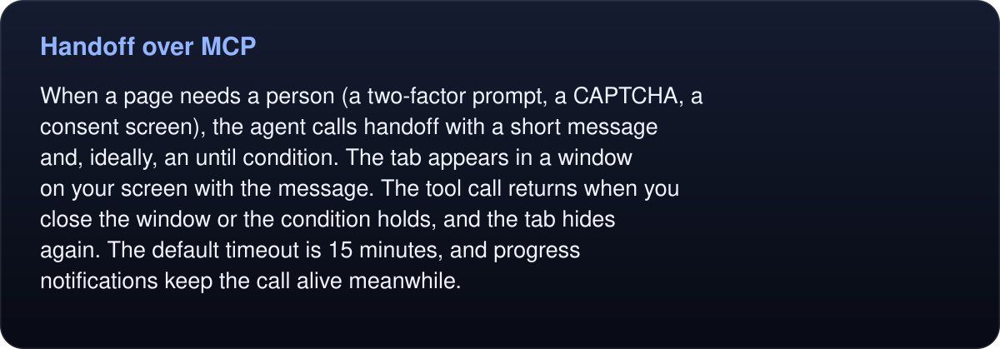
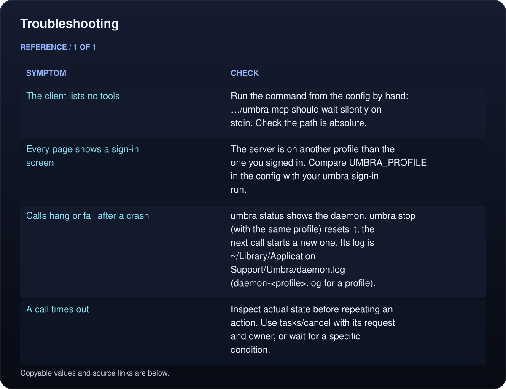

# Umbra over MCP

`umbra mcp` is a [Model Context Protocol](https://modelcontextprotocol.io) server on stdio. Its tools are Umbra's commands. Each call goes to the profile's daemon, which it starts on first use, so an MCP client and the `umbra` CLI drive the same live tabs. An agent can open a page through MCP, and you can look at the same tab from a terminal with `umbra snapshot`.

## Set it up

```sh
umbra mcp --print-config
```

This prints the setup for Claude Code, Codex, Claude Desktop and Cursor, filled in with the full path of the `umbra` you ran it with. After `make install` that path is `~/Applications/Umbra.app/Contents/MacOS/umbra`.

**Claude Code** (add `--scope user` to use it in every project):

```sh
claude mcp add umbra -- ~/Applications/Umbra.app/Contents/MacOS/umbra mcp
```

**Codex** (every project):

```sh
codex mcp add umbra -- ~/Applications/Umbra.app/Contents/MacOS/umbra mcp
```

**Claude Desktop** (`~/Library/Application Support/Claude/claude_desktop_config.json`) and **Cursor** (`~/.cursor/mcp.json`) take the same block. Use the absolute path that `--print-config` prints, since these files don't expand `~`:

```json
{
  "mcpServers" : {
    "umbra" : {
      "args" : [
        "mcp"
      ],
      "command" : "/Users/you/Applications/Umbra.app/Contents/MacOS/umbra"
    }
  }
}
```

### Choosing a profile

Without `UMBRA_PROFILE`, the server uses your default profile and its sign-ins. To give an agent its own store, run `--print-config` with the profile set. It then adds the variable to every snippet:

```sh
UMBRA_PROFILE=agent umbra mcp --print-config
# Claude Code: claude mcp add umbra -e UMBRA_PROFILE=agent -- …/umbra mcp
# JSON clients: "env" : { "UMBRA_PROFILE" : "agent" }
```

Then sign that profile in to the sites the agent should reach: `UMBRA_PROFILE=agent umbra sign-in https://site.example/login`.

## What the agent gets

- **Tools generated from the command registry**, with the same parameters as the CLI for commands marked MCP-supported. `umbra schema` prints them as JSON, and `umbra help <command>` describes each one.
- **Instructions** sent on `initialize`. They teach the loop (`open`, `snapshot`, act on refs, snapshot again), waiting instead of sleeping, `handoff` for human-only steps, and `fetch` for signed-in JSON APIs.
- **Text plus structured results.** Successes put result text in `content` and remaining nonduplicate fields in `structuredContent`. MCP omits the runtime `request` field and binary data; screenshot data arrives as image content.
- **Images.** `screenshot` without a path returns the image itself as MCP image content, alongside a text line such as `88×48 PNG (base64 in data)`.
- **Tool hints.** Tools that only look (`snapshot`, `text`, `markdown`, `links`, `info`, `console`, `network`…) are marked read-only. `screenshot`, `pdf` and `download` are marked destructive because they can replace a file at the path given. Every tool is marked open-world.
- **Errors the model can act on.** A failure comes back as a tool error with Umbra's message. Codes 1 to 4 also get a hint: a signed-out site, for example, says to call `sign-in` with the site's name, which shows the person Umbra's window and returns once they've signed in.
<!-- umbra-figure: docs-mcp-facts-9ae9e01a90 -->
<picture>
  <source media="(max-width: 600px)" srcset="../assets/docs/docs-mcp-facts-9ae9e01a90-1-mobile-58f687f265.svg">
  
</picture>

<details>
<summary>Read the text, values and source links</summary>

- **Progress for long calls.** If the client sends a progress token, `open`, `wait`, `handoff` and other long calls report progress every 5 seconds, so the client's request timeout doesn't give up on them.

</details>
<!-- /umbra-figure -->

Relative paths in arguments (`screenshot shot.png`, `upload … invoice.pdf`) are resolved against the directory the server was started in, unless the call passes `cwd`.

## Ownership, observations and cancellation

The same runtime controls are available as MCP tools. A minimal owned task uses separate `tools/call` requests with these argument objects:

```json
{"name":"open","arguments":{"url":"http://127.0.0.1:8765/","tab":"research","agent":"researcher","task":"lookup"}}
{"name":"lease","arguments":{"tab":"research","agent":"researcher","task":"lookup","seconds":300}}
{"name":"observe","arguments":{"tab":"research","agent":"researcher","task":"lookup","interactive":true,"max":4000}}
```

Use a returned `baseline` as `since` with identical scope/budgets for incremental observations. Retain its reconstructed text and metadata: absent delta `refs`, `url`, `title`, `truncated`, `depthLimited` and `doc` inherit from that requested token. Full/reset results replace the state. `max` limits outline characters, not model tokens. JSON-valued command parameters such as `batch.steps`, `workflow.vars`, `frame.args` and `extract.schema` are **JSON strings** in the MCP arguments, matching their generated schema; they are not nested objects at that parameter boundary.

Assign a runtime `request` when you need explicit cancellation, then use `cancel` from another call with the same owner:

```json
{"name":"wait","arguments":{"selector":"#ready","tab":"research","agent":"researcher","task":"lookup","request":"wait-ready","timeout":30}}
{"name":"cancel","arguments":{"id":"wait-ready","agent":"researcher","task":"lookup"}}
```

The JSON-RPC request ID and the runtime cancellation identifier are different protocol fields. `tasks` shows actual pending runtime IDs. `deadline` is an absolute Unix timestamp in seconds, and timeout includes runtime queueing. Already-dispatched JavaScript can continue after cancellation, including later side effects; cancellation does not undo earlier actions. Verify actual state before repeating a submission. [Full runtime guide](runtime/README.md).

## Handoff over MCP

<!-- umbra-figure: docs-mcp-facts-c8e9f42456 -->
<picture>
  <source media="(max-width: 600px)" srcset="../assets/docs/docs-mcp-facts-c8e9f42456-1-mobile-b242232aef.svg">
  
</picture>

<details>
<summary>Read the text, values and source links</summary>

When a page needs a person (a two-factor prompt, a CAPTCHA, a consent screen), the agent calls `handoff` with a short message and, ideally, an `until` condition. The tab appears in a window on your screen with the message. The tool call returns when you close the window or the condition holds, and the tab hides again. The default timeout is 15 minutes, and progress notifications keep the call alive meanwhile.

</details>
<!-- /umbra-figure -->

## Troubleshooting

<!-- umbra-figure: docs-mcp-table-bcaa4479ad -->
<picture>
  <source media="(max-width: 600px)" srcset="../assets/docs/docs-mcp-table-bcaa4479ad-1-mobile-64fbc22428.svg">
  
</picture>

<details>
<summary>Read the text, values and source links</summary>

- **Symptom:** The client lists no tools
- **Check:** Run the command from the config by hand: `…/umbra mcp` should wait silently on stdin. Check the path is absolute.

- **Symptom:** Every page shows a sign-in screen
- **Check:** The server is on another profile than the one you signed in. Compare `UMBRA_PROFILE` in the config with your `umbra sign-in` run.

- **Symptom:** Calls hang or fail after a crash
- **Check:** `umbra status` shows the daemon. `umbra stop` (with the same profile) resets it; the next call starts a new one. Its log is `~/Library/Application Support/Umbra/daemon.log` (`daemon-<profile>.log` for a profile).

- **Symptom:** A call times out
- **Check:** Inspect actual state before repeating an action. Use `tasks`/`cancel` with its request and owner, or wait for a specific condition.

</details>
<!-- /umbra-figure -->
