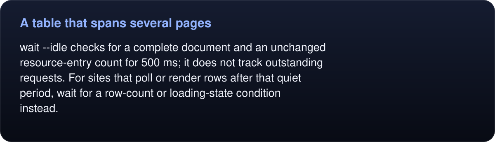
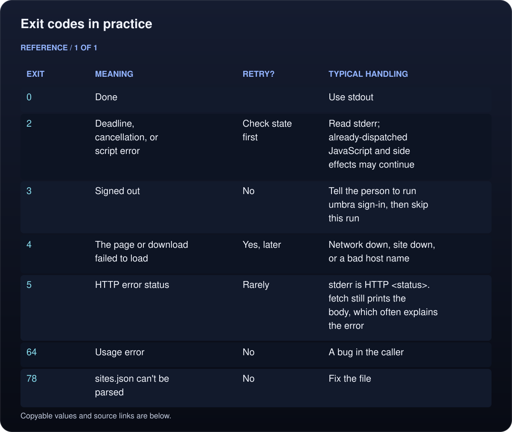

# Recipes

Copy-paste patterns for driving Umbra from scripts and agents. There are two styles:

- **Session commands** (`open`, `snapshot`, `click`, `fill`…) talk to the profile's daemon, so a tab and its sign-in carry over from one command to the next. Use them to work through a site step by step.
- **One-shot commands** (`read`, `fetch`, `download`) do one job and exit with a code. Scheduled scripts use them.

The original page workflows use Northwind Ops, the test app in [`bench/site`](../bench/README.md) (`python3 bench/site/server.py --port 8765`), or a local test server. The runtime examples below use those same selector patterns; substitute your own URLs and verify each postcondition.

**Session commands**

- [A table that spans several pages](#a-table-that-spans-several-pages)
- [Fill in a form and confirm it saved](#fill-in-a-form-and-confirm-it-saved)
- [Save a file the page downloads](#save-a-file-the-page-downloads)
- [Upload a file behind a styled button](#upload-a-file-behind-a-styled-button)
- [Follow a pop-up into its own tab](#follow-a-pop-up-into-its-own-tab)
- [Screenshots, PDFs and the mobile layout](#screenshots-pdfs-and-the-mobile-layout)
- [Find out why a page misbehaves](#find-out-why-a-page-misbehaves)
- [Structured output for scripts](#structured-output-for-scripts)
- [A long-lived client on the socket](#a-long-lived-client-on-the-socket)
- [Owned work and cancellation](#owned-work-and-cancellation)
- [Incremental observations and typed records](#incremental-observations-and-typed-records)
- [Checked batches and recoverable workflows](#checked-batches-and-recoverable-workflows)

**One-shot commands**

- [Exit codes in practice](#exit-codes-in-practice)
- [Python](#python) · [Node](#node) · [Shell](#shell)
- [Several API calls in one run](#several-api-calls-in-one-run)
- [Pages that redirect through JavaScript](#pages-that-redirect-through-javascript)
- [Waiting for content the page renders](#waiting-for-content-the-page-renders)
- [Downloading files](#downloading-files)
- [Running on a schedule with launchd](#running-on-a-schedule-with-launchd)
- [Trying scripts on a separate profile](#trying-scripts-on-a-separate-profile)

## A table that spans several pages

The orders table is rendered by JavaScript, ten rows at a time, with a **Next** button. Read each page as markdown, and stop when **Next** is disabled:

```zsh
umbra open 127.0.0.1:8765/app/orders
while true; do
  umbra markdown --target table >> orders.md
  umbra get "text=Next" --json | jq -e .enabled > /dev/null || break
  umbra click "text=Next"
  umbra wait --idle
done
```

<!-- umbra-figure: docs-recipes-facts-1f1c49324d -->
<picture>
  <source media="(max-width: 600px)" srcset="../assets/docs/docs-recipes-facts-1f1c49324d-1-mobile-55f286403c.svg">
  
</picture>

<details>
<summary>Read the text, values and source links</summary>

`wait --idle` checks for a complete document and an unchanged resource-entry count for 500 ms; it does not track outstanding requests. For sites that poll or render rows after that quiet period, wait for a row-count or loading-state condition instead.

</details>
<!-- /umbra-figure -->

## Fill in a form and confirm it saved

```sh
umbra open 127.0.0.1:8765/app/settings
umbra fill "text=Display name" "Jordan Lee"
umbra click "text=Save changes"
umbra wait --text "Settings saved"
```

`fill` types the value as trusted keyboard input, so a React-controlled field keeps it. A label works as the target for its field. `wait --text` matches case-sensitively and exits 2 if the text never appears.

## Save a file the page downloads

```sh
umbra click "text=Export CSV"     # reports: downloaded orders.csv to ~/Downloads/Umbra/…
umbra downloads                   # every file this tab downloaded, with its path
```

Files a page downloads land in `~/Downloads/Umbra/`, in a folder named after the profile when you use one. The click waits for the download and reports where it went. When you already know the URL, `umbra download <url> <file>` saves it exactly where you say.

## Upload a file behind a styled button

```sh
umbra open 127.0.0.1:8765/app/upload
umbra upload "text=Choose file…" invoice.pdf
```

`upload` clicks the button natively and answers the file chooser it opens, so it works even when the real `<input type=file>` is hidden. Relative paths mean your current directory.

## Follow a pop-up into its own tab

A link with `target=_blank` opens a new tab, and the click names it:

```console
$ umbra click "text=Q3 2026 operations report"
clicked link "Q3 2026 operations report ↗" (e1) → opened tab tab-2: Q3 2026 operations report · Northwind Ops · http://127.0.0.1:8765/app/report?quarter=2026-Q3 (switch with: tab select tab-2)

$ umbra get "#report-number" --tab tab-2
RPT-585498
```

To keep tasks apart from the start, open each in a named tab with `umbra open <url> --tab NAME`.

## Screenshots, PDFs and the mobile layout

```sh
umbra screenshot page.png                 # the viewport
umbra screenshot page.png --full          # the whole page
umbra screenshot row.png --target e12     # one element
umbra pdf page.pdf                        # one tall page, selectable text, working links

umbra viewport --mobile && umbra reload   # iPhone Safari's user agent at 390×844
umbra screenshot mobile.png --full
umbra viewport 1280 900                   # back to the desktop user agent
```

The tab stays invisible the whole time. Without a path, `screenshot` returns the image as base64 (with `--json`) or, over MCP, as an image the model can see.

## Find out why a page misbehaves

```sh
umbra console --level error     # console errors, uncaught exceptions and rejected promises
umbra network --failed          # requests that failed or got an HTTP error
umbra info                      # status, ready state, visibility, scroll and element counts
```

Pages that are heavy with images or trackers load faster with `umbra block images trackers` followed by `umbra reload`. `umbra block --none` turns it off again.

## Structured output for scripts

Every command takes `--json` and prints its full result as JSON, which `jq` can pick apart:

```sh
umbra info --json | jq -r .status                  # 200
umbra get "text=Next" --json | jq -e .enabled      # exits 1 when the button is disabled
umbra links --json | jq -r '.links[].href'
```

## A long-lived client on the socket

Use the [Python, TypeScript or Swift SDK](../sdk/README.md) when a program sends many commands. Each client requires an explicit profile, reuses its socket, bounds replies and uses absolute deadlines. Start the daemon explicitly or connect to one already running:

```python
# PYTHONPATH=/path/to/umbra/sdk/python python3 script.py
import os
from umbra import Umbra

with Umbra(os.environ["UMBRA_PROFILE"]) as browser:
    browser.call("open", {"url": "http://127.0.0.1:8765/app/orders", "tab": "orders"})
    print(browser.call("get", {"target": "text=Showing", "tab": "orders"})["text"])
```

`close()` closes the connection, not the daemon. For the raw JSON-lines protocol, see [how it works](how-it-works.md#the-protocol); keep wire correlation IDs distinct from runtime request IDs unless you explicitly set both. The SDK handles profile socket hashing too.

## Owned work and cancellation

Start the local fixture, then use a separate profile and named tab:

```sh
export UMBRA_PROFILE=recipe-runtime
umbra open http://127.0.0.1:8765/app/settings --tab settings
umbra lease --tab settings --agent writer --task settings
umbra snapshot --tab settings --agent writer --task settings --interactive
umbra wait --selector '#ready' --tab settings --agent writer --task settings --request ready-check --timeout 30
# In another terminal with the same UMBRA_PROFILE, while that request is pending:
umbra tasks --json
umbra cancel ready-check --agent writer --task settings
```

Every operation on a leased tab needs matching labels. Already-dispatched JavaScript can keep running after cancellation, and earlier side effects cannot be undone. Check actual state before repeating an action. Finish by releasing the lease and closing the tab:

```sh
umbra lease --release --tab settings --agent writer --task settings
umbra tab close settings
```

## Incremental observations and typed records

On an unleased orders tab, keep the baseline token and the same observation options:

```sh
umbra open http://127.0.0.1:8765/app/orders --tab orders
umbra observe --tab orders --interactive --max 4000 --json > first.json
baseline=$(python3 -c 'import json; print(json.load(open("first.json"))["baseline"])')
umbra observe --tab orders --interactive --max 4000 --since "$baseline" --json
umbra extract table --tab orders --kind table --limit 10 --text-max 300 --json
```

A delta is a line replacement patch, not a complete snapshot: splice `patch.lines` at `patch.start`, removing `patch.delete` old lines. Navigation, cache eviction or changed options returns full content instead. Budgets count characters, not model tokens. Extraction gives records and source refs; check its `truncated` flag before assuming the table is complete.

## Checked batches and recoverable workflows

Use one batch to fill/save, with an explicit verification condition. Coordinator commands take each tab inside the step’s args:

```sh
umbra open http://127.0.0.1:8765/app/settings --tab settings
umbra batch '[
  {"command":"fill","args":{"tab":"settings","target":"text=Display name","value":"Jordan Lee"}},
  {"command":"click","args":{"tab":"settings","target":"text=Save changes"},"after":{"text":"Settings saved"}}
]' --agent writer --task settings --json
```

This stops on failure without rollback or automatic retry. For reusable variable binding and disk checkpoints, follow the [workflow recipe](runtime/README.md#batch-known-steps-and-checkpoint-a-workflow). A pending checkpoint records an uncertain outcome; inspect state and explicitly resolve it. Optional SDK model callbacks propose replacement args after fresh observation and never execute the proposal themselves.

## Exit codes in practice

<!-- umbra-figure: docs-recipes-table-dcdf3c4c34 -->
<picture>
  <source media="(max-width: 600px)" srcset="../assets/docs/docs-recipes-table-dcdf3c4c34-1-mobile-6309781f79.svg">
  
</picture>

<details>
<summary>Read the text, values and source links</summary>

- **Exit:** `0`
- **Meaning:** Done
- **Retry?:**
- **Typical handling:** Use stdout

- **Exit:** `2`
- **Meaning:** Deadline, cancellation, or script error
- **Retry?:** Check state first
- **Typical handling:** Read stderr; already-dispatched JavaScript and side effects may continue

- **Exit:** `3`
- **Meaning:** Signed out
- **Retry?:** No
- **Typical handling:** Tell the person to run `umbra sign-in`, then skip this run

- **Exit:** `4`
- **Meaning:** The page or download failed to load
- **Retry?:** Yes, later
- **Typical handling:** Network down, site down, or a bad host name

- **Exit:** `5`
- **Meaning:** HTTP error status
- **Retry?:** Rarely
- **Typical handling:** stderr is `HTTP <status>`. `fetch` still prints the body, which often explains the error

- **Exit:** `64`
- **Meaning:** Usage error
- **Retry?:** No
- **Typical handling:** A bug in the caller

- **Exit:** `78`
- **Meaning:** `sites.json` can't be parsed
- **Retry?:** No
- **Typical handling:** Fix the file

</details>
<!-- /umbra-figure -->

Umbra writes results to stdout and messages to stderr. When the profile's daemon is running, one-shots go through it and share its tabs' session. Otherwise they run on their own, take turns on the profile's lock, and time spent waiting for the lock doesn't count toward `--timeout`. So if your caller enforces its own timeout, make it generous.

The callers below run any `umbra` command, not just the one-shots. Add `--json` to a session command and parse what it prints.

## Python

```python
import subprocess


class SignedOut(Exception):
    """Exit 3: the site's session is gone. Run `umbra sign-in` again."""


class UmbraError(Exception):
    def __init__(self, code, message):
        super().__init__(f"umbra exited {code}: {message}")
        self.code = code


def umbra(*args, script=""):
    """Runs one umbra command and returns its stdout. An empty script makes `read` print the page's HTML."""
    result = subprocess.run(["umbra", *args], input=script, capture_output=True, text=True)
    if result.returncode == 3:
        raise SignedOut(result.stderr.strip())
    if result.returncode != 0:
        raise UmbraError(result.returncode, result.stderr.strip())
    return result.stdout
```

Using it:

```python
import json

title = umbra("read", "https://example.com", script="return document.title").strip()

html = umbra("read", "https://example.com")  # the whole page

# Canvas may prefix JSON with "while(1);" when you're signed in with a browser session.
body = umbra("fetch", "https://canvas.example.edu/api/v1/courses?per_page=100")
courses = json.loads(body.removeprefix("while(1);"))

try:
    links = json.loads(umbra("read", "--cookie", "li_at", "https://www.linkedin.com/jobs/",
                             script=open("jobs.js").read()))
except SignedOut:
    print("LinkedIn is signed out: run `umbra sign-in LinkedIn`")
```

## Node

```js
import { spawn } from 'node:child_process'

// Runs one umbra command and resolves with its stdout; rejects with err.exitCode set (3 = signed out).
export function umbra(args, script = '') {
  return new Promise((resolve, reject) => {
    const child = spawn('umbra', args)
    let out = '', err = ''
    child.stdout.setEncoding('utf8').on('data', chunk => { out += chunk })
    child.stderr.setEncoding('utf8').on('data', chunk => { err += chunk })
    child.on('error', reject)
    child.on('close', code => {
      if (code === 0) return resolve(out)
      reject(Object.assign(new Error(`umbra ${args[0]} exited ${code}: ${err.trim()}`), { exitCode: code }))
    })
    child.stdin.end(script)
  })
}
```

Using it (ES module, top-level `await`):

```js
import { readFile } from 'node:fs/promises'

const title = (await umbra(['read', 'https://example.com'], 'return document.title')).trim()

try {
  const script = await readFile('stories.js', 'utf8')
  const stories = JSON.parse(await umbra(['read', '--cookie', 'sessionid', 'https://www.instagram.com/'], script))
} catch (error) {
  if (error.exitCode === 3) console.error('Instagram is signed out: run `umbra sign-in Instagram`')
  else throw error
}
```

## Shell

```zsh
#!/bin/zsh
out=$(umbra read --cookie li_at https://www.linkedin.com/jobs/ < jobs.js)
case $? in
  0) print -r -- "$out" ;;
  3) print -u2 "signed out: run 'umbra sign-in'"; exit 3 ;;
  2|4) print -u2 "timed out or failed to load; try again later"; exit 75 ;;
  *) print -u2 "umbra failed"; exit 1 ;;
esac
```

Umbra's JSON output pipes straight into `jq`:

```sh
umbra read https://canvas.example.edu/ < modules.js | jq -r '.[].name'
```

## Several API calls in one run

Each run pays for a process start and a page load, so do related requests inside one script. Load any page on the site, then call its API with `fetch()`; the browser attaches the session cookies. The Canvas course sync lists every module and its items this way. A full listing takes about 3.7 s.

`modules.js`:

```js
const get = async path => {
  const response = await fetch(path, { credentials: 'include', headers: { Accept: 'application/json' } })
  if (!response.ok) throw new Error(`${path}: HTTP ${response.status}`)
  return JSON.parse((await response.text()).replace(/^while\(1\);/, ''))
}
const modules = await get('/api/v1/courses/123/modules?per_page=100')
const items = await Promise.all(modules.map(m => get(`/api/v1/courses/123/modules/${m.id}/items?per_page=100`)))
return JSON.stringify(modules.map((m, i) => ({ name: m.name, items: items[i].map(item => item.title) })))
```

```sh
umbra read https://canvas.example.edu/ < modules.js
```

If a request fails, the thrown error ends the run with exit 2, and its message lands on stderr after `the script failed:`.

## Pages that redirect through JavaScript

Some pages hand you on with a script redirect or a form that submits itself, as many LTI launches do, including Kaltura's lecture player. Umbra acts on the *first* page load, so use `--until` to describe the page you actually want. It re-checks the expression in whichever document is current until it's true:

```sh
umbra read --until 'location.hostname == "player.example.com"' \
  "https://lms.example.edu/lti/launch/456" < player.js
```

If there's nothing reliable to test for, `--wait 4` pauses a fixed four seconds instead. `--wait` adds to `--timeout`, while `--until` waits within it.

## Waiting for content the page renders

When the page builds its content with JavaScript, wait for an element to exist:

```sh
umbra read --until 'document.querySelector("[data-test=results] li")' https://example.com/search < results.js
```

For more control, such as a custom deadline or error message, wait inside the script instead:

```js
const deadline = Date.now() + 15000
let row
while (!(row = document.querySelector('[data-test="results"] li'))) {
  if (Date.now() > deadline) throw new Error('results never appeared')
  await new Promise(resolve => setTimeout(resolve, 200))
}
return [...document.querySelectorAll('[data-test="results"] li')].map(li => li.textContent.trim()).join('\n')
```

## Downloading files

```sh
umbra download "https://canvas.example.edu/files/789/download" ~/Courses/ELEC-101/week1.pdf
```

The download carries the session, follows redirects (including to a storage host on another domain), and lands in a hidden `.week1.pdf.umbra-part` beside the target. That file is renamed into place only once it's complete, so readers never see half a file and an existing file is replaced in one step. An HTTP error status exits 5 and writes nothing.

## Running on a schedule with launchd

Run Umbra from a LaunchAgent: a job in your own login session. A LaunchDaemon runs outside it. launchd's `PATH` doesn't include `~/.local/bin`, so use absolute paths. Save this as `~/Library/LaunchAgents/com.example.course-sync.plist`:

```xml
<?xml version="1.0" encoding="UTF-8"?>
<!DOCTYPE plist PUBLIC "-//Apple//DTD PLIST 1.0//EN" "http://www.apple.com/DTDs/PropertyList-1.0.dtd">
<plist version="1.0">
<dict>
  <key>Label</key>
  <string>com.example.course-sync</string>
  <key>ProgramArguments</key>
  <array>
    <string>/usr/bin/python3</string>
    <string>/Users/you/sync/course_sync.py</string>
  </array>
  <key>EnvironmentVariables</key>
  <dict>
    <key>PATH</key>
    <string>/Users/you/.local/bin:/usr/bin:/bin</string>
  </dict>
  <key>StartInterval</key>
  <integer>3600</integer>
  <key>StandardErrorPath</key>
  <string>/Users/you/Library/Logs/course-sync.log</string>
</dict>
</plist>
```

```sh
launchctl bootstrap gui/$(id -u) ~/Library/LaunchAgents/com.example.course-sync.plist
```

Without a daemon, one-shot jobs on the same profile take turns on the store lock. Through a daemon, independent scratch tabs can run concurrently within runtime limits. Give a job its own profile when it needs a separate signed-in identity.

## Trying scripts on a separate profile

Write and debug a script against a throwaway profile, so mistakes can't disturb the store your scheduled jobs use:

```sh
export UMBRA_PROFILE=scratch
umbra sign-in https://canvas.example.edu/login
umbra read https://canvas.example.edu/ < modules.js
```

`--profile scratch` on a single command does the same as the variable. A profile has its own store, daemon and download folder. When you're done, `umbra --profile scratch stop`; to delete the profile's files, see [how-it-works.md](how-it-works.md#profiles).
