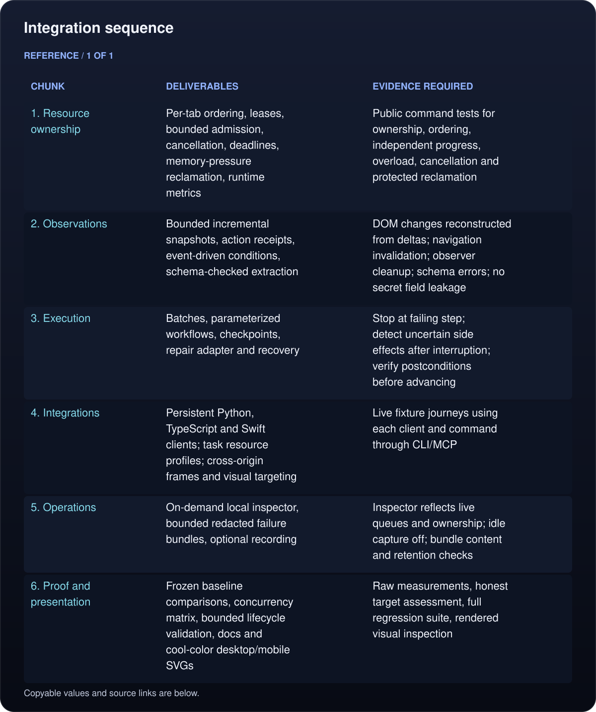
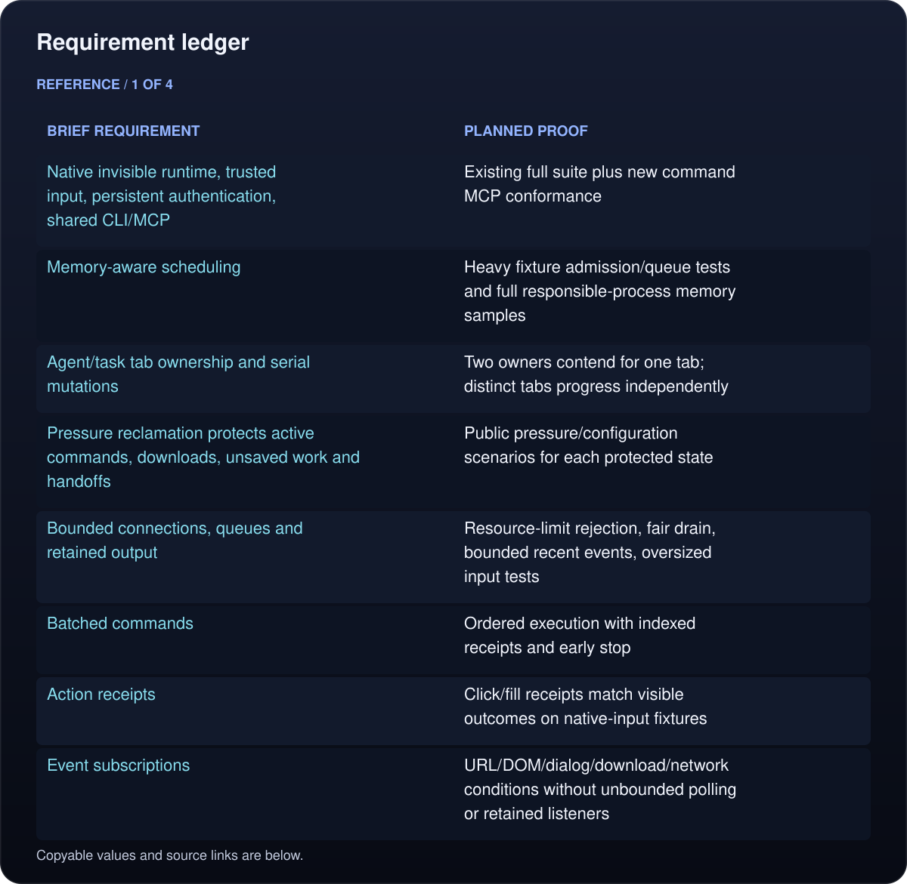
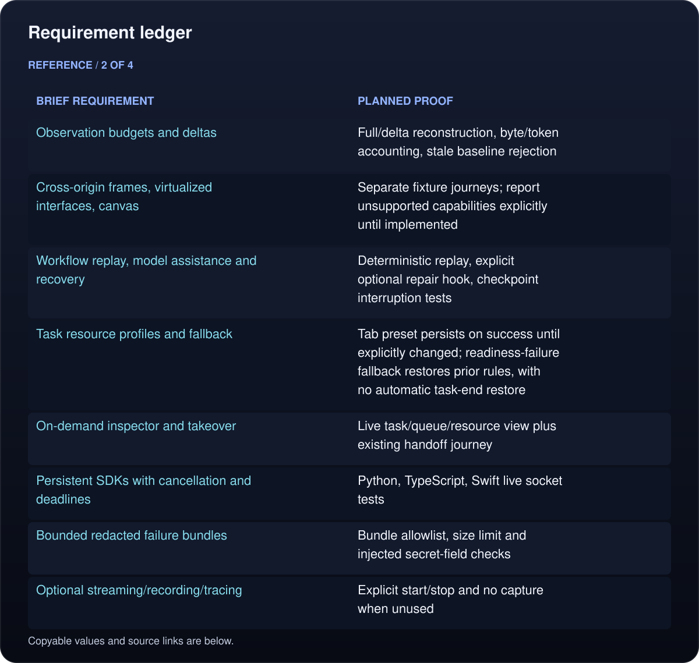
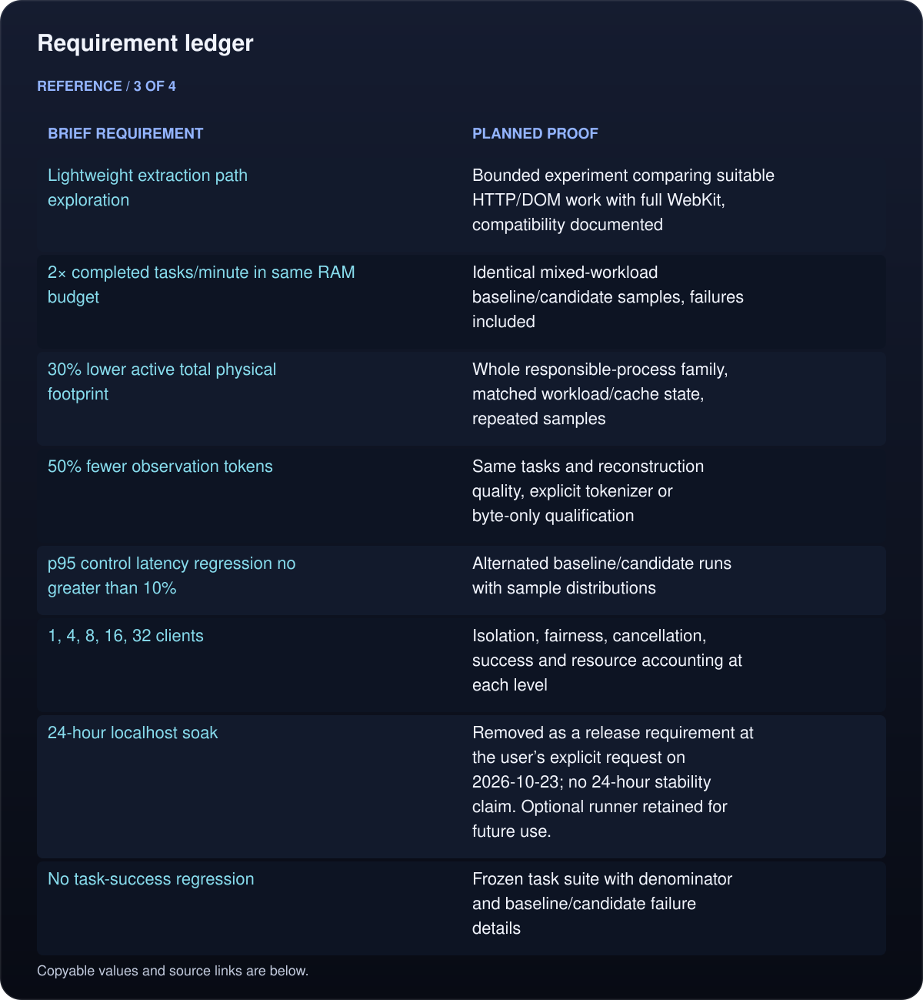
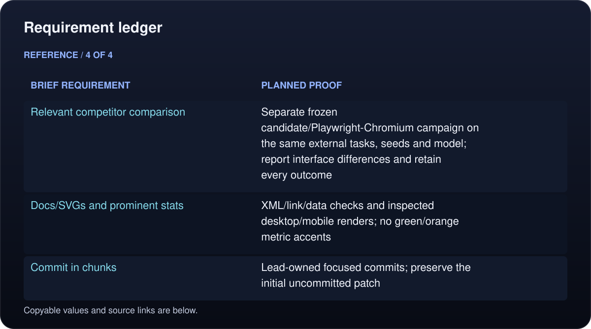

# Umbra agent runtime

Build a native browser runtime that completes more agent work per GB of RAM while preserving invisible operation, trusted input, authenticated profiles, and CLI/MCP parity. The source brief is the user-supplied `pasted-text-1.txt` from 2026-10-22. Proposed targets are acceptance gates, not achieved measurements.

## Integration sequence

<!-- umbra-figure: docs-runtime-plan-table-b427c3db5d -->
<picture>
  <source media="(max-width: 600px)" srcset="../../assets/docs/docs-runtime-plan-table-b427c3db5d-1-mobile-3548114a17.svg">
  
</picture>

Read the text, values and source links

- **Chunk:** 1. Resource ownership
- **Deliverables:** Per-tab ordering, leases, bounded admission, cancellation, deadlines, memory-pressure reclamation, runtime metrics
- **Evidence required:** Public command tests for ownership, ordering, independent progress, overload, cancellation and protected reclamation

- **Chunk:** 2. Observations
- **Deliverables:** Bounded incremental snapshots, action receipts, event-driven conditions, schema-checked extraction
- **Evidence required:** DOM changes reconstructed from deltas; navigation invalidation; observer cleanup; schema errors; no secret field leakage

- **Chunk:** 3. Execution
- **Deliverables:** Batches, parameterized workflows, checkpoints, repair adapter and recovery
- **Evidence required:** Stop at failing step; detect uncertain side effects after interruption; verify postconditions before advancing

- **Chunk:** 4. Integrations
- **Deliverables:** Persistent Python, TypeScript and Swift clients; task resource profiles; cross-origin frames and visual targeting
- **Evidence required:** Live fixture journeys using each client and command through CLI/MCP

- **Chunk:** 5. Operations
- **Deliverables:** On-demand local inspector, bounded redacted failure bundles, optional recording
- **Evidence required:** Inspector reflects live queues and ownership; idle capture off; bundle content and retention checks

- **Chunk:** 6. Proof and presentation
- **Deliverables:** Frozen baseline comparisons, concurrency matrix, bounded lifecycle validation, docs and cool-color desktop/mobile SVGs
- **Evidence required:** Raw measurements, honest target assessment, full regression suite, rendered visual inspection

<!-- /umbra-figure -->

## Requirement ledger

Implementation, passing tests and a performance result are distinct evidence. Final dispositions are recorded in `STATUS.md`; the 24-hour soak requirement was explicitly removed by the user on 2026-10-23.

<!-- umbra-figure: docs-runtime-plan-table-ced2a94de8 -->
<picture>
  <source media="(max-width: 600px)" srcset="../../assets/docs/docs-runtime-plan-table-ced2a94de8-1-mobile-d8c8185110.svg">
  
</picture>

<picture>
  <source media="(max-width: 600px)" srcset="../../assets/docs/docs-runtime-plan-table-ced2a94de8-2-mobile-8971631057.svg">
  
</picture>

<picture>
  <source media="(max-width: 600px)" srcset="../../assets/docs/docs-runtime-plan-table-ced2a94de8-3-mobile-9334fc6697.svg">
  
</picture>

<picture>
  <source media="(max-width: 600px)" srcset="../../assets/docs/docs-runtime-plan-table-ced2a94de8-4-mobile-d0a743c03c.svg">
  
</picture>

Read the text, values and source links

- **Brief requirement:** Native invisible runtime, trusted input, persistent authentication, shared CLI/MCP
- **Planned proof:** Existing full suite plus new command MCP conformance

- **Brief requirement:** Memory-aware scheduling
- **Planned proof:** Heavy fixture admission/queue tests and full responsible-process memory samples

- **Brief requirement:** Agent/task tab ownership and serial mutations
- **Planned proof:** Two owners contend for one tab; distinct tabs progress independently

- **Brief requirement:** Pressure reclamation protects active commands, downloads, unsaved work and handoffs
- **Planned proof:** Public pressure/configuration scenarios for each protected state

- **Brief requirement:** Bounded connections, queues and retained output
- **Planned proof:** Resource-limit rejection, fair drain, bounded recent events, oversized input tests

- **Brief requirement:** Batched commands
- **Planned proof:** Ordered execution with indexed receipts and early stop

- **Brief requirement:** Action receipts
- **Planned proof:** Click/fill receipts match visible outcomes on native-input fixtures

- **Brief requirement:** Event subscriptions
- **Planned proof:** URL/DOM/dialog/download/network conditions without unbounded polling or retained listeners

- **Brief requirement:** Observation budgets and deltas
- **Planned proof:** Full/delta reconstruction, byte/token accounting, stale baseline rejection

- **Brief requirement:** Cross-origin frames, virtualized interfaces, canvas
- **Planned proof:** Separate fixture journeys; report unsupported capabilities explicitly until implemented

- **Brief requirement:** Workflow replay, model assistance and recovery
- **Planned proof:** Deterministic replay, explicit optional repair hook, checkpoint interruption tests

- **Brief requirement:** Task resource profiles and fallback
- **Planned proof:** Tab preset persists on success until explicitly changed; readiness-failure fallback restores prior rules, with no automatic task-end restore

- **Brief requirement:** On-demand inspector and takeover
- **Planned proof:** Live task/queue/resource view plus existing handoff journey

- **Brief requirement:** Persistent SDKs with cancellation and deadlines
- **Planned proof:** Python, TypeScript, Swift live socket tests

- **Brief requirement:** Bounded redacted failure bundles
- **Planned proof:** Bundle allowlist, size limit and injected secret-field checks

- **Brief requirement:** Optional streaming/recording/tracing
- **Planned proof:** Explicit start/stop and no capture when unused

- **Brief requirement:** Lightweight extraction path exploration
- **Planned proof:** Bounded experiment comparing suitable HTTP/DOM work with full WebKit, compatibility documented

- **Brief requirement:** 2× completed tasks/minute in same RAM budget
- **Planned proof:** Identical mixed-workload baseline/candidate samples, failures included

- **Brief requirement:** 30% lower active total physical footprint
- **Planned proof:** Whole responsible-process family, matched workload/cache state, repeated samples

- **Brief requirement:** 50% fewer observation tokens
- **Planned proof:** Same tasks and reconstruction quality, explicit tokenizer or byte-only qualification

- **Brief requirement:** p95 control latency regression no greater than 10%
- **Planned proof:** Alternated baseline/candidate runs with sample distributions

- **Brief requirement:** 1, 4, 8, 16, 32 clients
- **Planned proof:** Isolation, fairness, cancellation, success and resource accounting at each level

- **Brief requirement:** 24-hour localhost soak
- **Planned proof:** Removed as a release requirement at the user’s explicit request on 2026-10-23; no 24-hour stability claim. Optional runner retained for future use.

- **Brief requirement:** No task-success regression
- **Planned proof:** Frozen task suite with denominator and baseline/candidate failure details

- **Brief requirement:** Relevant competitor comparison
- **Planned proof:** Separate frozen candidate/Playwright-Chromium campaign on the same external tasks, seeds and model; report interface differences and retain every outcome

- **Brief requirement:** Docs/SVGs and prominent stats
- **Planned proof:** XML/link/data checks and inspected desktop/mobile renders; no green/orange metric accents

- **Brief requirement:** Commit in chunks
- **Planned proof:** Lead-owned focused commits; preserve the initial uncommitted patch

<!-- /umbra-figure -->

## State and safety

Development and tests use only throwaway named profiles, local fixture sites and build outputs. Installed binaries and the default authenticated store remain untouched. The initial worktree patch is preserved outside the repository and must not be absorbed into an unrelated commit. Workers use isolated worktrees and send patches; the lead reviews and integrates them.

The runtime design compares one daemon per task with a shared profile daemon plus explicit tab ownership and a bounded per-tab scheduler. The shared daemon retains authenticated state and avoids duplicating browser infrastructure; WebKit work stays on the main thread, while asynchronous operations on independent tabs may overlap. Performance measurements decide whether transport changes are justified.
