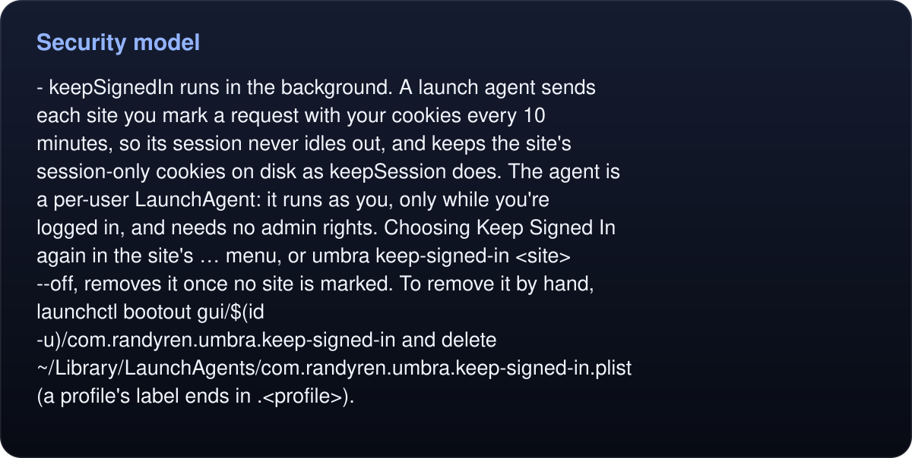

# Security model

- **Cookies stay in the store.** Like any browser, Umbra sends a cookie only to the site it belongs to. No command or tool prints, returns or exports a cookie value; `cookies` lists names and expiry dates only.
- **The agent acts as you.** On any site a profile is signed into, an agent can read, click and submit as you would. The [skill](../skill/SKILL.md) tells agents to do what the request asks and to ask first before any consequential action that's their own idea. Give agents a profile signed in only where you'd trust them.
- **People stay in charge of identity.** Signing in, two-factor prompts and CAPTCHAs happen in `sign-in` and `handoff` windows, by you.
- **The Unix socket is owner-only.** It lives in `~/Library/Application Support/Umbra/`. A process running as your macOS user can reach it. Profiles and leases do not sandbox agents from that user’s filesystem or other profiles.
- **Leases coordinate clients.** Agent/task labels protect a tab from accidental cross-agent operations, but any same-user client can supply them. Leases disappear on daemon restart.
- **Inspection is explicit.** `inspector` binds IPv4 loopback and protects state, captures and takeover with a bearer token from its returned URL. Keep the URL private and stop the inspector when done. `record` writes content-bearing PNGs only after an explicit start; page content in screenshots/recordings may be sensitive.
- **Diagnostics minimize retained content.** `diagnose` excludes page bodies, cookies, headers, URLs, screenshots and command arguments. Client-supplied labels remain and can contain whatever a client puts in them. Workflow checkpoints contain a plan digest/index/phase, not variables or page results; protect the workflow file and supplied variables separately.
- **Pages can't see Umbra's machinery.** Snapshot and action code runs in an isolated world.
- **No telemetry.** Umbra's own requests are the URLs you or your agent give it, the visits to sites you mark `keepSignedIn`, and, while the sign-in window is open, a cookie-free request for each listed site's icon (its home page, `/apple-touch-icon.png` or `/favicon.ico`, at most weekly); what those pages load is up to them, as in any browser.
- **The `keepSession` trade-off.** It re-saves a site's session-only cookies with a 30-day expiry so sign-ins survive between runs. They outlive the browser session the site had in mind, so turn it on only where it's needed and only on a Mac you trust.
<!-- umbra-figure: docs-security-facts-0e078b333c -->
<picture>
  <source media="(max-width: 600px)" srcset="../assets/docs/docs-security-facts-0e078b333c-1-mobile-aa81546978.svg">
  
</picture>

Read the text, values and source links

- **`keepSignedIn` runs in the background.** A launch agent sends each site you mark a request with your cookies every 10 minutes, so its session never idles out, and keeps the site's session-only cookies on disk as `keepSession` does. The agent is a per-user LaunchAgent: it runs as you, only while you're logged in, and needs no admin rights. Choosing **Keep Signed In** again in the site's **…** menu, or `umbra keep-signed-in <site> --off`, removes it once no site is marked. To remove it by hand, `launchctl bootout gui/$(id -u)/com.randyren.umbra.keep-signed-in` and delete `~/Library/LaunchAgents/com.randyren.umbra.keep-signed-in.plist` (a profile's label ends in `.<profile>`).

<!-- /umbra-figure -->
- **Your account protects the store.** As with Safari, anyone who can read your home folder can reuse your sessions.

## Limitations

- macOS 14 or later only. Prebuilt zips are Apple Silicon; build from source on Intel.
- Closed shadow roots remain unsupported. The top-level snapshot marks cross-origin frames; explicit `frames`/`frame` operations reach registered cross-origin documents through native WebKit APIs. Native frame actions refuse hidden, covered, transformed, zoomed or offscreen targets.
- Canvas has no semantic DOM extraction. `pointer` delivers trusted left-button coordinates but does not infer what was clicked or prove the application effect.
- Cancellation and deadlines do not terminate arbitrary already-dispatched JavaScript, which can continue producing side effects after acknowledgment; they cannot roll back earlier actions. Check actual state before repeating a consequential action. Workflows refuse automatic replay of uncertain non-repeatable steps.
- Memory controls bound admission and reclaim tracked clean abandoned tabs; they do not guarantee a fixed RAM ceiling for arbitrary pages. Runtime footprint counters exclude WebKit helpers. Outline budgets are characters, not model tokens.
- `http` is a cookie-free, JavaScript-free HTTP shortcut; it does not replace WebKit for signed-in or rendered pages. `watch` needs observed DOM/input events; silent property changes can require `wait --js` instead.
- Checkpoints use atomic replacement and a lock, without an fsync/power-loss durability guarantee. Optional SDK repair callbacks only propose replacement arguments and do not execute or automatically retry steps.
- `fill` and `type` insert text the way an input method does, so a page that listens for a `keydown` per character won't see one. Use `press` for those keys.
- HTML5 drag and drop is dispatched as page events, which are untrusted, because a native drag session would act on the real desktop. Mouse-driven drags (sliders, sortable lists, canvases) are native.
- No passkeys or Touch ID in the sign-in window. Use a password with a push approval or a code.
- One daemon per profile. Runs of the one-shot commands without a daemon take turns on the profile's lock.
- It's not a scraper or an anti-bot tool. It's for your own accounts at a human pace. It doesn't hide automation, rotate identities or solve CAPTCHAs, and site terms still apply.
