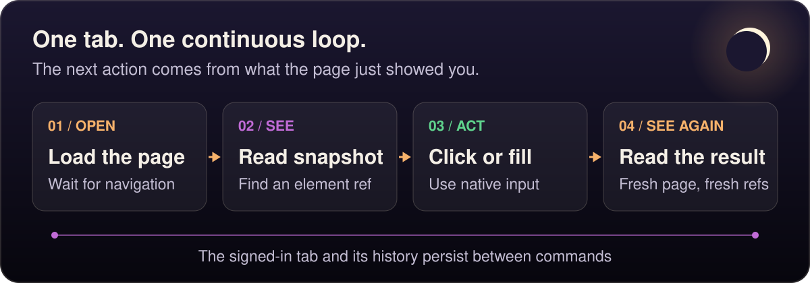
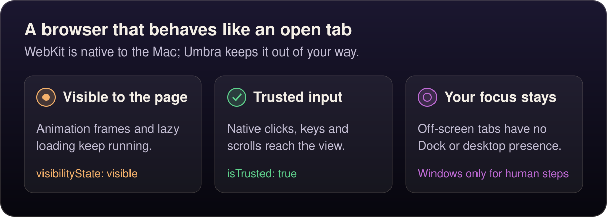

# The loop

<p align="center">
  <picture>
    <source media="(max-width: 600px)" srcset="../assets/the-loop-mobile.svg">
    
  </picture>
</p>

Open a page, look at it, act on what you see, look again. This is a real session against Northwind Ops, the test app in [`bench/site`](../bench/README.md), started with `python3 bench/site/server.py --port 8765`:

```console
$ umbra open 127.0.0.1:8765/login
Sign in · Northwind Ops · http://127.0.0.1:8765/login · HTTP 200

$ umbra snapshot --interactive
Sign in · Northwind Ops · http://127.0.0.1:8765/login
- heading "Sign in" [level=1]
- textbox "Username" [ref=e1] [required]
- textbox "Password" [ref=e2] [required] [type=password]
- checkbox "Remember me on this device" [ref=e3]
- button "Sign in" [ref=e4]

$ umbra fill e1 agent
filled textbox "Username" (e1) with "agent" via insertText

$ umbra fill e2 umbra-pass
filled textbox "Password" (e2) with •••••• via insertText

$ umbra click e4
clicked button "Sign in" (e4) → Dashboard · Northwind Ops · http://127.0.0.1:8765/app

$ umbra snapshot --interactive --scope main
Dashboard · Northwind Ops · http://127.0.0.1:8765/app
- heading "Dashboard" [level=1]
- heading "Recent orders" [level=2]
- link "Orders →" [ref=e1] → /app/orders
- link "#1040" [ref=e2] → /app/orders/1040
- link "#1039" [ref=e3] → /app/orders/1039
- link "#1038" [ref=e4] → /app/orders/1038
- link "#1037" [ref=e5] → /app/orders/1037
- link "#1036" [ref=e6] → /app/orders/1036

$ umbra click e1
clicked link "Orders →" (e1) → Orders · Northwind Ops · http://127.0.0.1:8765/app/orders

$ umbra select text=Status Pending
selected "Pending" in combobox "Status" (e1)

$ umbra get text=Showing
Showing 1–9 of 9 orders
```

Each command is a short process that talks to a per-profile daemon, so the tab, its history and its sign-in carry over from one command to the next. A target is a ref from the latest snapshot (`e4`), `text=` with visible text, or a CSS selector. Refs are numbered afresh after a navigation, so snapshot again before acting on a new page. Add `--json` to any command for structured output.

In the project's [agent eval](evaluation/README.md), fresh Claude Code and Codex agents completed all 14 unattended tasks on this app with Umbra, even with nothing about the skill in the task prompt, only `umbra help`.


## Why native WebKit, and why invisible

Umbra drives the same WebKit that Safari uses, through Apple's own `WKWebView`. Every tab lives in a transparent, click-through window placed far off screen, with WebKit's occlusion detection turned off. This configuration gives agents:

<p align="center">
  <picture>
    <source media="(max-width: 600px)" srcset="../assets/why-webkit-mobile.svg">
    
  </picture>
</p>

`document.visibilityState` stays `"visible"`, `requestAnimationFrame` and `IntersectionObserver` keep running, and native clicks, key presses, scrolls and mouse drags arrive with `isTrusted == true`. `fill` uses the input method path so React-controlled fields keep their values. The daemon has no Dock icon and never becomes the active app, except while a sign-in or handoff window is open (handoff shows no Dock icon).

Here is that checked from inside a tab, on the same session as above:

```console
$ umbra eval 'addEventListener("click", e => window.lastClick = { isTrusted: e.isTrusted }, { once: true })'

$ umbra click h1
clicked heading "Orders" (e3)

$ umbra eval 'return window.lastClick'
{"isTrusted":true}

$ umbra eval 'let frames = 0; const end = performance.now() + 1000; while (performance.now() < end) { await new Promise(requestAnimationFrame); frames++ } return { visibilityState: document.visibilityState, frames }'
{"frames":30,"visibilityState":"visible"}
```

Sites see Safari's user agent, built from the version of Safari installed on the Mac, and your sign-ins persist in a store that belongs to Umbra alone.
